<p align="center">
  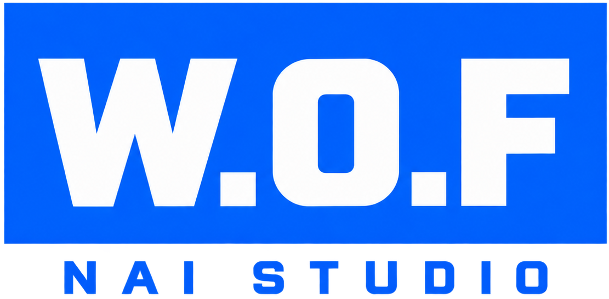
</p>

<p align="center">
  <a href="README.md">简体中文</a> ·
  <a href="README.zh-TW.md">繁體中文</a> ·
  <strong>English</strong> ·
  <a href="README.ja.md">日本語</a> ·
  <a href="README.ko.md">한국어</a>
</p>

<h3 align="center">Turn NovelAI image generation into a creative workspace you can build on and reuse</h3>

<p align="center">
  <a href="https://github.com/z15087716457-stack/W.O.F_NAI_Launcher/releases/latest"></a>
  
  
  <a href="LICENSE"></a>
</p>

<p align="center">
  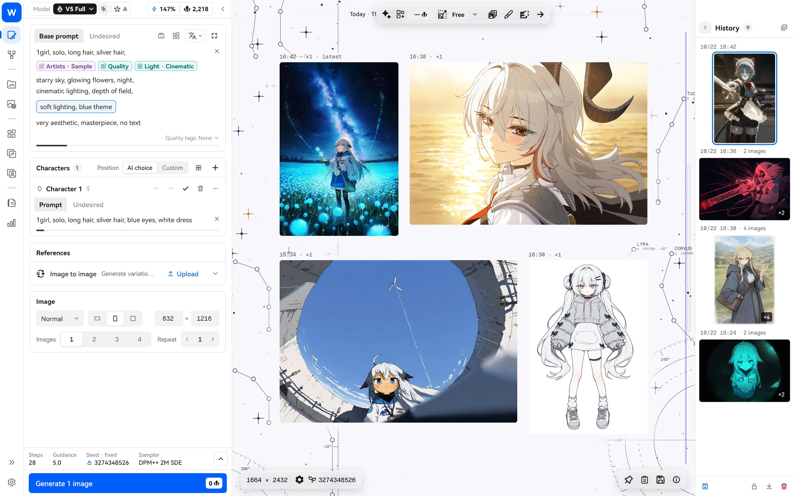
</p>

W.O.F NAI Studio is a third-party NovelAI desktop client for Windows. It does more than put the website on your desktop: save frequently used prompts as reusable **blocks**, let **style evolution** narrow down artist combinations over generations, and use **translation, Tag Wiki and local semantic search** to understand unfamiliar tags. The built-in **NAI Agent** can also help with the routine work of generating, organizing and editing images.

> This is an unofficial project and is not affiliated with NovelAI. Use your own NovelAI account and follow NovelAI's Terms of Service.

## Download

Get the latest version from [Releases](https://github.com/z15087716457-stack/W.O.F_NAI_Launcher/releases/latest). Choose one:

| File | Who it's for |
| --- | --- |
| `WOF_NAI_Studio_Windows_<version>_Setup.exe` | **The choice for most people.** Installs to your user directory without administrator rights, with Start menu and desktop shortcuts. |
| `WOF_NAI_Studio_Windows_<version>_Portable.zip` | For keeping the app in a folder of your choice, on a USB drive, or taking it between computers. Extract it and run `nai_launcher.exe`. |

Both versions support in-app updates. Your settings, gallery database and Agent data live in `user-data/` and `agent-data/` beside the program. Updates and uninstallation leave them intact.

> The installer is not code-signed yet. On first launch, Windows may say “Windows protected your PC.” Click “More info → Run anyway.” Each release includes SHA-256 checksums.

## What's new in 2.2

- **Independent resource windows**: Open and pin Local Gallery, Blocks, Vibes and Precise References, drag resources back to the workspace, and view full images inside the same window. Gallery timelines and the thumbnail disk cache are shared.
- **Chinese-aware prompt autocomplete**: Local candidates, Chinese names and related tags in the base and character editors, with independent workspace font sizing and a scrolling prompt toolbar.
- **Temporary blocks and translation adjustments**: Compare, restore or save Agent-edited blocks; refine, split, merge and undo translations.
- **Agent workflow improvements**: Slash commands, next-message suggestions, cache-warming status, searchable conversation history, wrapping code blocks and per-block copy.
- **Gallery and storage controls**: Whole-phrase and exact-tag search, search history, Copy Prompt, an adjustable thumbnail cache limit and clearer storage statistics.

**2.2.1 additions**: Let the Agent split prompts into temporary blocks, with whole-module or multiple translations inside. This update also fixes single-click history details, caret visibility over weighted text and update-manifest parsing, and adds individual-image browsing to the infinite canvas.

**2.2.2 update**: Smoother Agent thinking, word counts and expanded reasoning text with the existing UI preserved. This release also preserves character metadata from external bridge generations, fixes restart-to-install updates, disables external Agent controls while the bridge is off, balances the saved-settings toast and removes the top update pill.

See the [complete 2.2.2 changelog](CHANGELOG.md#222---2026-10-29) and [release downloads](https://github.com/z15087716457-stack/W.O.F_NAI_Launcher/releases/tag/v2.2.2). Agent suggestions, cache warming and translation adjustments use your own model service; their settings are configurable.

## Get started in three steps

1. **Sign in**: Use a NovelAI API Token (recommended) or your account and password. You can also enter as a guest to try local features first.
2. **Generate**: Write a prompt on the left and press `Ctrl+Enter`. Results appear in batches on the canvas in the middle.
3. **Build your library**: Save common artist strings and quality tags as blocks. Images you like are saved to Local Gallery automatically, ready for you to reuse their settings.

See [Quick start](docs/guide/en/quick-start.md) for details.

## What you can do

### Blocks: write once, reuse often

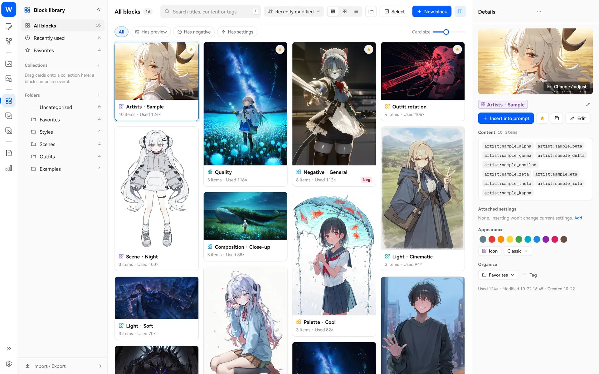

Save common snippets—artist pools, quality tags, negative tags and clothing lists—as “blocks,” then drag them into a prompt. A block can also carry negative tags and generation settings, letting you save a whole favorite style as a “style block” and apply its settings in one click after inserting it. Each block has three modes:

- **Fixed**: Inserts the content unchanged each time; good for quality and negative tags.
- **Sequential**: Moves to the next item with each generation; good for trying a set of outfits or scenes one by one, or writing a story as a series of scenes and advancing through them.
- **Random**: Draws a few items from the pool each time. Set the count, chance of appearing and random weights to try artist combinations in batches.

When you get a result you like, **lock** it and reroll the other blocks. → [Blocks guide](docs/guide/en/blocks.md)

### Style evolution: let good combinations “evolve”

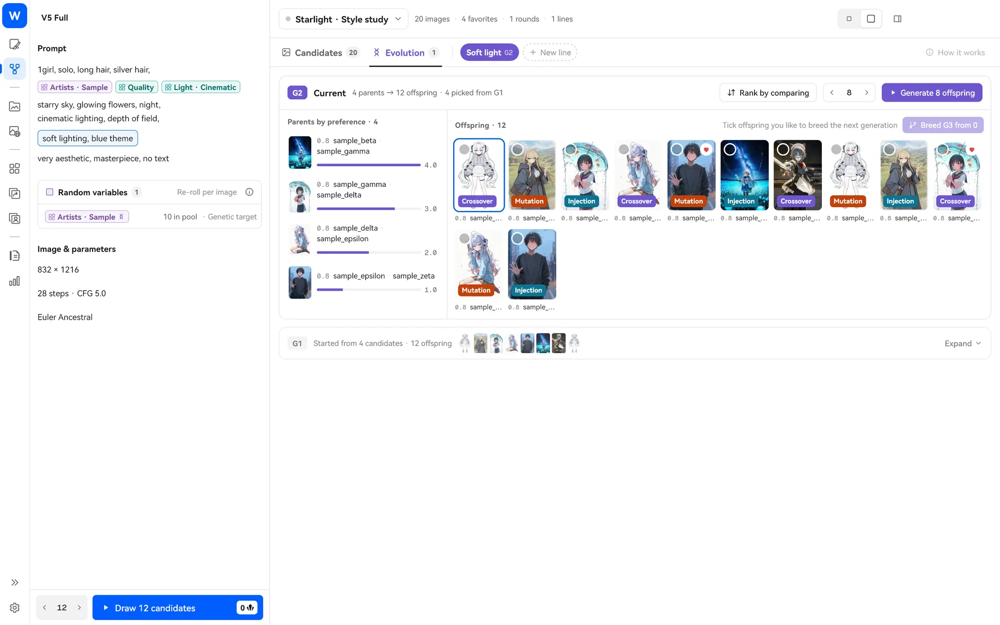

Not sure which artists mix well? Add a random artist pool in Style Explore and draw dozens of candidates at a time. Pick a few favorites and start evolution: the app crosses their artist strings, mutates them and injects new artists to produce the next generation. All you do is choose. Over a few generations, the style moves toward what you want. Save a combination you like as a block in one click. → [Style evolution guide](docs/guide/en/style-explore.md)

### Translation blocks, tag expansion and Tag Wiki: understand every tag

<table>
  <tr>
    <td width="50%">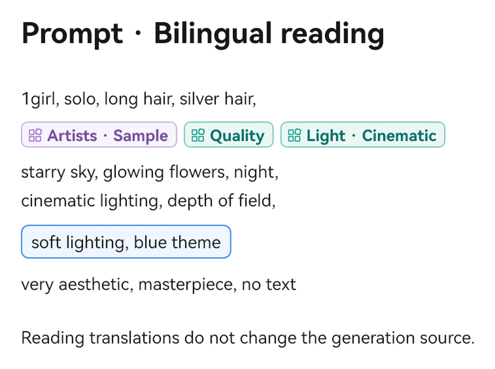</td>
    <td width="50%">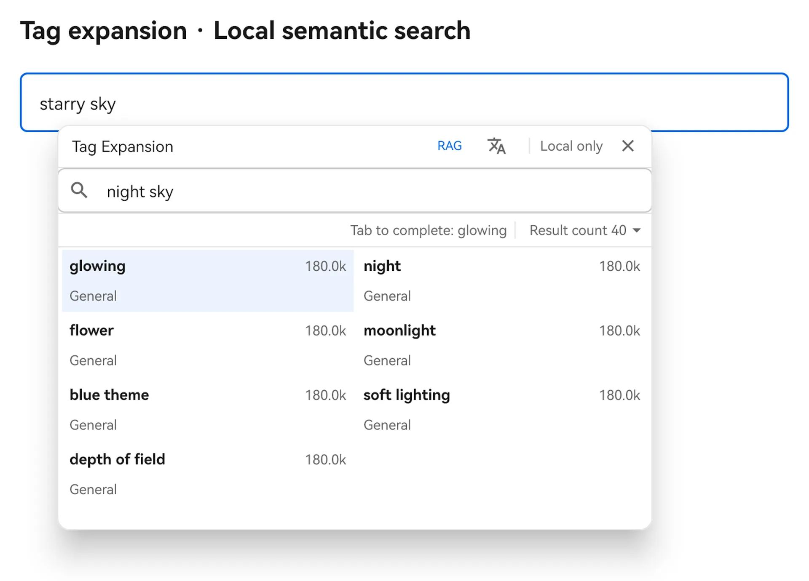</td>
  </tr>
  <tr>
    <td>
      <b>Translation blocks</b>: Translate English prompts into Chinese right where they are. Middle-click to switch between the original and the translation. Generation always uses the original; translations are just for reading. Translation requests include a glossary of matches from the local tag database and Wiki to keep the model from mistaking artist or work names for ordinary words. → <a href="docs/guide/en/translation.md">Guide</a>
    </td>
    <td>
      <b>Tag expansion</b>: <code>Ctrl+click</code> a tag in your prompt to search the local tag database; <code>Ctrl+drag-select</code> a passage to see which tags often appear with it. → <a href="docs/guide/en/tags-wiki.md">Guide</a>
    </td>
  </tr>
</table>

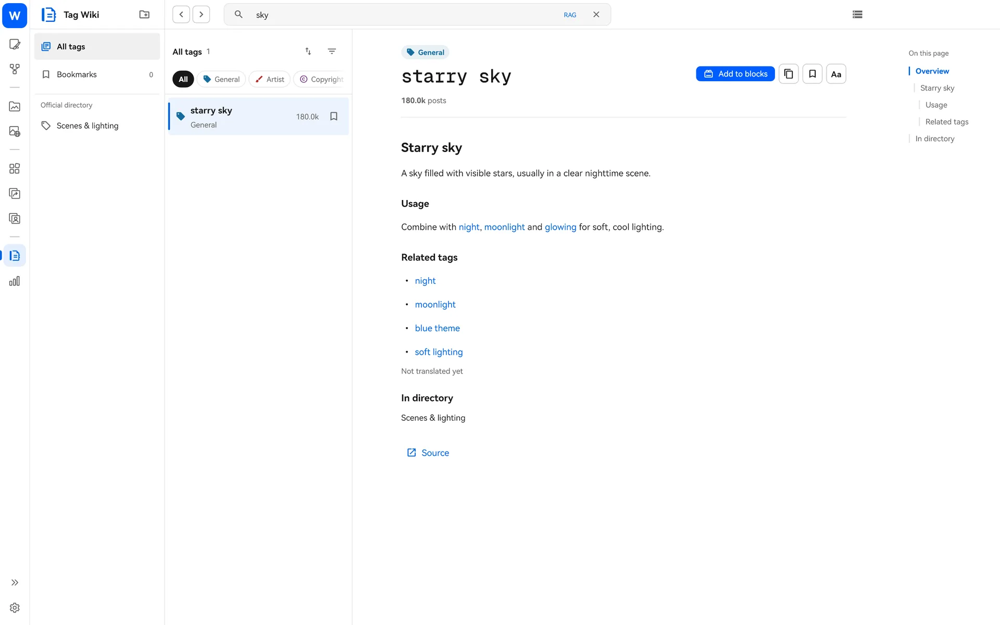

**Tag Wiki** includes a local copy of the Danbooru Wiki. Look up what a tag means and what it is often used with, even offline, and add it to a block in one click.

### Local semantic search (RAG): search by meaning

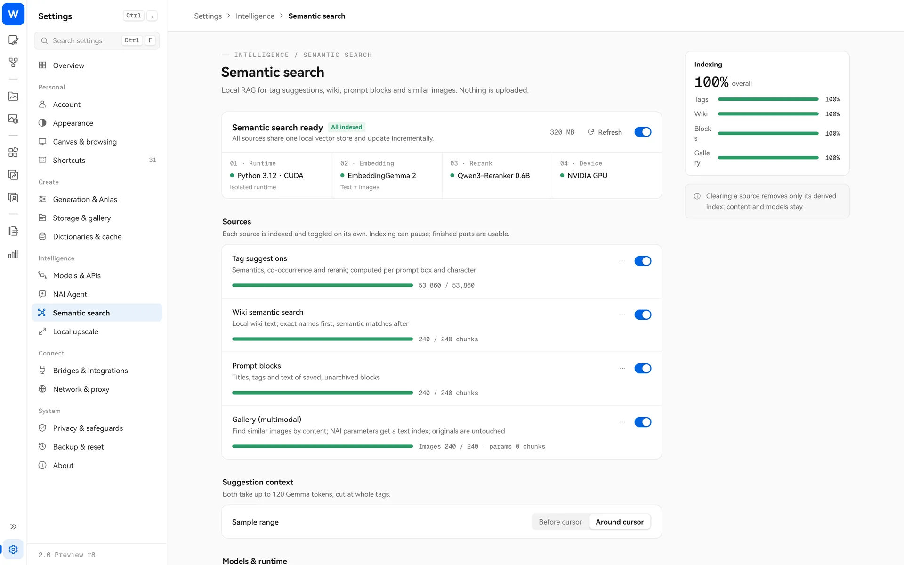

An optional component. Once enabled, tag suggestions, Tag Wiki, the block library and Local Gallery can search by “meaning.” Enter “a rainy street” to find related English tags, blocks and images you have made before, or use an image to find similar images. Everything runs on your computer; nothing is uploaded. → [Semantic search guide](docs/guide/en/rag.md)

### NAI Agent: let an AI assistant handle routine work

<table>
  <tr>
    <td width="62%">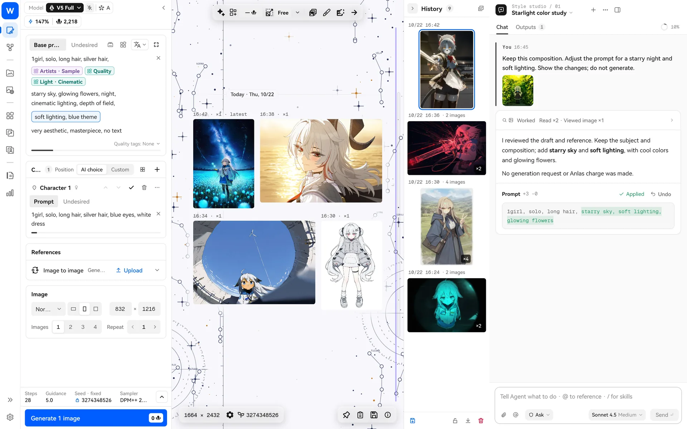</td>
    <td width="38%">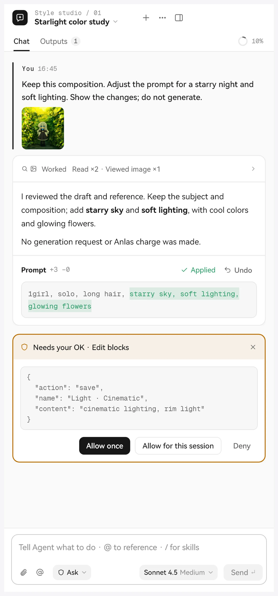</td>
  </tr>
</table>

Open the sidebar on the generation or Style Explore page and chat with an AI to edit prompts, look up tags and wiki entries, organize blocks and images, set reference images, or even prepare a generation. It uses the model service you configure in “Models & APIs.”

- It asks before making changes, deleting things or running commands. There are four permission levels: Read-only, Ask, Auto and Full access.
- **Model-initiated generation needs your confirmation on the price card at every permission level.** On a prompt-set card, your click on “Generate” directly authorizes one image, with no second confirmation.
- Write a set of prompts at once (a few story scenes, a set of outfits to try on, or storyboard panels), then switch between items, import to canvas or generate one image at a time from the prompt set card.
- Supports skills (Skill), MCP servers and CodeMode so you can extend it for your own workflow.

→ [NAI Agent guide](docs/guide/en/nai-agent.md)

### Infinite canvas and visual channel

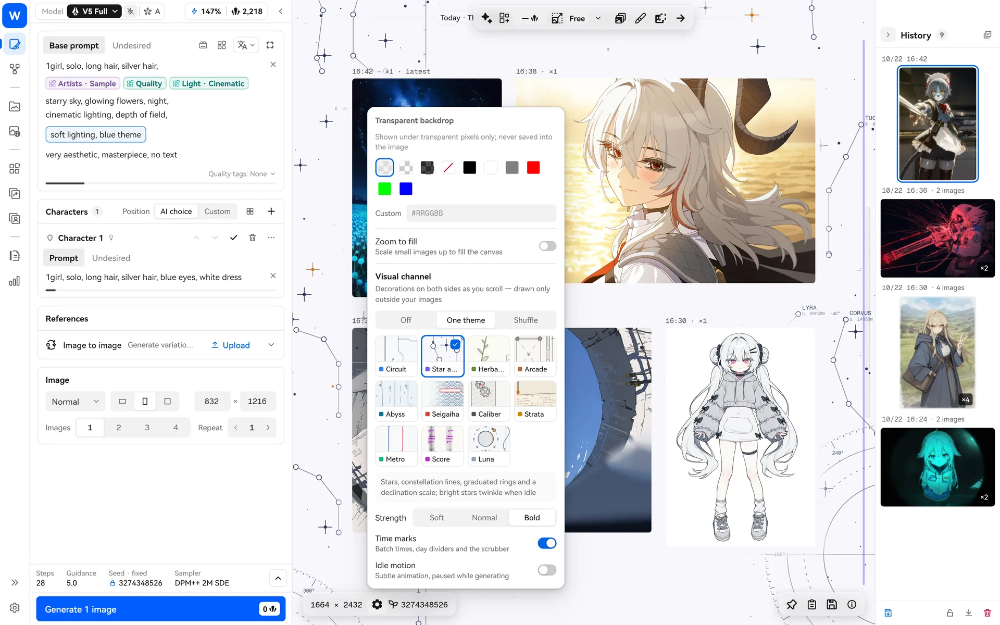

Generated images appear in batches on an infinitely pannable canvas. Use the wheel to pan, `Ctrl+wheel` to zoom and WASD to navigate. Hold Space to see the original before inpainting. Enable “Visual channel” decorations on both sides of the canvas: 11 themes including Star atlas, Circuit, Abyss and Metro, drawn only outside your images so they never cover them. → [Canvas guide](docs/guide/en/canvas.md)

### Local Gallery and Online Gallery

<table>
  <tr>
    <td width="50%">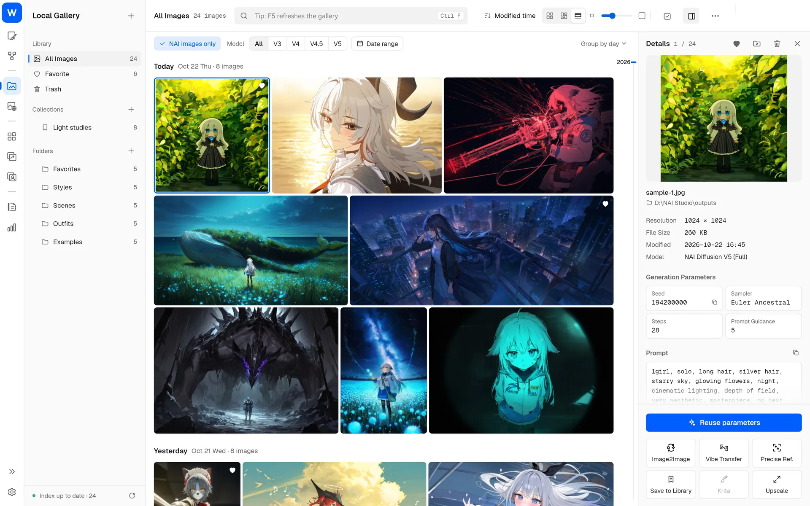</td>
    <td width="50%">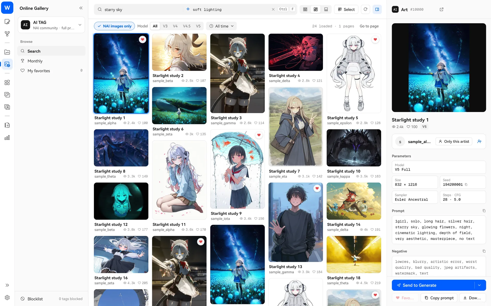</td>
  </tr>
</table>

- **Local Gallery**: Browse multiple image folders together in a continuous timeline grouped by day or month. Search prompts, use collections, move images in batches and recover them from Trash. Reuse the settings of any NAI image in one click.
- **Online Gallery**: Four sources—Danbooru, Safebooru, Gelbooru and AI TAG—with rankings, favorites and a blacklist. Reuse generation settings directly from work you like.

→ [Gallery guide](docs/guide/en/gallery.md)

### Reference images, Director Tools, inpainting and upscaling

<table>
  <tr>
    <td width="50%">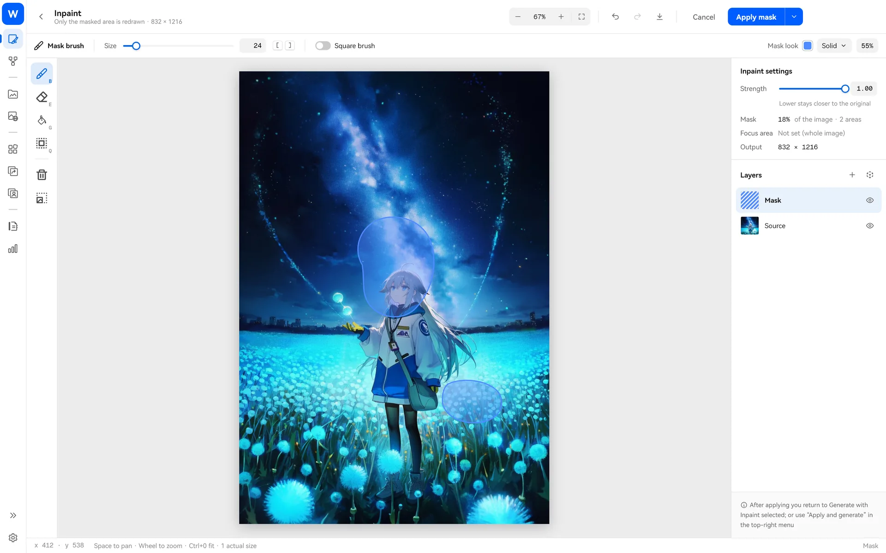</td>
    <td width="50%">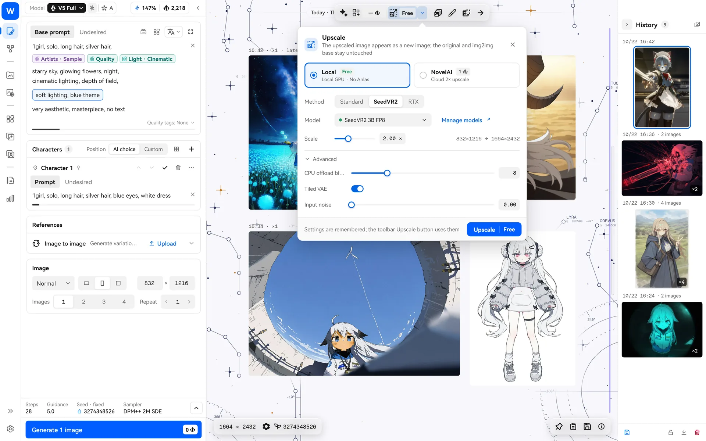</td>
  </tr>
</table>

- **Vibe Transfer and Precise Reference**: Manage both in the reference libraries and reuse encoded Vibes.
- **Director Tools**: Background removal, line-art extraction, colorization, expression correction, pixel alignment and more.
- **Inpainting**: A full-screen editor with brushes, selections, a magic wand and layers. Finish painting and choose “Apply and generate.”
- **Upscaling**: Use NovelAI's cloud upscaling, or upscale locally with Real-ESRGAN, NVIDIA RTX Video or SeedVR2 without spending Anlas.

→ [Image tools guide](docs/guide/en/image-tools.md)

### And more

- **All NovelAI models**: V1 through V4.5 and V5 (Full / Curated), multiple character prompt fields and positioning, transparent backgrounds, live Anlas estimates and high-cost warnings.
- **Statistics**: A creation calendar, model usage and output counts, and Anlas spending. Click a chart to jump to that day's images.
- **Local bridge**: External scripts or AI tools can read and write settings through the included `studio-bridge.exe`. Generation still requires a price quote and confirmation. Krita plugin integration is also supported.
- **Shortcuts**: Press `F1` to see all shortcuts; all are customizable.
- **Five interface languages, light and dark themes.**

## Privacy and network access

- Account tokens and API keys are kept in Windows secure storage and used only on your computer.
- Network access is used only for: NovelAI API calls; translation or Agent model services you configure; Online Gallery; update checks; and optional components you explicitly choose to download, such as semantic search and upscaling models.
- Semantic search, local upscaling and gallery organization all run locally.
- Automatic translation is off by default. Danbooru's online related-tag lookup sends only the relevant tags, not your full prompt.

See [FAQ](docs/guide/en/faq.md) for more answers.

## Guides

| Guide | Contents |
| --- | --- |
| [Quick start](docs/guide/en/quick-start.md) | Installation, sign-in, first generation, data locations |
| [Blocks](docs/guide/en/blocks.md) | Fixed / Sequential / Random, locking, weight rules, common uses |
| [Style evolution](docs/guide/en/style-explore.md) | Drawing candidates, starting evolution, pairwise comparison, saving as blocks |
| [Translation blocks](docs/guide/en/translation.md) | Translation model setup, bilingual reading, switching and restoring |
| [Tag expansion and Tag Wiki](docs/guide/en/tags-wiki.md) | Local tag search, related tags, offline wiki |
| [Local semantic search](docs/guide/en/rag.md) | Installation, indexing, where to use it |
| [NAI Agent](docs/guide/en/nai-agent.md) | Model setup, permissions, generation confirmation, skills and MCP |
| [Infinite canvas and visual channel](docs/guide/en/canvas.md) | Canvas controls, original comparison, decoration themes |
| [Gallery](docs/guide/en/gallery.md) | Organizing Local Gallery, browsing and reusing Online Gallery images |
| [Image tools](docs/guide/en/image-tools.md) | Reference images, Director Tools, inpainting, upscaling |
| [FAQ](docs/guide/en/faq.md) | Installation warnings, backups, migration from older versions, privacy |

<details>
<summary><b>Build from source</b></summary>

Requires Windows 10/11 x64, Flutter 3.47.7 (see `tool/flutter-sdk.json`), Visual Studio 2022 with “Desktop development with C++,” Git LFS and NuGet CLI.

```bash
git clone https://github.com/z15087716457-stack/W.O.F_NAI_Launcher.git
cd W.O.F_NAI_Launcher
git lfs install && git lfs pull
flutter pub get
dart run tool/generate.dart
flutter gen-l10n
flutter build windows --release --no-tree-shake-icons
```

Use `scripts/package_windows_release.ps1` to package the installer and portable versions. See [DEVELOPMENT.md](DEVELOPMENT.md) for development guidelines and [CHANGELOG.md](CHANGELOG.md) for version history.

</details>

## Acknowledgments and license

- This project is forked from [Aaalice233/Aaalice_NAI_Launcher](https://github.com/Aaalice233/Aaalice_NAI_Launcher) (MIT). Thanks to the original author for their open-source work. This fork is not affiliated with the upstream author; please report problems in this repository's Issues.
- The style evolution algorithm draws on ideas from [monineko/PromptCard-Studio](https://github.com/monineko/PromptCard-Studio) (GPL-3.0). This project uses an independent Dart implementation and does not copy its source code.
- NAI Agent is based on [Pi](https://github.com/earendil-works/pi) (MIT).
- This project is open source under the [MIT License](LICENSE). Bundled data, fonts and components follow their own licenses; see [Third-party notices](THIRD_PARTY_NOTICES.md).

The interface screenshots in this README are rendered with demo data. All example prompts and artist names are fictional.
