<p align="center">
  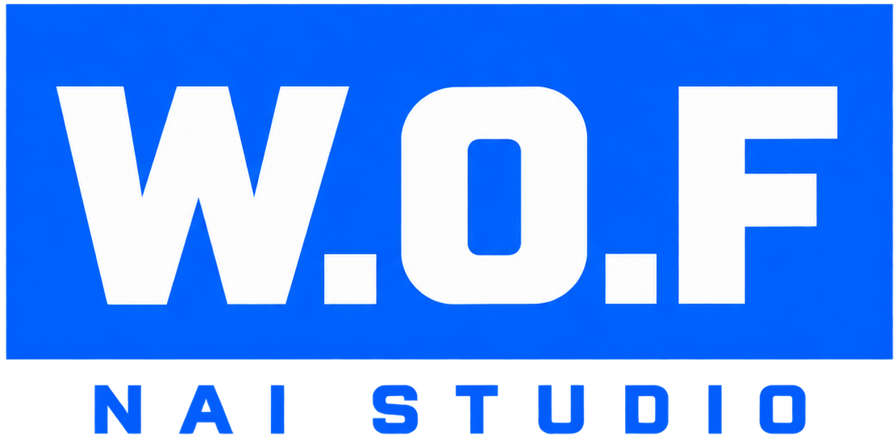
</p>

<p align="center">
  <a href="README.md">简体中文</a> ·
  <a href="README.zh-TW.md">繁體中文</a> ·
  <a href="README.en-US.md">English</a> ·
  <strong>日本語</strong> ·
  <a href="README.ko.md">한국어</a>
</p>

<h3 align="center">NovelAI の画像生成を、蓄積して再利用できる制作ワークスペースにします</h3>

<p align="center">
  <a href="https://github.com/z15087716457-stack/W.O.F_NAI_Launcher/releases/latest"></a>
  
  
  
  <a href="LICENSE"></a>
</p>

<p align="center">
  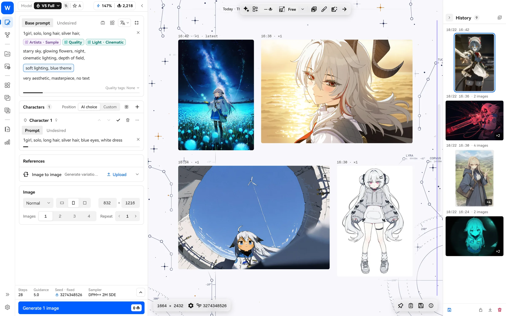
</p>

W.O.F NAI Studio は、Windows と macOS のデスクトップ向けの非公式 NovelAI クライアントです。公式サイトをデスクトップに移しただけではありません。よく使うプロンプトは**ブロック**として保存して再利用し、絵師の組み合わせは**画風の遺伝**で世代ごとに選別できます。わからないタグは**翻訳・タグ百科・ローカルのセマンティック検索**で調べられます。生成、整理、画像編集の細かな作業は、内蔵の **NAI Agent** に任せることもできます。

> 非公式プロジェクトであり、NovelAI とは関係ありません。ご自身の NovelAI アカウントを使用し、NovelAI の利用規約を守ってください。

## ダウンロード

[Releases](https://github.com/z15087716457-stack/W.O.F_NAI_Launcher/releases/latest) で OS に合うファイルを選んでください。Mac 版は macOS 対応を含むリリースから配布します。それまでは、PR の検証に成功した Actions 実行から `macos-validation` をダウンロードできます。

| ファイル | おすすめの用途 |
| --- | --- |
| `WOF_NAI_Studio_Windows_<バージョン>_Setup.exe` | **Windows では通常こちらを選んでください。** 現在のユーザーのフォルダーにインストールします。管理者権限は不要で、スタートメニューとデスクトップにショートカットを作成します。 |
| `WOF_NAI_Studio_Windows_<バージョン>_Portable.zip` | 好きなフォルダーや USB メモリに置いたり、複数の PC 間で持ち運んだりする場合に使います。展開後、`nai_launcher.exe` を実行します。 |
| `WOF_NAI_Studio_macOS_<バージョン>_Portable.zip` | **Mac 用です。** パッケージの動作には macOS 13.5 以降が必要です。Apple シリコンと Intel の両方のバイナリを含みます。Intel Mac での実機検証は未実施です。Finder で展開し、`W.O.F NAI Studio` を「アプリケーション」フォルダにドラッグします。 |

Windows 版はどちらもアプリ内更新に対応しています。設定、ギャラリーデータベース、Agent のデータはプログラムの隣の `user-data/` と `agent-data/` に保存され、アップグレードやアンインストールでも削除されません。

> インストーラーにはまだコード署名がありません。初回実行時に Windows が「Windows によって PC が保護されました」と表示する場合は、「詳細情報 → 実行」をクリックしてください。各リリースには SHA-256 チェックサムを添付しています。

### macOS

- **初回起動**：Mac 版は Apple の公証を受けていないため、初回はシステムに止められます。Finder で Control キーを押しながらアプリをクリック（または右クリック）し、「開く」を選んでから、もう一度「開く」をクリックします。macOS 15 以降は、一度アプリを開いてから「システム設定 → プライバシーとセキュリティ」の下の方にある「このまま開く」をクリックします。「壊れているため開けません」と表示された場合は、「ターミナル」で次の行を実行してから、いつも通り開いてください。

  ```bash
  xattr -dr com.apple.quarantine "/Applications/W.O.F NAI Studio.app"
  ```

- **更新**：アプリ内で新しいバージョンをダウンロードして検証すると、Finder でそれが選択されます。`⌘Q` で古いバージョンを終了し、新しいバージョンを「アプリケーション」にドラッグして置き換えます。
- **データの場所**：設定、データベース、Agent のデータは `~/Library/Application Support/com.wof.naiStudio/` にあり、アプリを置き換えても削除されません。
- **1.x からのアップグレード**：初回起動時に、旧版（Aaalice NAI Launcher）の設定、履歴、各種ライブラリとお気に入りをコピーします。旧版のデータはそのまま残ります。旧版が起動中のときは、先に終了するよう案内されます。ログイン情報はコピーされないため、もう一度ログインしてください。画像や Vibe など「書類」フォルダーにあるファイルは、もともと両方の版で共有されています。その後も「設定 → バックアップとリセット → 旧版のデータ」から再同期や前回の同期の取り消しができ、取り消した後は同期後のデータに戻すこともできます。切り替える前に毎回現在のデータをバックアップし、バックアップは直近 2 件を保持します。
- **ショートカット**：ショートカットの `Ctrl` は Mac では `⌘` になります。ショートカット一覧は `⌘/` で開きます。
- **ローカルアップスケール**：Real-ESRGAN が使えます。エンジンとモデルは Windows 版と同じで、Mac の GPU（Metal）で動きます。NVIDIA RTX Video と SeedVR2 は NVIDIA の GPU が必要なため、今のところ Windows 版のみです。
- **ローカルのセマンティック検索（RAG）**：Apple シリコンの Mac が必要です。実行デバイスが「自動」なら、メモリ 18 GB 以上の Mac では GPU、16 GB 以下では CPU を使います。Intel Mac では使えません。PyTorch が Intel Mac 向けの版を提供していないためです。
- **リソース小窓**：Mac ではメインウィンドウの中にパネルとして開きます。複数開いて移動・リサイズでき、リソースを作業エリアへドラッグできます。まだ独立したシステムウィンドウではないため、メインウィンドウの外には出せず、最前面表示や小窓内での大きな画像表示もありません。

## 3 ステップで始める

1. **ログイン**：NovelAI の API Token（推奨）またはアカウントとパスワードでログインします。ゲストとして入り、ローカル機能を試すこともできます。
2. **生成**：左側にプロンプトを書き、`Ctrl+Enter` を押します。結果は中央のキャンバスにバッチごとに並びます。
3. **蓄積**：よく使う絵師列や品質タグをブロックとして保存します。気に入った画像は自動でローカルギャラリーに入り、いつでもパラメータを再利用できます。

詳しくは[クイックスタート](docs/guide/ja/quick-start.md)を参照してください。

## できること

### ブロック：一度書いて、何度も使う

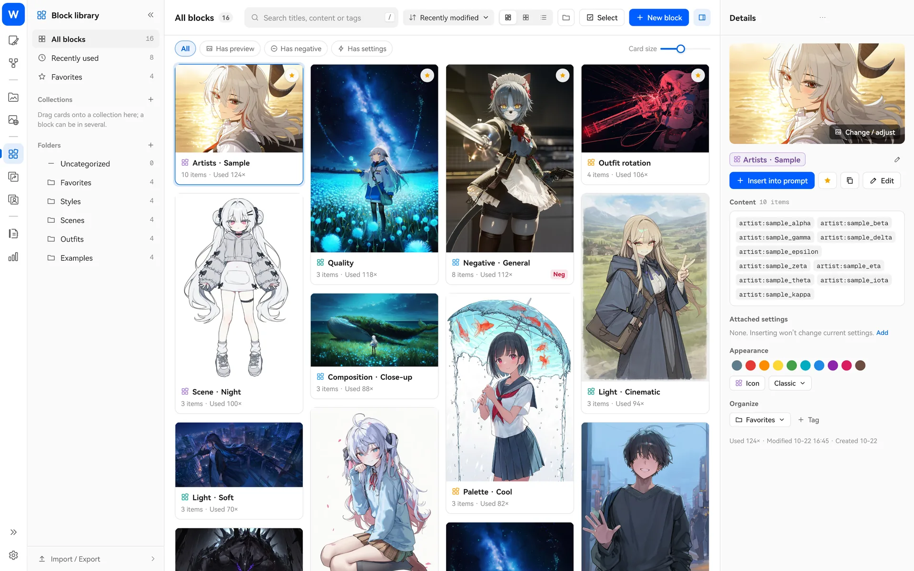

絵師プール、品質タグ、ネガティブタグ、服装リストなど、よく使う断片を「ブロック」として保存し、プロンプトにドラッグして使えます。ネガティブタグや生成パラメーターも一緒に保存できるので、お気に入りの画風一式を「画風ブロック」にまとめ、挿入後にワンクリックでパラメーターを適用できます。各ブロックには 3 つの使い方があります。

- **固定**：毎回そのまま挿入します。品質タグやネガティブタグに向いています。
- **順番**：生成するたびに次の項目へ進みます。服装や背景を順に試すだけでなく、物語をいくつかの場面に分けて書き、1 場面ずつ進めることもできます。
- **ランダム**：プールから毎回いくつか選びます。数、出現確率、ランダムな重みも設定でき、絵師の組み合わせをまとめて試すときに向いています。

気に入った結果が出たら**ロック**して、ほかのブロックだけを再抽選できます。→ [ブロックの使い方](docs/guide/ja/blocks.md)

### 画風の遺伝：よい組み合わせを「進化」させる

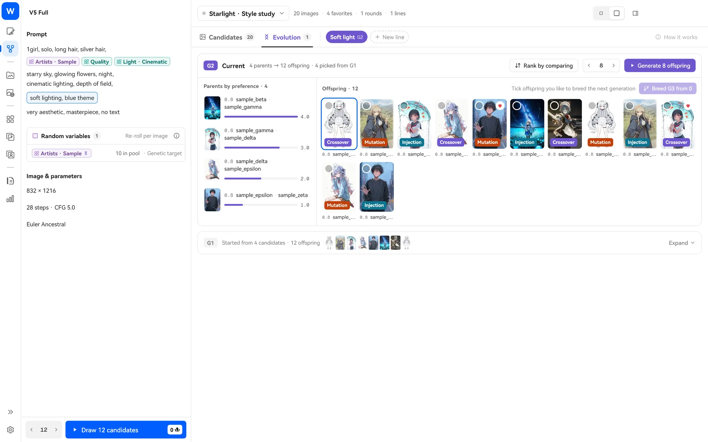

どの絵師を混ぜるとよいかわからないときは、画風探索にランダムな絵師プールを置き、数十枚の候補を作ります。気に入った数枚を選んで進化を始めると、プログラムが絵師列の交叉・変異・新しい絵師の注入を行い、次の世代を生成します。選んでいくだけで、数世代後には好みの画風に近づいていきます。気に入った組み合わせはワンクリックでブロックとして保存できます。→ [画風の遺伝の使い方](docs/guide/ja/style-explore.md)

### 翻訳ブロック・タグ拡張・タグ百科：タグの意味を理解する

<table>
  <tr>
    <td width="50%">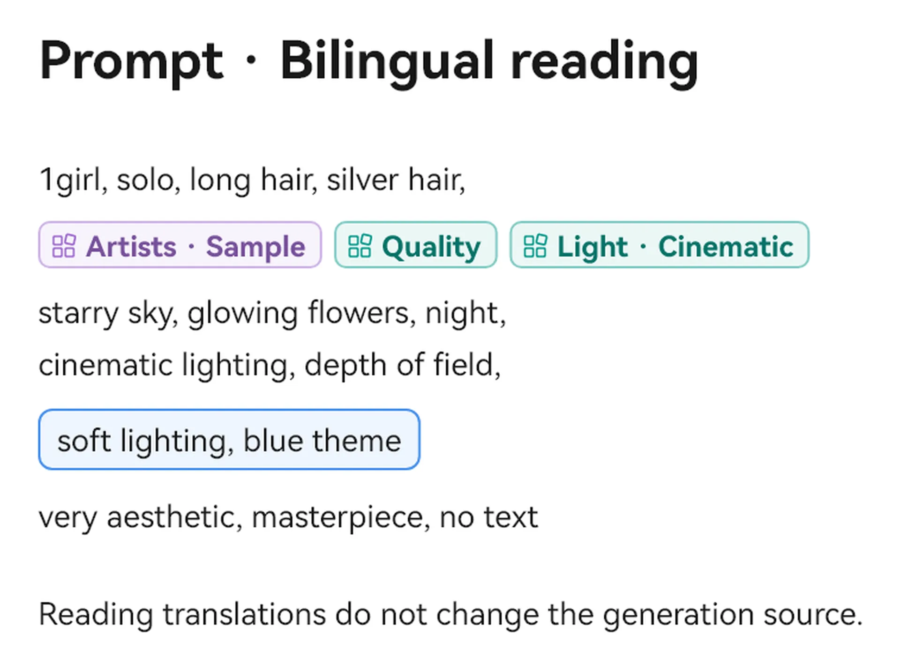</td>
    <td width="50%">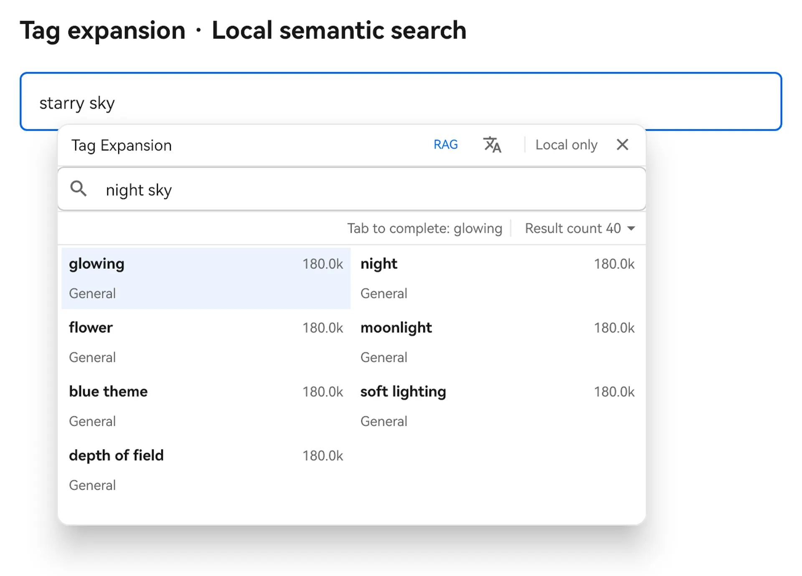</td>
  </tr>
  <tr>
    <td>
      <b>翻訳ブロック</b>：英語のプロンプトを中国語に翻訳し、その場に表示します。中クリックで原文と訳文を切り替えられます。生成には必ず原文を使い、翻訳は読むためだけのものです。翻訳時には、ローカルのタグライブラリや Wiki で一致した用語集を添え、モデルが絵師名や作品名を一般の単語と取り違えるのを防ぎます。→ <a href="docs/guide/ja/translation.md">使い方</a>
    </td>
    <td>
      <b>タグ拡張</b>：プロンプトのタグを <code>Ctrl+クリック</code>すると、ローカルのタグライブラリを検索できます。範囲を <code>Ctrl+ドラッグ選択</code>すると、よく一緒に使われるタグを調べられます。→ <a href="docs/guide/ja/tags-wiki.md">使い方</a>
    </td>
  </tr>
</table>

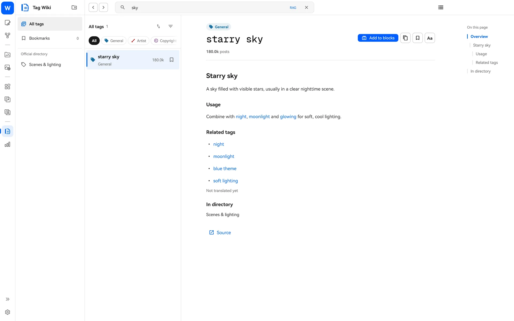

**タグ百科**にはローカルの Danbooru Wiki が付属しています。オフラインでもタグの意味やよく使われる組み合わせを調べ、ワンクリックでブロックに追加できます。

### ローカルのセマンティック検索（RAG）：意味で探す

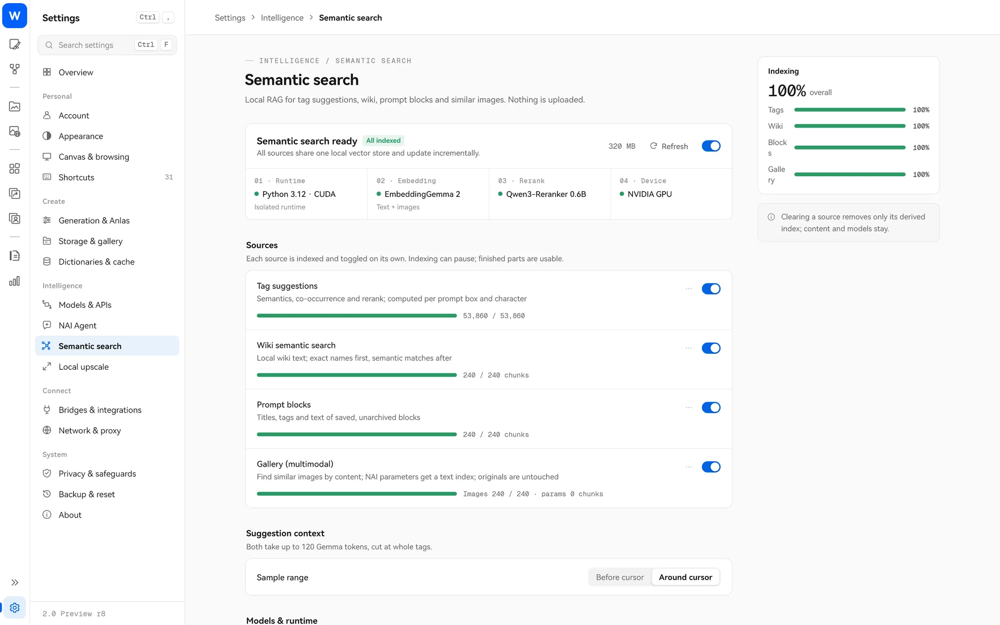

オプション機能です。有効にすると、タグ候補、タグ百科、ブロックライブラリ、ローカルギャラリーを「意味」で検索できます。「雨の降る通り」と入力して関連する英語のタグやブロック、以前作った画像を探したり、画像から似た画像を探したりできます。すべて PC 上で動作し、内容は一切アップロードしません。→ [セマンティック検索の使い方](docs/guide/ja/rag.md)

### NAI Agent：細かな作業を AI アシスタントに任せる

<table>
  <tr>
    <td width="62%">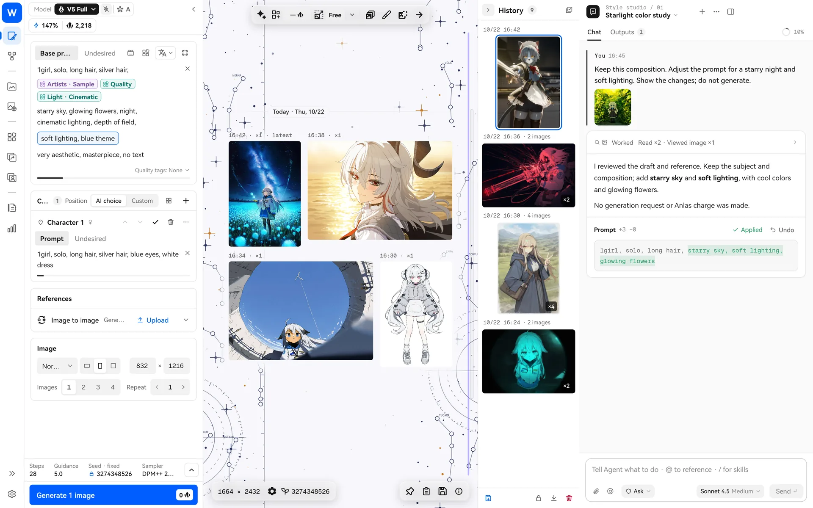</td>
    <td width="38%">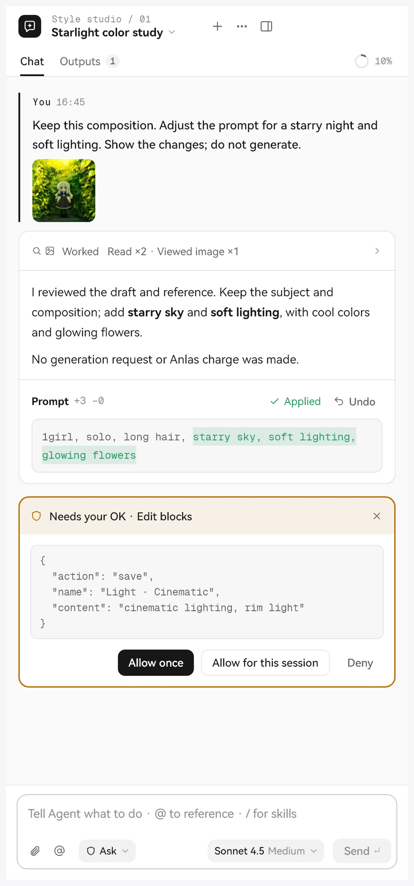</td>
  </tr>
</table>

画像生成ページや画風探索ページでサイドバーを開くと、チャットで AI にプロンプトの修正、タグや百科の検索、ブロックやギャラリーの整理、参照画像の設定、生成の準備などを頼めます。「モデルと API」でご自身が設定した大規模言語モデルサービスを使います。

- 変更・削除・コマンド実行の前に確認します。権限は閲覧のみ・確認・自動・フルアクセスの 4 段階です。
- **モデル自身が生成を開始する場合は、どの権限でも価格カードでの本人の確認が必要です。** プロンプトセットカードは「生成」のクリックで 1 枚を許可し、再確認はありません。
- 複数のプロンプト（物語の数場面、試着する衣装一式、絵コンテの各コマ）をまとめて作り、プロンプトセットカードで項目を切り替えたり、キャンバスに読み込んだり、1 枚ずつ生成したりできます。
- スキル（Skill）、MCP サーバー、CodeMode に対応し、自分のワークフローに合わせて拡張できます。

→ [NAI Agent の使い方](docs/guide/ja/nai-agent.md)

### 無限キャンバスとビジュアルチャンネル

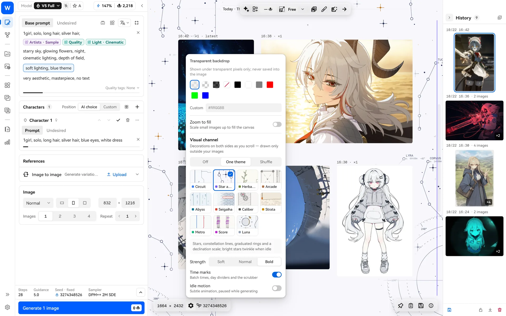

生成結果は、無限にドラッグできるキャンバスにバッチごとに並びます。ホイールで移動、`Ctrl+ホイール`でズーム、WASD でナビゲーション、スペース長押しでインペイント前の原画像を確認できます。キャンバスの両側には「ビジュアルチャンネル」の装飾を表示できます。星図、回路、深海、地下鉄など 11 種類のテーマがあり、画像の外側だけに描かれるため画像を隠しません。→ [キャンバスの使い方](docs/guide/ja/canvas.md)

### ローカルギャラリーとオンラインギャラリー

<table>
  <tr>
    <td width="50%">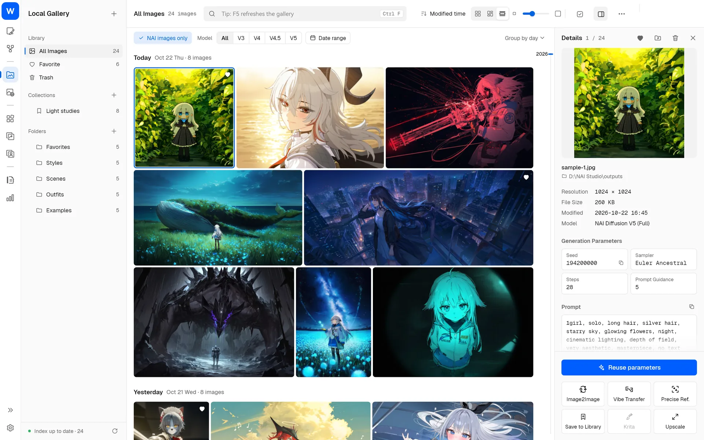</td>
    <td width="50%">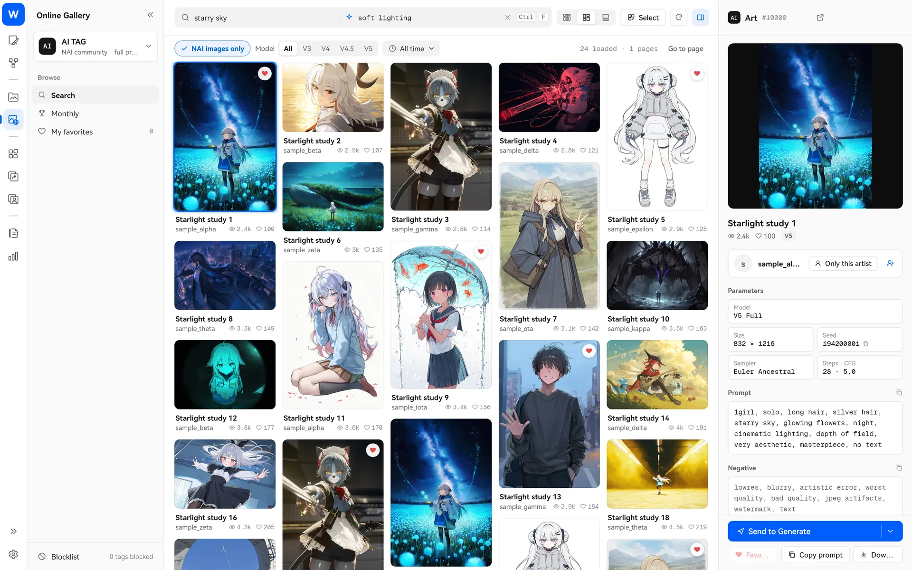</td>
  </tr>
</table>

- **ローカルギャラリー**：複数の画像フォルダーをまとめて閲覧できます。日別・月別の連続したタイムライン、プロンプト検索、コレクション、一括移動、ゴミ箱があり、NAI 画像のパラメータをワンクリックで再利用できます。
- **オンラインギャラリー**：Danbooru・Safebooru・Gelbooru・AI TAG の 4 ソースに対応しています。ランキング、お気に入り、ブラックリストを使え、気に入った作品の生成パラメータを直接再利用できます。

→ [ギャラリーの使い方](docs/guide/ja/gallery.md)

### 参照画像・ディレクターツール・インペイント・アップスケール

<table>
  <tr>
    <td width="50%">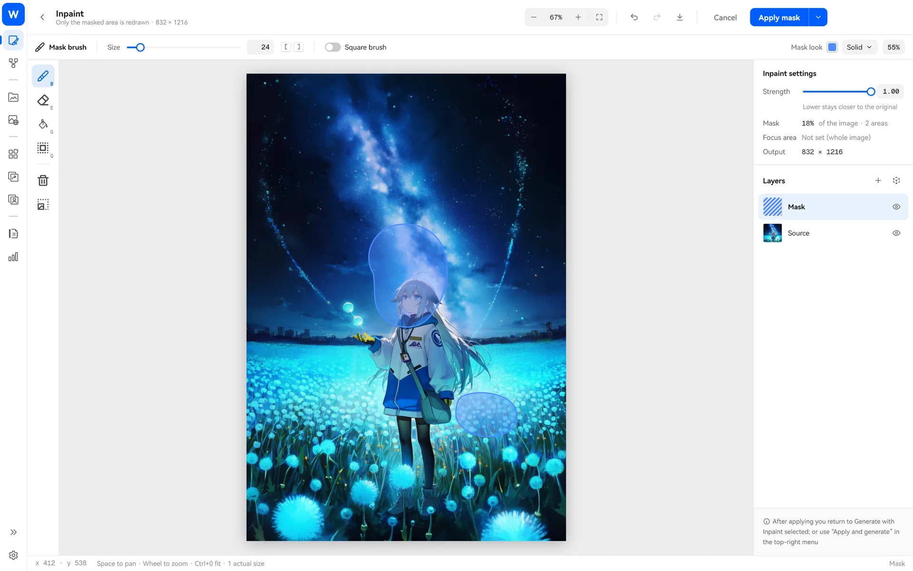</td>
    <td width="50%">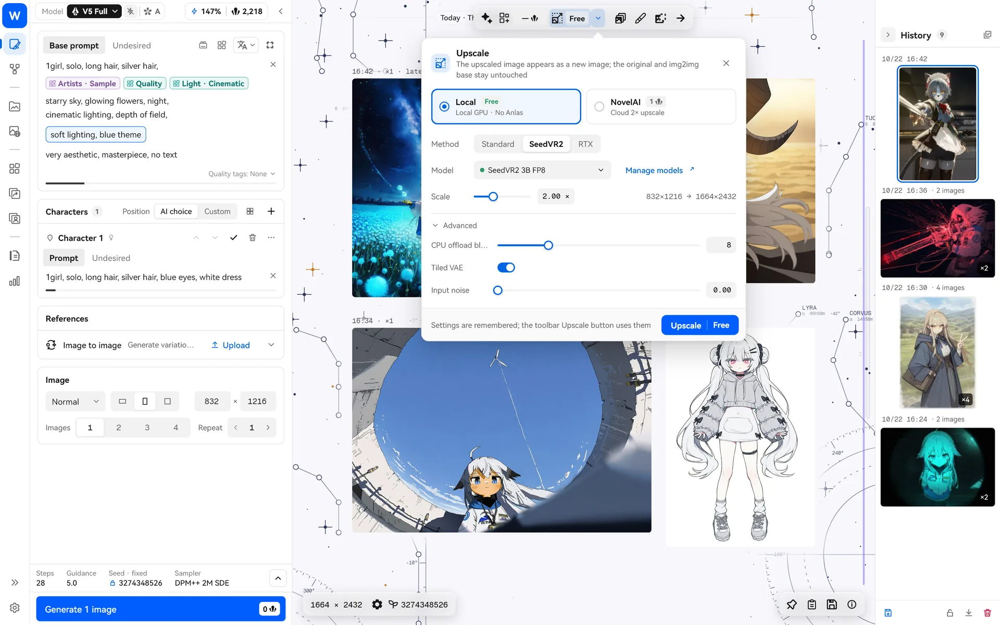</td>
  </tr>
</table>

- **Vibe Transfer と精密参照**：参照ライブラリで Vibe と精密参照をまとめて管理し、エンコード済みの Vibe を再利用できます。
- **ディレクターツール**：背景除去、線画抽出、着色、表情修正、ピクセル整列などを使えます。
- **インペイント**：ブラシ、選択範囲、マジックワンド、レイヤーを備えた全画面エディターです。描き終えたら、そのまま「適用して生成」できます。
- **アップスケール**：NovelAI のクラウド拡大、または PC 上で Real-ESRGAN・NVIDIA RTX Video・SeedVR2 による拡大を使えます。ローカル処理では Anlas を消費しません。

→ [画像ツールの使い方](docs/guide/ja/image-tools.md)

### ほかにも

- **NovelAI の全モデル**：V1 から V4.5、V5（Full / Curated）、複数キャラクターの入力欄と位置指定、透明背景、Anlas のリアルタイム見積もり、高消費時の警告に対応しています。
- **統計**：制作カレンダー、モデル別の生成量、Anlas 消費を確認し、グラフからその日の画像へ直接移動できます。
- **ローカルブリッジ**：外部スクリプトや AI ツールが、付属の `studio-bridge`（Windows では `studio-bridge.exe`）でパラメータを読み書きできます。生成前には同じく見積もり確認が必要です。Krita プラグイン連携にも対応しています。
- **ショートカット**：`F1`（Mac では `⌘/`）ですべて確認でき、どれもカスタマイズできます。
- **5 つの表示言語、ライトテーマとダークテーマ**。

## プライバシーと通信

- アカウントのトークンと API キーはこのコンピューターに保存します。Windows ではシステムのセキュアストレージ、macOS では現在のユーザー専用の暗号化ファイルを使用します。キーチェーンを使用していた版からアップグレードする場合は、認証情報を再入力してください。
- 通信するのは、NovelAI API の呼び出し、ご自身が設定した翻訳・Agent モデルサービスの利用、オンラインギャラリーの閲覧、更新確認、自分でダウンロードを選んだオプションコンポーネント（セマンティック検索モデル、拡大モデルなど）の取得時だけです。
- セマンティック検索、ローカル拡大、ギャラリー整理はすべて PC 上で処理します。
- 自動翻訳は初期状態ではオフです。Danbooru のオンライン関連タグには関連するタグだけを送り、プロンプト全体は送りません。

詳しくは[よくある質問](docs/guide/ja/faq.md)を参照してください。

## チュートリアル一覧

| チュートリアル | 内容 |
| --- | --- |
| [クイックスタート](docs/guide/ja/quick-start.md) | インストール、ログイン、初めての生成、データの場所 |
| [ブロック](docs/guide/ja/blocks.md) | 固定 / 順番 / ランダム、ロック、重みのルール、活用例 |
| [画風の遺伝](docs/guide/ja/style-explore.md) | 候補作成、進化の開始、2 枚比較、ブロックとして保存 |
| [翻訳ブロック](docs/guide/ja/translation.md) | 翻訳モデルの設定、二言語での閲覧、切り替えと復元 |
| [タグ拡張とタグ百科](docs/guide/ja/tags-wiki.md) | ローカルのタグ検索、関連タグ、オフライン百科 |
| [ローカルのセマンティック検索](docs/guide/ja/rag.md) | インストール、索引構築、利用できる場所 |
| [NAI Agent](docs/guide/ja/nai-agent.md) | モデル設定、権限、生成の確認、スキルと MCP |
| [無限キャンバスとビジュアルチャンネル](docs/guide/ja/canvas.md) | キャンバス操作、原画像との比較、装飾テーマ |
| [ギャラリー](docs/guide/ja/gallery.md) | ローカルギャラリーの整理、オンラインギャラリーの閲覧と再利用 |
| [画像ツール](docs/guide/ja/image-tools.md) | 参照画像、ディレクターツール、インペイント、アップスケール |
| [よくある質問](docs/guide/ja/faq.md) | インストール時の警告、バックアップ、旧版からの移行、プライバシー |

<details>
<summary><b>ソースからビルド</b></summary>

どちらのプラットフォームでも Flutter 3.47.7（`tool/flutter-sdk.json` 参照）と Git LFS が必要です。

```bash
git clone https://github.com/z15087716457-stack/W.O.F_NAI_Launcher.git
cd W.O.F_NAI_Launcher
git lfs install && git lfs pull
flutter pub get
dart run tool/generate.dart
flutter gen-l10n
```

**Windows**：Windows 10/11 x64、Visual Studio 2022 の「C++ によるデスクトップ開発」、NuGet CLI が必要です。

```bash
flutter build windows --release --no-tree-shake-icons
```

インストーラー版とポータブル版のパッケージ作成には `scripts/package_windows_release.ps1` を使います。

**macOS**：アプリ本体のデプロイ対象は macOS 12 で、同梱の Node には macOS 13.5 以降が必要です。ビルドには Xcode 本体（コマンドラインツールだけでは足りません）、CocoaPods、rustup（ドラッグ＆ドロップとクリップボードに使う `super_native_extensions` が Rust をコンパイルします）が必要です。リリースビルドは Apple シリコンの Mac で、Rosetta（`softwareupdate --install-rosetta`）を入れた状態で行います。`studio-bridge` の Intel 版は x64 の Dart SDK でコンパイルするためです。

```bash
scripts/build_macos.sh --release
scripts/package_macos_release.sh
```

`build_macos.sh` はユニバーサルのアプリをビルドし、NAI Agent 用の Node ランタイム、Pi、`studio-bridge` と、ローカルアップスケール用の Real-ESRGAN を入れます。`package_macos_release.sh` はそれを検査して `dist/WOF_NAI_Studio_macOS_<バージョン>_Portable.zip` にまとめます。署名は既定で ad-hoc です。Apple の開発者証明書があれば環境変数 `CODESIGN_IDENTITY` で指定します。`tool/branding/wof_icon.svg` を変えたら、`tool/branding/generate_macos_icons.sh` で Mac のアイコンを作り直します（Homebrew の librsvg に含まれる `rsvg-convert` が必要です）。

開発ルールは [DEVELOPMENT.md](DEVELOPMENT.md)、変更履歴は [CHANGELOG.md](CHANGELOG.md) を参照してください。

</details>

## 謝辞とライセンス

- 本プロジェクトは [Aaalice233/Aaalice_NAI_Launcher](https://github.com/Aaalice233/Aaalice_NAI_Launcher)（MIT）から派生しています。原作者のオープンソースでの取り組みに感謝します。本フォークは上流の作者とは関係ありません。問題は本リポジトリの Issues にお寄せください。
- 画風の遺伝のアルゴリズムは [monineko/PromptCard-Studio](https://github.com/monineko/PromptCard-Studio)（GPL-3.0）の考え方を参考にしています。独立した Dart 実装であり、ソースコードはコピーしていません。
- NAI Agent は [Pi](https://github.com/earendil-works/pi)（MIT）を基盤としています。
- 本プロジェクトは [MIT License](LICENSE) で公開しています。付属のデータ、フォント、コンポーネントにはそれぞれのライセンスが適用されます。[サードパーティーに関する表記](THIRD_PARTY_NOTICES.md)を参照してください。

README の画面画像はデモデータで描画しています。例のプロンプトと絵師名はすべて架空のものです。
