<p align="center">
  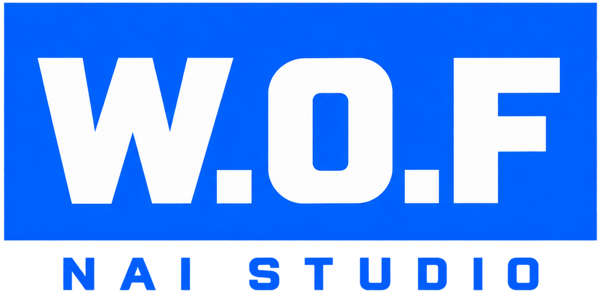
</p>

<p align="center">
  <a href="README.md">简体中文</a> ·
  <a href="README.zh-TW.md">繁體中文</a> ·
  <a href="README.en-US.md">English</a> ·
  <a href="README.ja.md">日本語</a> ·
  <strong>한국어</strong>
</p>

<h3 align="center">NovelAI 이미지 생성을 쌓아 두고 다시 활용하는 창작 작업 공간으로 만듭니다</h3>

<p align="center">
  <a href="https://github.com/z15087716457-stack/W.O.F_NAI_Launcher/releases/latest"></a>
  
  
  
  <a href="LICENSE"></a>
</p>

<p align="center">
  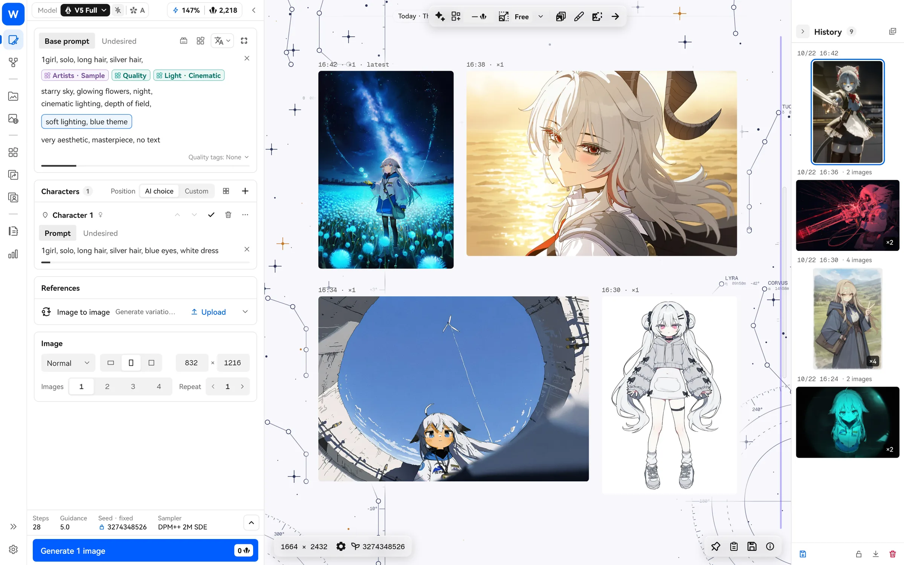
</p>

W.O.F NAI Studio는 Windows와 macOS 데스크톱용 NovelAI 서드파티 클라이언트입니다. 단순히 공식 사이트를 데스크톱으로 옮긴 것이 아닙니다. 자주 쓰는 프롬프트를 **블록**으로 저장해 반복 사용하고, **화풍 유전**으로 작가 조합을 세대별로 골라낼 수 있습니다. 이해하기 어려운 태그는 **번역, 태그 백과, 로컬 시맨틱 검색**으로 알아볼 수 있으며, 생성·정리·이미지 편집 같은 자잘한 작업은 내장 **NAI Agent**에 맡길 수 있습니다.

> NovelAI와 무관한 비공식 프로젝트입니다. 본인의 NovelAI 계정을 사용하고 NovelAI 이용약관을 준수하십시오.

## 다운로드

[Releases](https://github.com/z15087716457-stack/W.O.F_NAI_Launcher/releases/latest)에서 운영체제에 맞는 파일을 선택하세요. Mac 패키지는 macOS 지원이 포함된 릴리스부터 제공됩니다. 그 전에는 PR 검증에 성공한 Actions 실행에서 `macos-validation`을 다운로드할 수 있습니다.

| 파일 | 권장 대상 |
| --- | --- |
| `WOF_NAI_Studio_Windows_<버전>_Setup.exe` | **대부분의 Windows 사용자는 이 버전을 선택하면 됩니다.** 현재 사용자 폴더에 설치하며 관리자 권한이 필요하지 않습니다. 시작 메뉴와 바탕 화면 바로 가기를 만듭니다. |
| `WOF_NAI_Studio_Windows_<버전>_Portable.zip` | 원하는 폴더나 USB에 넣거나 여러 PC 사이에서 가지고 다닐 때 사용합니다. 압축을 푼 뒤 `nai_launcher.exe`를 실행합니다. |
| `WOF_NAI_Studio_macOS_<버전>_Portable.zip` | **Mac용입니다.** 전체 패키지는 macOS 13.5 이상이 필요하며 Apple 실리콘과 Intel용 바이너리를 모두 포함합니다. Intel Mac 실기 검증은 아직 진행하지 않았습니다. Finder에서 압축을 푼 뒤 `W.O.F NAI Studio`를 “응용 프로그램” 폴더로 드래그합니다. |

Windows의 두 버전 모두 앱 내 업데이트를 지원합니다. 설정, 갤러리 데이터베이스, Agent 데이터는 프로그램 옆의 `user-data/`와 `agent-data/`에 저장하며, 업그레이드하거나 제거해도 삭제하지 않습니다.

> 설치 파일에는 아직 코드 서명이 없습니다. 처음 실행할 때 Windows에서 “Windows의 PC 보호”가 표시되면 “추가 정보 → 실행”을 클릭합니다. 각 버전에 SHA-256 체크섬이 함께 제공됩니다.

### macOS

- **처음 열기**: Mac 버전은 Apple의 공증을 받지 않았기 때문에 처음 열 때 시스템이 막습니다. Finder에서 Control 키를 누른 채 앱을 클릭(또는 오른쪽 클릭)하고 “열기”를 선택한 다음, 다시 “열기”를 클릭합니다. macOS 15부터는 앱을 한 번 연 뒤 “시스템 설정 → 개인정보 보호 및 보안” 아래쪽에서 “그래도 열기”를 클릭합니다. “손상되었기 때문에 열 수 없습니다”라고 나오면 “터미널”에서 다음 줄을 실행한 뒤 평소처럼 엽니다.

  ```bash
  xattr -dr com.apple.quarantine "/Applications/W.O.F NAI Studio.app"
  ```

- **업데이트**: 앱에서 새 버전을 다운로드하고 확인하면 Finder에서 새 버전이 선택됩니다. `⌘Q`로 이전 버전을 종료하고, 새 버전을 “응용 프로그램”으로 드래그해 바꾸면 됩니다.
- **데이터 위치**: 설정, 데이터베이스, Agent 데이터는 `~/Library/Application Support/com.wof.naiStudio/`에 있으며, 앱을 바꿔도 삭제되지 않습니다.
- **1.x에서 업그레이드**: 처음 열 때 이전 버전(Aaalice NAI Launcher)의 설정, 기록, 각종 라이브러리와 즐겨찾기를 복사하며, 이전 버전의 데이터는 그대로 둡니다. 이전 버전이 실행 중이면 먼저 종료하라는 안내가 나옵니다. 로그인 정보는 복사하지 않으므로 다시 로그인해야 합니다. 이미지, Vibe 등 “문서” 폴더의 파일은 원래 두 버전이 함께 씁니다. 이후에도 “설정 → 백업과 초기화 → 이전 버전 데이터”에서 다시 동기화하거나 마지막 동기화를 되돌릴 수 있고, 되돌린 뒤에는 동기화 후 데이터로 다시 돌아갈 수도 있습니다. 바꾸기 전마다 현재 데이터를 백업하며 백업은 최근 2개를 보관합니다.
- **단축키**: 단축키의 `Ctrl`은 Mac에서 `⌘`가 되고, 단축키 목록은 `⌘/`로 엽니다.
- **로컬 업스케일**: Real-ESRGAN을 사용할 수 있습니다. 엔진과 모델은 Windows 버전과 같으며 Mac의 GPU(Metal)에서 실행됩니다. NVIDIA RTX Video와 SeedVR2는 NVIDIA GPU가 필요해 현재 Windows 버전에서만 사용할 수 있습니다.
- **로컬 시맨틱 검색(RAG)**: Apple 실리콘 Mac이 필요합니다. 실행 장치가 자동이면 메모리 18 GB 이상인 Mac에서는 GPU를, 16 GB 이하에서는 CPU를 사용합니다. Intel Mac에서는 사용할 수 없습니다. PyTorch가 Intel Mac용 빌드를 더 이상 제공하지 않기 때문입니다.
- **리소스 창**: Mac에서는 메인 창 안의 패널로 열립니다. 여러 개를 열어 옮기거나 크기를 바꾸고, 리소스를 작업 영역으로 끌어다 놓을 수 있습니다. 아직 독립된 시스템 창이 아니어서 메인 창 밖으로 꺼낼 수 없고, 항상 위에 표시와 창 안에서 큰 이미지 보기도 없습니다.

## 세 단계로 시작하기

1. **로그인**: NovelAI API Token(권장) 또는 계정과 비밀번호로 로그인합니다. 게스트로 먼저 들어가 로컬 기능을 사용해 볼 수도 있습니다.
2. **생성**: 왼쪽에 프롬프트를 작성하고 `Ctrl+Enter`를 누릅니다. 결과는 가운데 캔버스에 배치별로 표시됩니다.
3. **쌓아 두기**: 자주 쓰는 작가 문자열과 품질 태그를 블록으로 저장합니다. 마음에 드는 이미지는 자동으로 로컬 갤러리에 들어가며 언제든 파라미터를 재사용할 수 있습니다.

자세한 설명은 [빠른 시작](docs/guide/ko/quick-start.md)을 참고합니다.

## 주요 기능

### 블록: 한 번 작성하고 반복해서 사용합니다

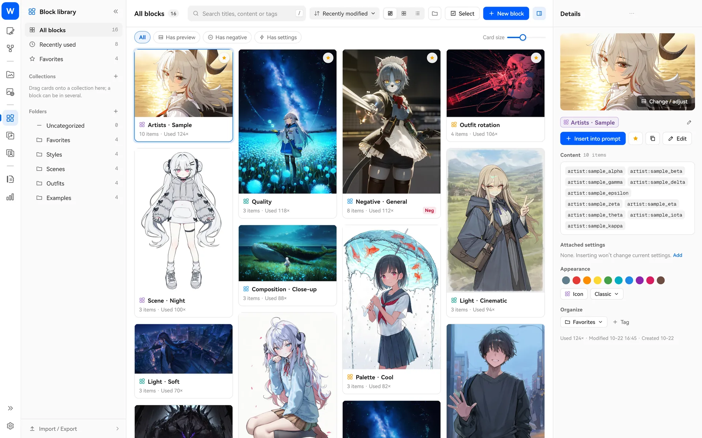

작가 풀, 품질 태그, 네거티브 태그, 의상 목록 등 자주 쓰는 조각을 “블록”으로 저장하고 프롬프트로 끌어다 사용할 수 있습니다. 부정 내용과 생성 설정도 함께 담아 좋아하는 화풍 전체를 “화풍 블록”으로 저장하고, 삽입한 뒤 한 번의 클릭으로 설정을 적용할 수 있습니다. 블록마다 세 가지 방식을 설정할 수 있습니다.

- **고정**: 매번 그대로 넣습니다. 품질 태그와 네거티브 태그에 적합합니다.
- **순서**: 생성할 때마다 다음 항목으로 바꿉니다. 의상이나 장면을 하나씩 시험하거나, 이야기를 여러 장면으로 나누어 작성하고 한 장면씩 진행할 수 있습니다.
- **무작위**: 매번 풀에서 몇 항목을 뽑습니다. 개수, 등장 확률, 무작위 가중치도 설정할 수 있어 작가 조합을 일괄 시험할 때 적합합니다.

마음에 드는 결과가 나오면 **잠금**으로 유지하고 다른 블록만 다시 뽑을 수 있습니다. → [블록 사용 방법](docs/guide/ko/blocks.md)

### 화풍 유전: 마음에 드는 조합을 “진화”시킵니다

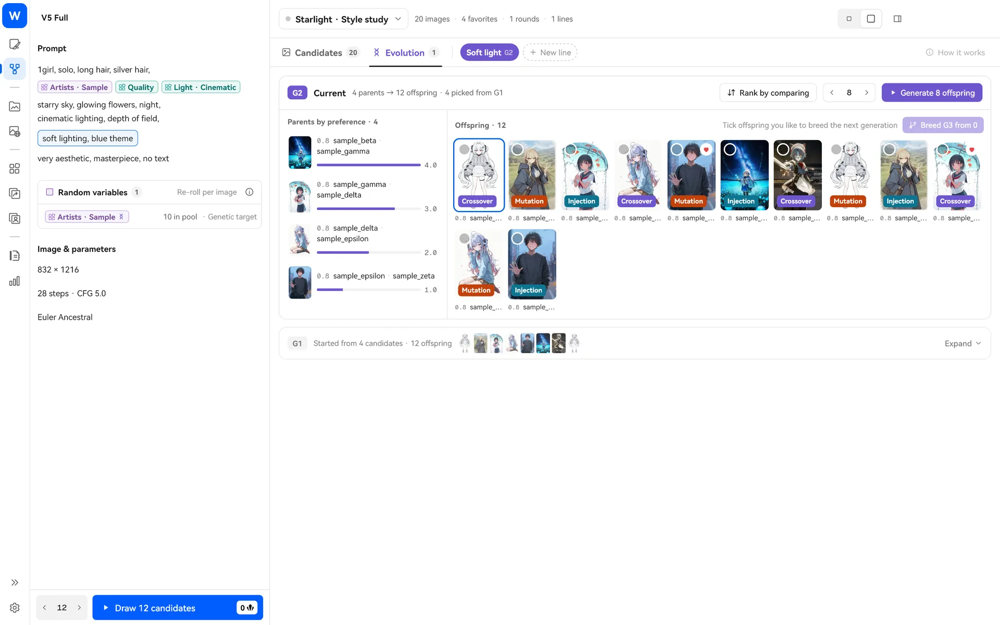

어떤 작가를 섞어야 좋을지 모르겠다면 화풍 탐색에 무작위 작가 풀을 넣고 한 번에 수십 장의 후보를 뽑습니다. 마음에 드는 몇 장을 골라 진화를 시작하면 프로그램이 작가 문자열을 교차·변이하고 새 작가를 주입해 다음 세대를 생성합니다. 고르기만 하면 몇 세대 뒤에는 원하는 화풍에 가까워집니다. 만족스러운 조합은 한 번의 클릭으로 블록에 저장할 수 있습니다. → [화풍 유전 사용 방법](docs/guide/ko/style-explore.md)

### 번역 블록·태그 확장·태그 백과: 태그의 뜻을 이해합니다

<table>
  <tr>
    <td width="50%">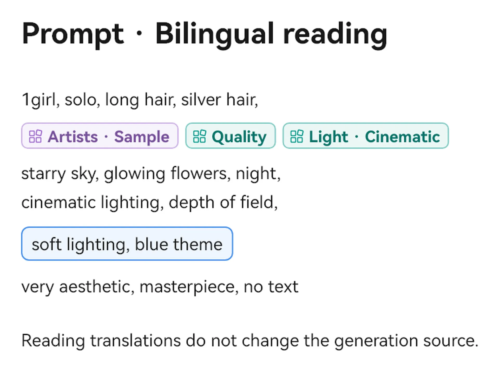</td>
    <td width="50%">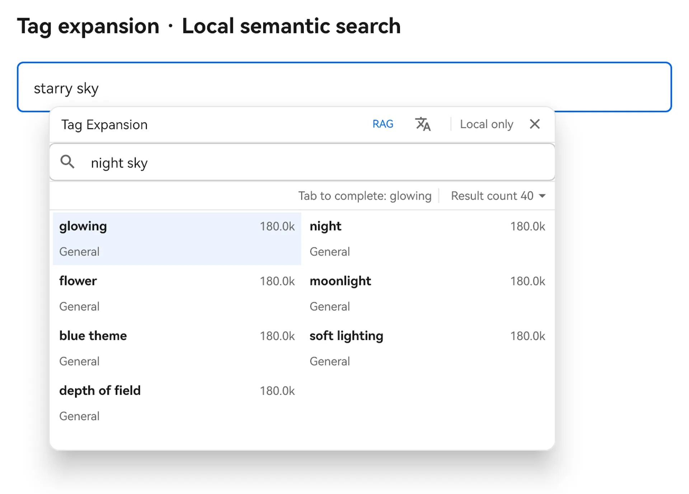</td>
  </tr>
  <tr>
    <td>
      <b>번역 블록</b>: 영어 프롬프트를 중국어로 번역해 원래 위치에 표시합니다. 마우스 가운데 버튼으로 클릭하면 원문과 번역문을 전환합니다. 생성에는 항상 원문을 사용하며 번역은 읽기만 돕습니다. 번역할 때 로컬 태그 라이브러리와 Wiki에서 일치하는 용어집을 함께 보내, 모델이 작가명이나 작품명을 일반 단어로 오해하지 않도록 돕습니다. → <a href="docs/guide/ko/translation.md">사용 방법</a>
    </td>
    <td>
      <b>태그 확장</b>: 프롬프트의 태그를 <code>Ctrl+클릭</code>하면 로컬 태그 라이브러리를 검색합니다. 범위를 <code>Ctrl+드래그 선택</code>하면 자주 함께 쓰는 태그를 확인합니다. → <a href="docs/guide/ko/tags-wiki.md">사용 방법</a>
    </td>
  </tr>
</table>

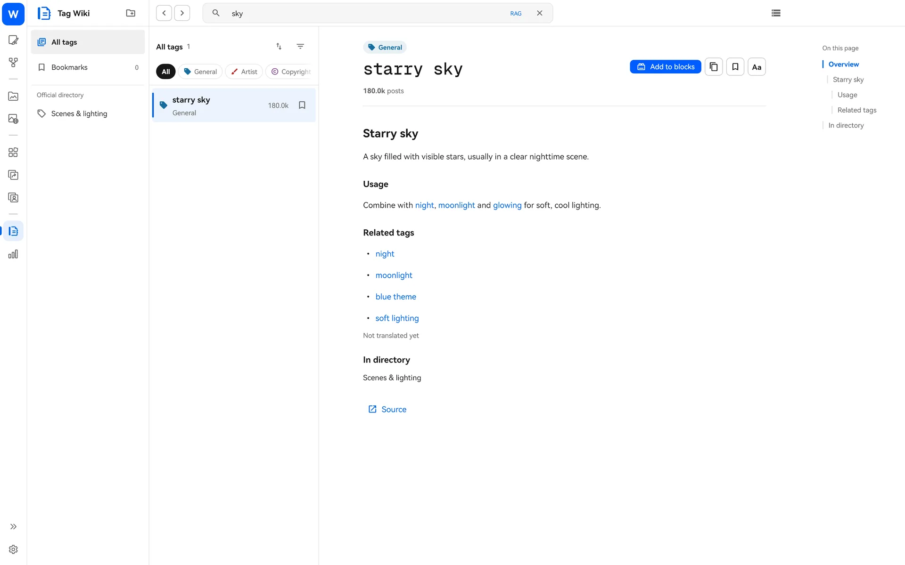

**태그 백과**에는 로컬 Danbooru Wiki가 포함되어 있습니다. 오프라인에서도 태그의 뜻과 자주 쓰는 조합을 알아보고 한 번의 클릭으로 블록에 추가할 수 있습니다.

### 로컬 시맨틱 검색(RAG): 의미로 찾습니다

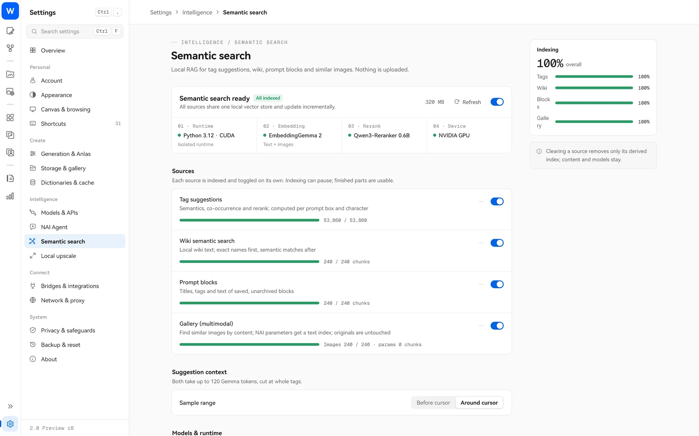

선택 기능입니다. 켜면 태그 추천, 태그 백과, 블록 라이브러리, 로컬 갤러리를 “의미”로 검색할 수 있습니다. “비 오는 거리”를 입력해 관련 영어 태그와 블록, 예전에 만든 이미지를 찾거나 이미지로 비슷한 이미지를 찾을 수 있습니다. 모두 본인의 PC에서 실행하며 어떤 내용도 업로드하지 않습니다. → [시맨틱 검색 사용 방법](docs/guide/ko/rag.md)

### NAI Agent: 자잘한 작업을 AI 도우미에게 맡깁니다

<table>
  <tr>
    <td width="62%">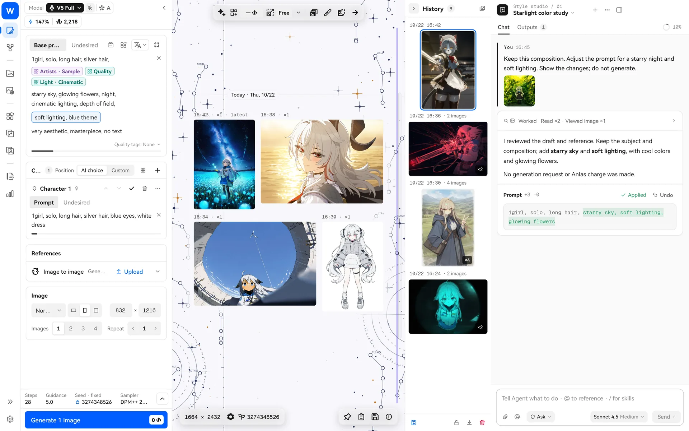</td>
    <td width="38%">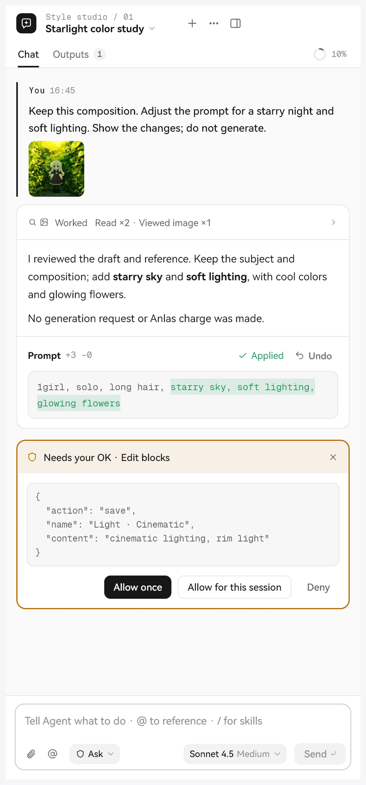</td>
  </tr>
</table>

이미지 생성 페이지나 화풍 탐색 페이지에서 사이드바를 열면 대화로 AI에게 프롬프트 수정, 태그와 백과 검색, 블록과 갤러리 정리, 참조 이미지 설정, 생성 준비 등을 요청할 수 있습니다. “모델과 API”에 직접 설정한 대규모 언어 모델 서비스를 사용합니다.

- 수정·삭제·명령 실행 전에 먼저 확인합니다. 권한은 읽기 전용·확인·자동·전체 권한의 네 단계입니다.
- **모델이 직접 생성을 시작할 때는 어떤 권한 단계에서도 가격 카드에서 승인해야 합니다.** 프롬프트 세트 카드의 “생성”을 직접 클릭하면 1장을 승인한 것으로 처리하며 다시 확인하지 않습니다.
- 여러 프롬프트(이야기의 여러 장면, 입혀 볼 의상 세트, 스토리보드의 여러 컷)를 한 번에 작성하고, 프롬프트 세트 카드에서 항목을 하나씩 전환하거나 캔버스로 가져오거나 한 장씩 생성할 수 있습니다.
- 스킬(Skill), MCP 서버, CodeMode를 지원하며 자신의 작업 흐름에 맞게 확장할 수 있습니다.

→ [NAI Agent 사용 방법](docs/guide/ko/nai-agent.md)

### 무한 캔버스와 비주얼 채널

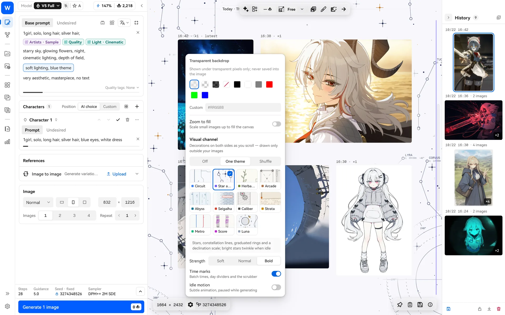

생성 결과는 끝없이 끌어 이동할 수 있는 캔버스에 배치별로 놓입니다. 휠로 이동하고 `Ctrl+휠`로 확대·축소하며 WASD로 탐색합니다. 스페이스 키를 누르고 있으면 인페인트 전 원본을 확인합니다. 캔버스 양쪽에는 “비주얼 채널” 장식을 켤 수 있습니다. 성도, 회로, 심해, 지하철 등 11가지 테마가 있으며 이미지 바깥에만 그려 이미지를 가리지 않습니다. → [캔버스 사용 방법](docs/guide/ko/canvas.md)

### 로컬 갤러리와 온라인 갤러리

<table>
  <tr>
    <td width="50%">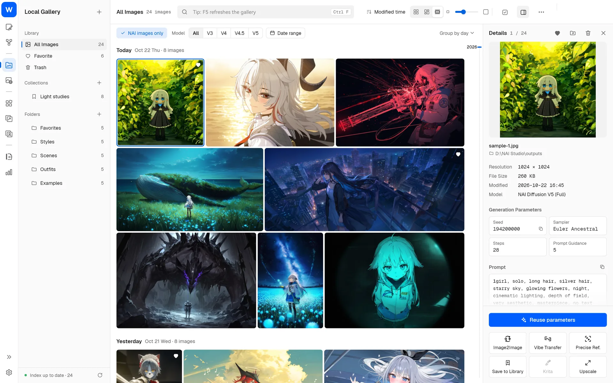</td>
    <td width="50%">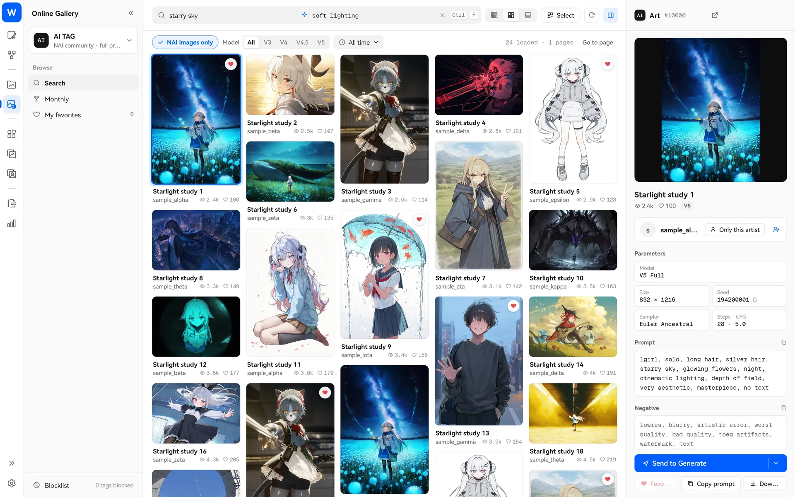</td>
  </tr>
</table>

- **로컬 갤러리**: 여러 이미지 폴더를 한곳에서 탐색합니다. 일별·월별로 묶은 연속 타임라인, 프롬프트 검색, 컬렉션, 일괄 이동, 휴지통을 지원하며 NAI 이미지의 파라미터를 한 번의 클릭으로 재사용할 수 있습니다.
- **온라인 갤러리**: Danbooru, Safebooru, Gelbooru, AI TAG 네 가지 소스를 지원합니다. 순위, 즐겨찾기, 블랙리스트를 사용할 수 있으며 마음에 드는 작품의 생성 파라미터를 바로 재사용할 수 있습니다.

→ [갤러리 사용 방법](docs/guide/ko/gallery.md)

### 참조 이미지·디렉터 도구·인페인트·업스케일

<table>
  <tr>
    <td width="50%">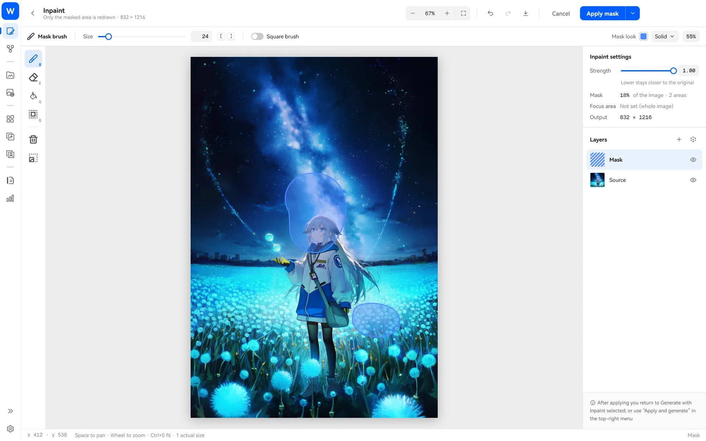</td>
    <td width="50%">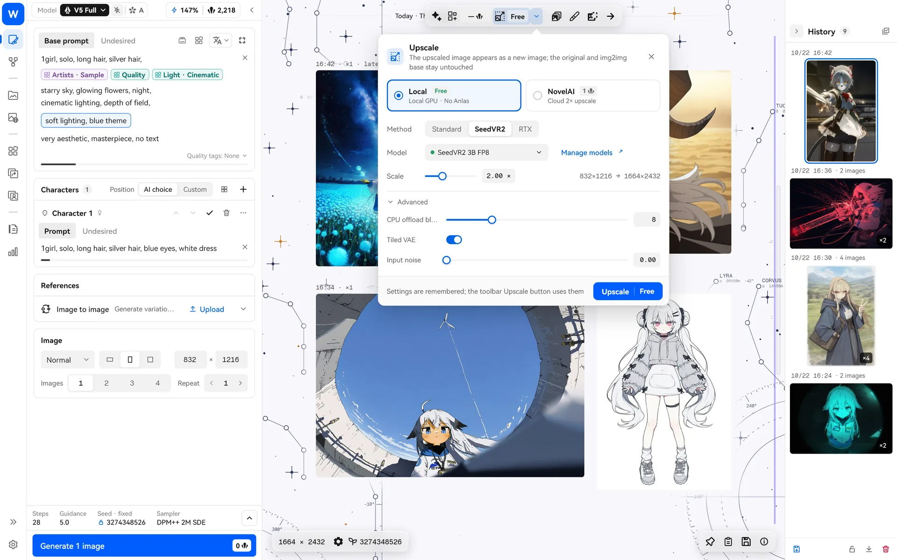</td>
  </tr>
</table>

- **Vibe 트랜스퍼와 정밀 참조**: 참조 라이브러리에서 Vibe와 정밀 참조를 함께 관리하고 인코딩한 Vibe를 재사용할 수 있습니다.
- **디렉터 도구**: 배경 제거, 선화 추출, 채색, 표정 수정, 픽셀 정렬 등을 지원합니다.
- **인페인트**: 브러시, 선택 영역, 마술봉, 레이어를 갖춘 전체 화면 편집기입니다. 그린 뒤 바로 “적용 후 생성”할 수 있습니다.
- **업스케일**: NovelAI 클라우드 업스케일 또는 PC에서 Real-ESRGAN, NVIDIA RTX Video, SeedVR2를 이용한 업스케일을 사용할 수 있습니다. 로컬 처리에는 Anlas를 쓰지 않습니다.

→ [이미지 도구 사용 방법](docs/guide/ko/image-tools.md)

### 그 밖의 기능

- **NovelAI 전체 모델**: V1부터 V4.5, V5(Full / Curated), 여러 캐릭터 입력란과 위치 지정, 투명 배경, Anlas 실시간 예상 비용, 높은 비용 경고를 지원합니다.
- **통계**: 창작 달력, 모델별 생성량, Anlas 소비를 확인하고 차트를 클릭해 해당 날짜의 이미지로 바로 이동합니다.
- **로컬 브리지**: 외부 스크립트나 AI 도구가 포함된 `studio-bridge`(Windows에서는 `studio-bridge.exe`)를 통해 파라미터를 읽고 쓸 수 있습니다. 생성 전에는 마찬가지로 견적 승인이 필요합니다. Krita 플러그인 연동도 지원합니다.
- **단축키**: `F1`(Mac에서는 `⌘/`)로 전체 단축키를 확인하며 모두 사용자 지정할 수 있습니다.
- **5가지 인터페이스 언어, 밝은 테마와 어두운 테마**.

## 개인정보와 네트워크

- 계정 토큰과 API 키는 이 컴퓨터에 저장합니다. Windows는 시스템 보안 저장소를, macOS는 현재 사용자 전용 암호화 파일을 사용합니다. 키체인을 사용하던 버전에서 업그레이드할 때는 인증 정보를 다시 입력하세요.
- 네트워크는 다음 경우에만 사용합니다. NovelAI API 호출, 직접 설정한 번역 또는 Agent 모델 서비스 사용, 온라인 갤러리 탐색, 업데이트 확인, 직접 다운로드를 선택한 선택 구성요소(시맨틱 검색 모델, 업스케일 모델 등) 설치입니다.
- 시맨틱 검색, 로컬 업스케일, 갤러리 정리는 모두 PC에서 처리합니다.
- 자동 번역은 기본적으로 꺼져 있습니다. Danbooru 온라인 관련 태그에는 해당 태그만 보내며 전체 프롬프트는 보내지 않습니다.

더 궁금한 내용은 [자주 묻는 질문](docs/guide/ko/faq.md)을 참고합니다.

## 사용 안내 목록

| 안내 | 내용 |
| --- | --- |
| [빠른 시작](docs/guide/ko/quick-start.md) | 설치, 로그인, 첫 생성, 데이터 위치 |
| [블록](docs/guide/ko/blocks.md) | 고정 / 순서 / 무작위, 잠금, 가중치 규칙, 활용 예 |
| [화풍 유전](docs/guide/ko/style-explore.md) | 후보 뽑기, 진화 시작, 둘씩 비교, 블록으로 저장 |
| [번역 블록](docs/guide/ko/translation.md) | 번역 모델 설정, 두 언어로 읽기, 전환과 복원 |
| [태그 확장과 태그 백과](docs/guide/ko/tags-wiki.md) | 로컬 태그 검색, 관련 태그, 오프라인 백과 |
| [로컬 시맨틱 검색](docs/guide/ko/rag.md) | 설치, 색인 만들기, 사용 위치 |
| [NAI Agent](docs/guide/ko/nai-agent.md) | 모델 설정, 권한, 생성 승인, 스킬과 MCP |
| [무한 캔버스와 비주얼 채널](docs/guide/ko/canvas.md) | 캔버스 조작, 원본 비교, 장식 테마 |
| [갤러리](docs/guide/ko/gallery.md) | 로컬 갤러리 정리, 온라인 갤러리 탐색과 재사용 |
| [이미지 도구](docs/guide/ko/image-tools.md) | 참조 이미지, 디렉터 도구, 인페인트, 업스케일 |
| [자주 묻는 질문](docs/guide/ko/faq.md) | 설치 경고, 데이터 백업, 구버전 이전, 개인정보 |

<details>
<summary><b>소스에서 빌드</b></summary>

두 플랫폼 모두 Flutter 3.47.7(`tool/flutter-sdk.json` 참고)과 Git LFS가 필요합니다.

```bash
git clone https://github.com/z15087716457-stack/W.O.F_NAI_Launcher.git
cd W.O.F_NAI_Launcher
git lfs install && git lfs pull
flutter pub get
dart run tool/generate.dart
flutter gen-l10n
```

**Windows**: Windows 10/11 x64, Visual Studio 2022의 “C++를 사용한 데스크톱 개발”, NuGet CLI가 필요합니다.

```bash
flutter build windows --release --no-tree-shake-icons
```

설치형과 포터블 패키지는 `scripts/package_windows_release.ps1`로 만듭니다.

**macOS**: 앱 자체의 배포 대상은 macOS 12이며 함께 제공되는 Node에는 macOS 13.5 이상이 필요합니다. 빌드하려면 Xcode 전체(명령줄 도구만으로는 부족합니다), CocoaPods, rustup(드래그 앤 드롭과 클립보드에 쓰는 `super_native_extensions`가 Rust를 컴파일합니다)이 필요합니다. 릴리스 빌드는 Rosetta(`softwareupdate --install-rosetta`)를 설치한 Apple 실리콘 Mac에서 합니다. `studio-bridge`의 Intel 버전을 x64 Dart SDK로 컴파일하기 때문입니다.

```bash
scripts/build_macos.sh --release
scripts/package_macos_release.sh
```

`build_macos.sh`는 유니버설 앱을 빌드하고 NAI Agent용 Node 런타임, Pi, `studio-bridge`와 로컬 업스케일용 Real-ESRGAN을 넣습니다. `package_macos_release.sh`는 이를 검사한 뒤 `dist/WOF_NAI_Studio_macOS_<버전>_Portable.zip`으로 묶습니다. 기본 서명은 ad-hoc이며, Apple 개발자 인증서가 있으면 환경 변수 `CODESIGN_IDENTITY`로 지정합니다. `tool/branding/wof_icon.svg`를 바꾼 뒤에는 `tool/branding/generate_macos_icons.sh`로 Mac 아이콘을 다시 만듭니다(Homebrew librsvg의 `rsvg-convert`가 필요합니다).

개발 규칙은 [DEVELOPMENT.md](DEVELOPMENT.md), 버전 기록은 [CHANGELOG.md](CHANGELOG.md)를 참고합니다.

</details>

## 감사의 말과 라이선스

- 이 프로젝트는 [Aaalice233/Aaalice_NAI_Launcher](https://github.com/Aaalice233/Aaalice_NAI_Launcher)(MIT)에서 파생되었습니다. 원작자의 오픈 소스 작업에 감사드립니다. 이 포크는 원작자와 무관하며 문제는 이 저장소의 Issues에 제출해 주십시오.
- 화풍 유전 알고리즘의 아이디어는 [monineko/PromptCard-Studio](https://github.com/monineko/PromptCard-Studio)(GPL-3.0)를 참고했습니다. 독립적인 Dart 구현이며 소스 코드를 복사하지 않았습니다.
- NAI Agent는 [Pi](https://github.com/earendil-works/pi)(MIT)를 기반으로 합니다.
- 이 프로젝트는 [MIT License](LICENSE)로 공개됩니다. 포함된 데이터, 글꼴, 구성요소에는 각자의 라이선스가 적용됩니다. [서드파티 고지](THIRD_PARTY_NOTICES.md)를 참고합니다.

README의 화면 이미지는 데모 데이터로 렌더링했습니다. 예시 프롬프트와 작가 이름은 모두 가상입니다.
