<p align="center">
  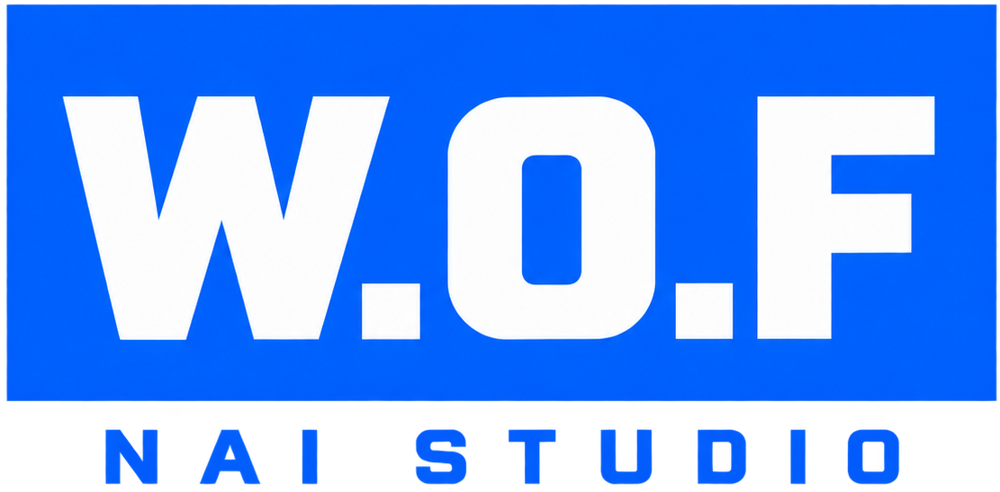
</p>

<p align="center">
  <strong>简体中文</strong> ·
  <a href="README.zh-TW.md">繁體中文</a> ·
  <a href="README.en-US.md">English</a> ·
  <a href="README.ja.md">日本語</a> ·
  <a href="README.ko.md">한국어</a>
</p>

<h3 align="center">把 NovelAI 生图变成一套可以积累、可以复用的创作工作台</h3>

<p align="center">
  <a href="https://github.com/z15087716457-stack/W.O.F_NAI_Launcher/releases/latest"></a>
  
  
  
  <a href="LICENSE"></a>
</p>

<p align="center">
  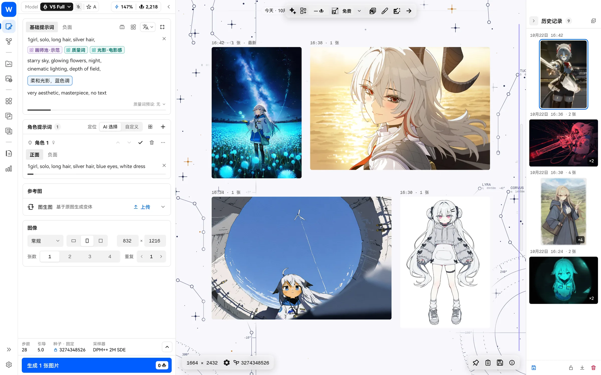
</p>

W.O.F NAI Studio 是一个 Windows 和 macOS 桌面上的 NovelAI 第三方客户端。它不只是把官网搬到桌面：常用的提示词可以存成**积木**反复使用，画师组合可以交给**画风遗传**一代代筛选，看不懂的标签有**翻译、标签百科和本地语义检索**帮忙，生成、整理、修图的杂活还可以交给内置的 **NAI Agent**。

> 这是非官方项目，与 NovelAI 无关。请使用你自己的 NovelAI 账号，并遵守 NovelAI 的服务条款。

## 下载

在 [Releases](https://github.com/z15087716457-stack/W.O.F_NAI_Launcher/releases/latest) 选择对应系统的文件。Mac 包随包含此适配的版本发布。首个 Mac 版本发布前，可在通过 PR 校验的 Actions 页面下载 `macos-validation`。

| 文件 | 适合谁 |
| --- | --- |
| `WOF_NAI_Studio_Windows_<版本>_Setup.exe` | **大多数 Windows 用户选这个。** 装到当前用户目录，不需要管理员权限，有开始菜单和桌面快捷方式。 |
| `WOF_NAI_Studio_Windows_<版本>_Portable.zip` | 想放在自己指定的文件夹、U 盘或多台电脑之间带着走。解压后运行 `nai_launcher.exe`。 |
| `WOF_NAI_Studio_macOS_<版本>_Portable.zip` | **Mac 用这个。** 完整包需要 macOS 13.5 及以上，包含 Apple 芯片与 Intel 两种架构。用访达解压后，把 `W.O.F NAI Studio` 拖进“应用程序”。 |

Windows 的两个版本都支持应用内更新。你的设置、图库数据库和 Agent 数据都放在程序旁边的 `user-data/` 和 `agent-data/` 里，升级和卸载都不会删除它们。

> **2.2.3 及更早 Portable 首次升级**：请完全退出应用，解压新版覆盖原程序目录，保留 `user-data/` 与 `agent-data/`。2.2.4 及之后可正常使用应用内更新；Setup 不受此旧脚本问题影响。

> 安装包暂未做代码签名，第一次运行时 Windows 可能提示“已保护你的电脑”。点“更多信息 → 仍要运行”即可。每个版本都附有 SHA-256 校验值。

### macOS

- **构建与签名**：GitHub Actions 在 `macos-15` 上生成 Apple 芯片 / Intel 通用包，使用 ad-hoc 临时签名，不需要 Apple Developer 证书或密钥。PR 的 Actions 产物可用于验证，正式 tag 的产物随 Release 发布；Intel 尚待实机验证。
- **Agent 工具**：随包提供 Node 和 npm/npx，从访达启动也能用于 Agent 包管理和本地命令 MCP。安装 Git 来源的扩展需要系统可用的 Git；这些安装仍由现有权限流程确认。
- **第一次打开**：Mac 版没有经过 Apple 公证，第一次打开会被系统拦下。在访达里按住 Control 点按应用（或右键点按），选“打开”，再点“打开”。macOS 15 起这一步改了：先双击打开一次，再到“系统设置 → 隐私与安全性”最下面点“仍要打开”。如果提示“已损坏，无法打开”，在“终端”里运行下面这行，然后照常打开：

  ```bash
  xattr -dr com.apple.quarantine "/Applications/W.O.F NAI Studio.app"
  ```

- **更新**：应用内下载并校验新版本后，会在访达中选中它。按 `⌘Q` 退出旧版本，把新版本拖进“应用程序”替换即可。
- **数据位置**：设置、数据库和 Agent 数据在 `~/Library/Application Support/com.wof.naiStudio/`，替换应用不会删除它们。
- **从 1.x 升级**：第一次打开时，会把旧版（Aaalice NAI Launcher）的设置、历史记录、各类库和收藏复制过来，旧版自己的数据保持原样；旧版还开着时，会先请你退出它。登录信息不复制，需要重新登录。图片、Vibe 等放在“文稿”里的文件本来就是两版共用的。之后还可以在“设置 → 备份与重置 → 旧版数据”里再同步一次或撤销上次同步，撤销后还能换回同步后的数据；每次换之前都会备份当前数据，备份保留最近 2 份。
- **快捷键**：快捷键里的 `Ctrl` 在 Mac 上换成 `⌘`，快捷键列表用 `⌘/` 打开。
- **本地放大**：Real-ESRGAN 可以用，引擎和模型与 Windows 版相同，用 Mac 的显卡（Metal）运行。NVIDIA RTX Video 和 SeedVR2 需要 NVIDIA 显卡，目前只有 Windows 版。
- **本地语义检索（RAG）**：需要 Apple 芯片的 Mac。运行设备选“自动”时，内存 18 GB 及以上的 Mac 用 GPU，16 GB 及以下用 CPU。Intel 芯片的 Mac 用不了：PyTorch 已不再提供 Intel Mac 的版本。
- **资源小窗**：Mac 上资源小窗开在主窗口里面，可以同时开几个、拖动、缩放，把资源拖回创作区；还不是独立的系统窗口，不能拖到主窗口外，也没有窗口置顶和小窗里看大图。

## 2.2 新增与增强

- **独立资源小窗**：本地画廊、积木、Vibe 和精准参考可多开、置顶、拖回创作区；小窗内直接看大图，并共用图库时间线和缩略图缓存。
- **中文提示词补全**：基础框和角色框支持本地候选、中文名称与关联标签；创作区字号独立可调，工具栏溢出后横向滚动。
- **临时积木与翻译调整**：Agent 改写的积木可对比、还原或另存；译文支持追加调整、拆分、合并和撤销。
- **Agent 工作流增强**：斜杠指令、下一句建议、缓存保温状态和可搜索的历史导航；代码块换行及逐块复制。
- **图库与存储管理**：整段／完整标签搜索、搜索历史、复制 Prompt、可调缓存上限及更清楚的容量统计。

**2.2.1 补充**：Agent 可直接把提示词拆成临时块，块内支持整段／多段翻译；历史单击详情、权重区域光标与无限画布逐张浏览已修复或增强，并修复应用内更新清单解析。

**2.2.6 更新**：修复图库偶发刷新失败、失败缩略图恢复与目录打开阻塞；图库分类记住浏览位置，导入图片可查看参考使用记录，种子可反复固定，简洁查看器正确跟随新批次；Agent 可管理块预览图。

详细功能、修复与升级说明见 [2.2.6 更新日志](CHANGELOG.md#226---2026-11-04) 和 [正式版下载](https://github.com/z15087716457-stack/W.O.F_NAI_Launcher/releases/tag/v2.2.6)。Agent 建议、缓存保温及翻译调整使用你自己的模型服务，可在设置中调整相关功能。

## 三步上手

1. **登录**：用 NovelAI 的 API Token（推荐）或账号密码登录；也可以先用游客身份进入，体验本地功能。
2. **生成**：在左侧写提示词，按 `Ctrl+Enter`。结果会一批批铺在中间的画布上。
3. **积累**：把常用的画师串、质量词存成积木；满意的图自动进本地画廊，随时复用参数。

更详细的说明见 [快速上手](docs/guide/zh-CN/quick-start.md)。

## 能做什么

### 积木：写一次，反复用


把画师池、质量词、负面词、服装清单这些常用片段存成“积木”，拖进提示词就能用。一个积木还能同时带上负面词和生图参数，把喜欢的画风整套存成“画风块”，插入后一键套用参数。每个积木可以设成三种方式：

- **固定**：每次原样放入，适合质量词和负面词；
- **顺序**：每次生成往后换一项，适合把一组服装或场景挨个试一遍，也可以把一个故事写成几幕，一幕一幕往下推进；
- **随机**：每次从池里抽几项，还能设抽几个、出现概率和随机权重，适合批量试画师组合。

抽到满意的结果就**锁定**它，再去重抽别的积木。→ [积木教程](docs/guide/zh-CN/blocks.md)

### 画风遗传：让好看的组合自己“进化”

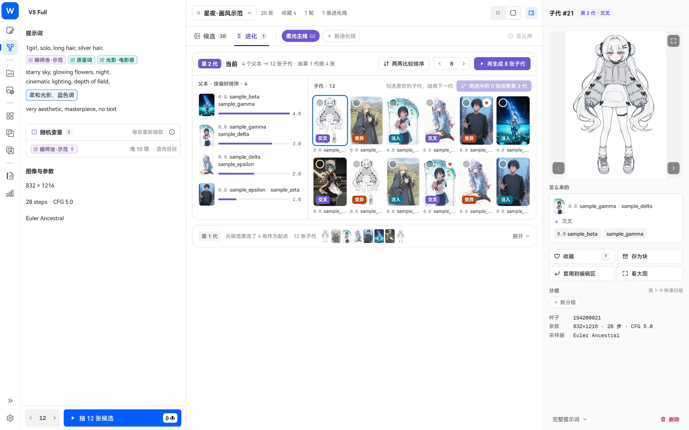

不知道哪几位画师混在一起好看？在画风探索里放一个随机画师池，一次抽几十张候选。挑出喜欢的几张，开始进化：程序会对它们的画师串做交叉、变异和注入新画师，生成下一代。你只管挑，几代之后画风就会朝你想要的方向靠拢。满意的组合可以一键存成积木。→ [画风遗传教程](docs/guide/zh-CN/style-explore.md)

### 翻译块、标签扩展与标签百科：看懂每一个标签

<table>
  <tr>
    <td width="50%">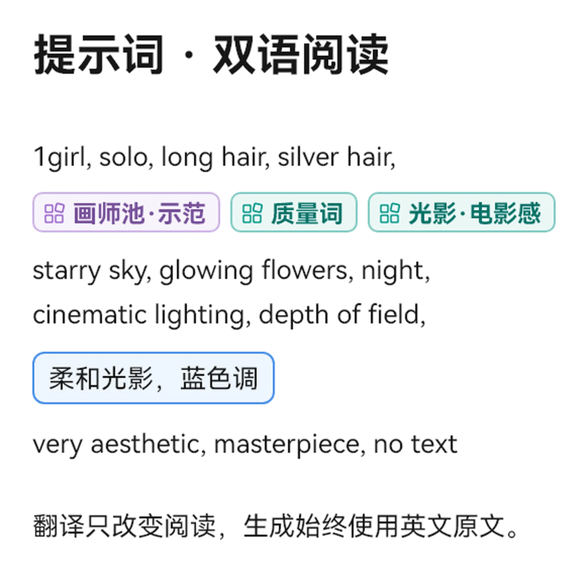</td>
    <td width="50%">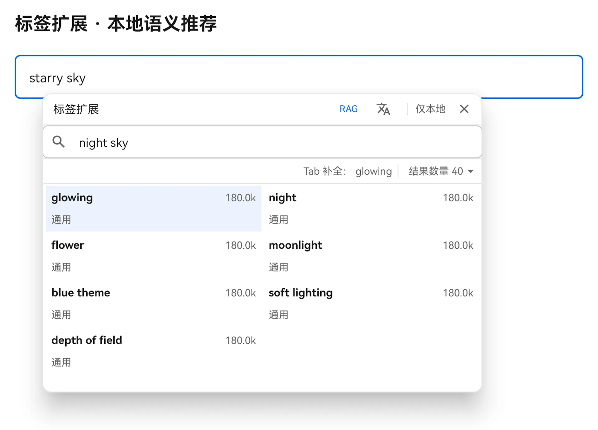</td>
  </tr>
  <tr>
    <td>
      <b>翻译块</b>：把英文提示词翻成中文在原位显示，中键一点就能在原文和译文之间切换。生成时永远使用原文，翻译只帮你读。翻译时会附上本地标签库和 Wiki 里命中的术语表，防止模型把画师、作品名当成普通词。→ <a href="docs/guide/zh-CN/translation.md">教程</a>
    </td>
    <td>
      <b>标签扩展</b>：<code>Ctrl+单击</code>提示词里的标签，搜索本地标签库；<code>Ctrl+拖选</code>一段，看哪些标签常和它一起出现。→ <a href="docs/guide/zh-CN/tags-wiki.md">教程</a>
    </td>
  </tr>
</table>

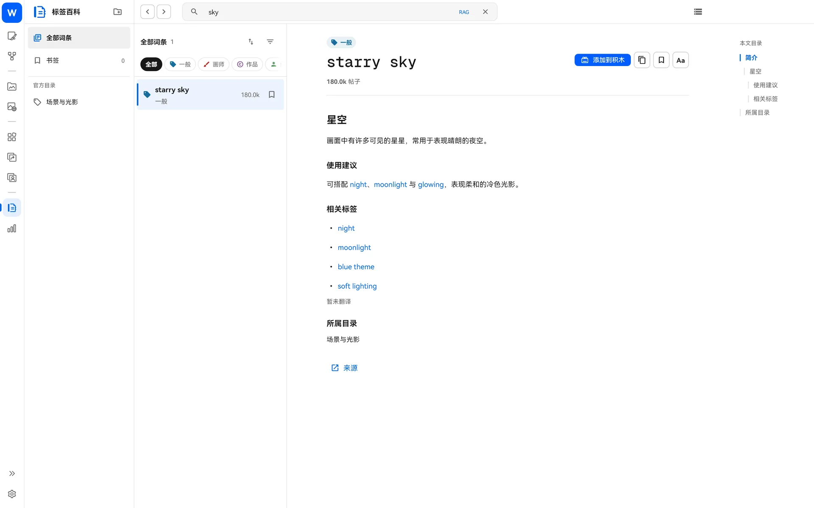

**标签百科**随软件附带本地 Danbooru Wiki，离线就能查一个标签是什么意思、常和什么一起用，并一键加进积木。

### 本地语义检索（RAG）：用意思找东西

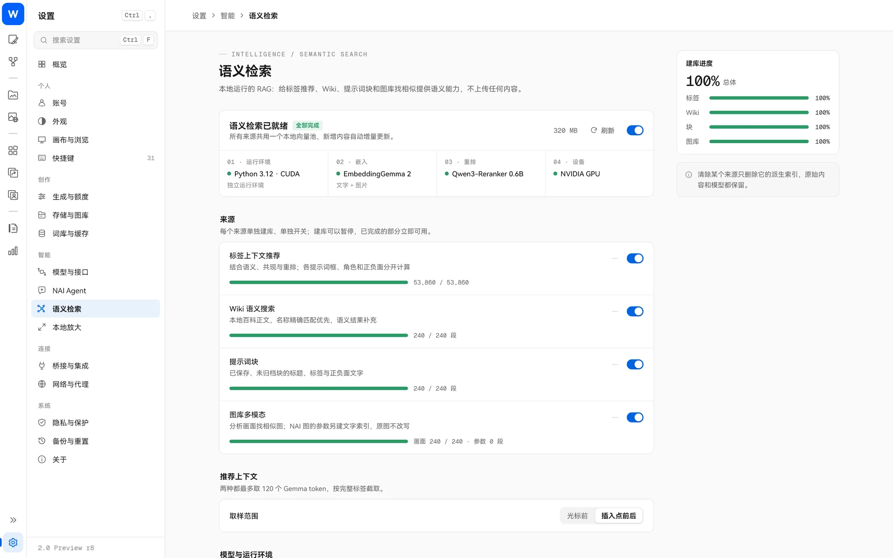

可选组件。开启后，标签推荐、标签百科、积木库和本地画廊都能按“意思”搜索：输入“下雨的街道”也能找到相关的英文标签、积木和你以前画过的图，还能用一张图找相似的图。全部在你的电脑上运行，不上传任何内容。→ [语义检索教程](docs/guide/zh-CN/rag.md)

### NAI Agent：把杂活交给 AI 助手

<table>
  <tr>
    <td width="62%">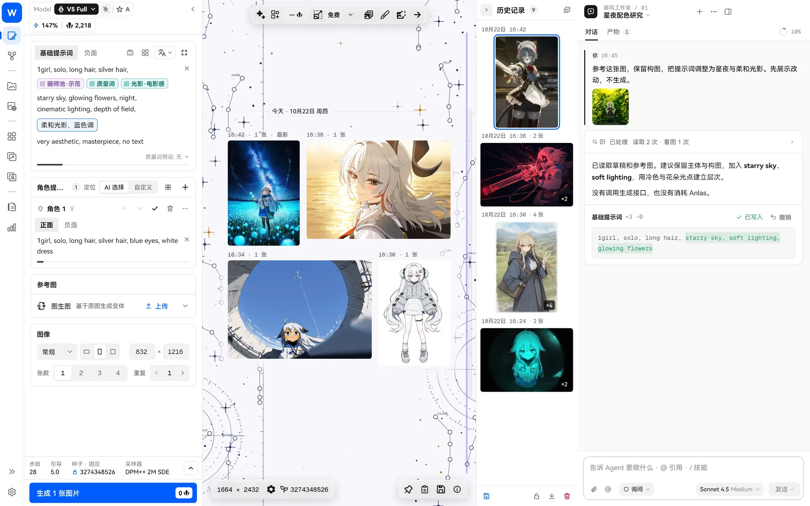</td>
    <td width="38%">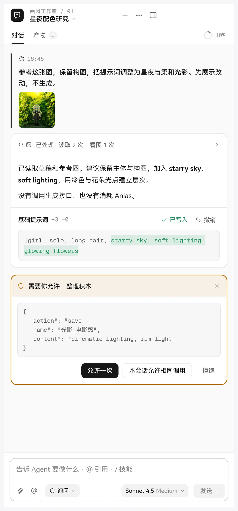</td>
  </tr>
</table>

在生图页或画风探索页打开侧栏，用聊天的方式让 AI 帮你改提示词、查标签和百科、整理积木和图库、设置参考图，甚至准备一次生成。它使用你自己在“模型与接口”里配置的大模型服务。

- 修改、删除、运行命令前会先问你，权限分只读、询问、自动、完全四档；
- **模型主动发起生图时，任何档位都要你在价格卡上亲自确认**；提示词组卡由你点击“生成”直接授权单张生成，不再二次确认；
- 一次写好一组提示词（几幕故事、一组试衣、几个分镜），在提示词组卡里逐项切换、导入画布或单张生成；
- 支持技能（Skill）、MCP 服务器和 CodeMode，可以按自己的工作流扩展。

→ [NAI Agent 教程](docs/guide/zh-CN/nai-agent.md)

### 无限画布与视觉通道

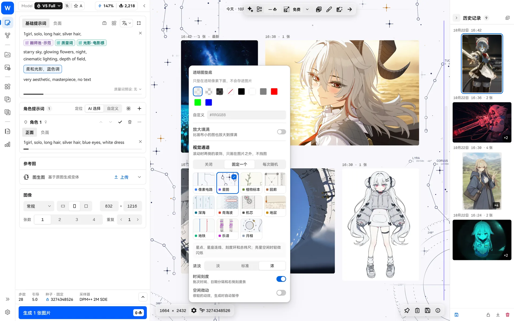

生成结果按批次铺在一张可以无限拖动的画布上，滚轮平移、`Ctrl+滚轮`缩放、WASD 导航，按住空格看局部重绘前的原图。画布两侧可以开启“视觉通道”装饰：星图、像素电路、深海、地铁等 11 种主题，只画在图片之外，不挡图。→ [画布教程](docs/guide/zh-CN/canvas.md)

### 本地画廊与在线画廊

<table>
  <tr>
    <td width="50%">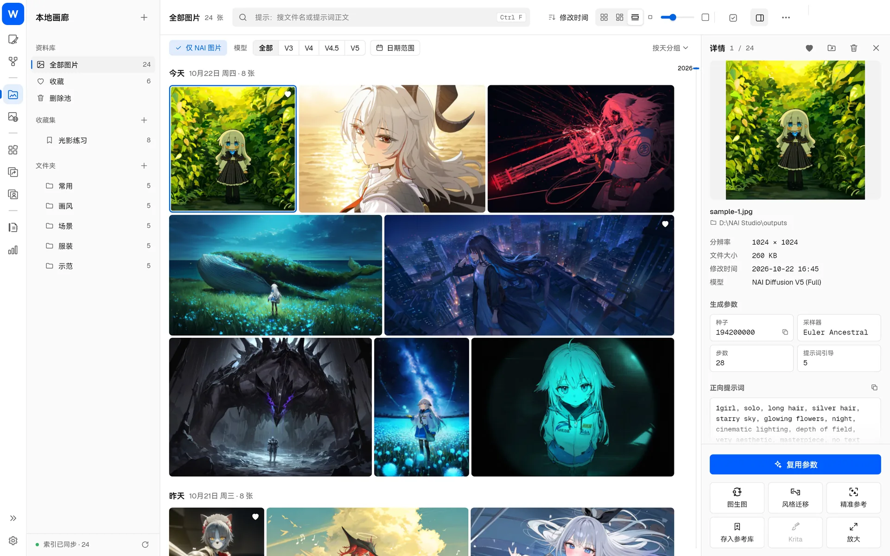</td>
    <td width="50%">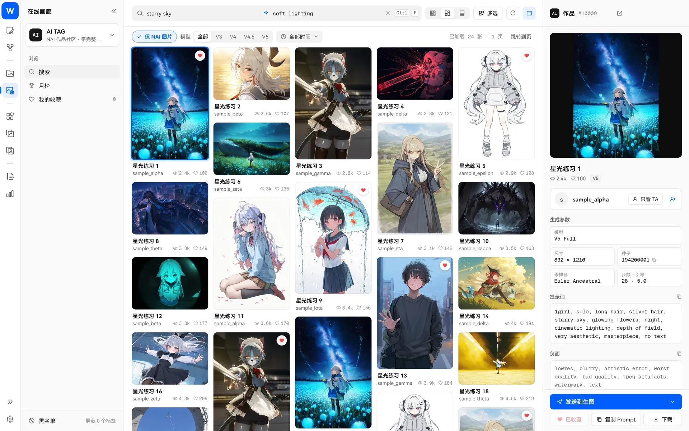</td>
  </tr>
</table>

- **本地画廊**：多个图库文件夹统一浏览，按天或月分组的连续时间线，按提示词搜索，收藏集、批量移动和删除池；任何一张 NAI 图都能一键复用参数。
- **在线画廊**：Danbooru、Safebooru、Gelbooru、AI TAG 四个来源，支持排行榜、收藏和黑名单，看到喜欢的作品可以直接复用它的生成参数。

→ [画廊教程](docs/guide/zh-CN/gallery.md)

### 参考图、导演工具、局部重绘与放大

<table>
  <tr>
    <td width="50%">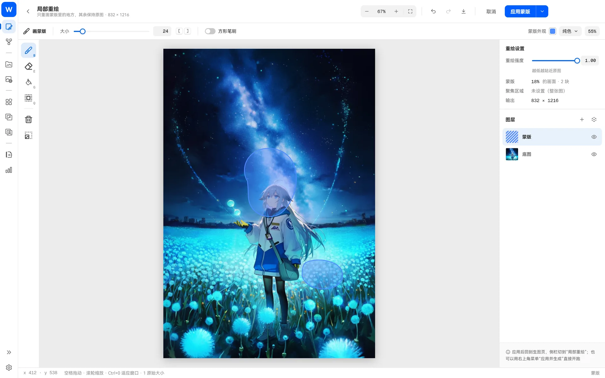</td>
    <td width="50%">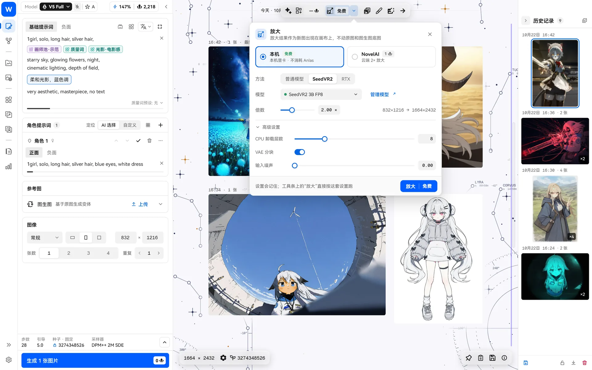</td>
  </tr>
</table>

- **风格迁移与精准参考**：参考图库统一管理 Vibe 和精准参考，编码过的 Vibe 可以重复使用；
- **导演工具**：背景移除、线稿提取、上色、表情修复、像素对齐等；
- **局部重绘**：画笔、选区、魔棒、图层齐全的全屏编辑器，画完直接“应用并生成”；
- **放大**：NovelAI 云端放大，或在本机用 Real-ESRGAN、NVIDIA RTX Video、SeedVR2 放大，不花 Anlas。

→ [图像工具教程](docs/guide/zh-CN/image-tools.md)

### 还有这些

- **NovelAI 全模型**：V1 到 V4.5、V5（Full / Curated）、多角色框和角色定位、透明背景、Anlas 实时估算和高消耗提醒；
- **统计**：创作日历、模型与产量、Anlas 消耗，点图表直接跳到当天的图；
- **本机桥接**：外部脚本或 AI 工具可以通过随附的 `studio-bridge`（Windows 上是 `studio-bridge.exe`）读写参数，生图前同样要报价确认；也支持 Krita 插件联动；
- **快捷键**：按 `F1`（Mac 上是 `⌘/`）查看全部快捷键，都能自定义；
- **五种界面语言、浅色和深色主题**。

## 隐私与网络

- 账号 Token 和各家 API 密钥保存在本机。Windows 使用系统安全存储。macOS 使用当前用户专用的加密凭据文件；从旧的钥匙串版升级时需要重新输入密钥。
- 只有这些情况会联网：调用 NovelAI 接口；使用你自己配置的翻译或 Agent 模型服务；浏览在线画廊；检查更新；以及你主动点击下载的可选组件（语义检索模型、放大模型等）。
- 语义检索、本地放大、图库整理都在本机完成。
- 自动翻译默认关闭；Danbooru 在线关联标签只发送相关的标签，不发送完整提示词。

更多问题见 [常见问题](docs/guide/zh-CN/faq.md)。

## 教程目录

| 教程 | 内容 |
| --- | --- |
| [快速上手](docs/guide/zh-CN/quick-start.md) | 安装、登录、第一次生成、数据位置 |
| [积木](docs/guide/zh-CN/blocks.md) | 固定 / 顺序 / 随机、锁定、权重规则、典型用法 |
| [画风遗传](docs/guide/zh-CN/style-explore.md) | 抽候选、开始进化、两两比较、存为积木 |
| [翻译块](docs/guide/zh-CN/translation.md) | 配置翻译模型、双语阅读、切换与还原 |
| [标签扩展与标签百科](docs/guide/zh-CN/tags-wiki.md) | 本地标签搜索、关联标签、离线百科 |
| [本地语义检索](docs/guide/zh-CN/rag.md) | 安装、建库、在哪些地方能用 |
| [NAI Agent](docs/guide/zh-CN/nai-agent.md) | 配置模型、权限、生图确认、技能与 MCP |
| [无限画布与视觉通道](docs/guide/zh-CN/canvas.md) | 画布操作、原图对比、装饰主题 |
| [画廊](docs/guide/zh-CN/gallery.md) | 本地画廊整理、在线画廊浏览与复用 |
| [图像工具](docs/guide/zh-CN/image-tools.md) | 参考图、导演工具、局部重绘、放大 |
| [常见问题](docs/guide/zh-CN/faq.md) | 安装提示、数据备份、旧版迁移、隐私 |

<details>
<summary><b>从源码构建</b></summary>

两个平台都需要 Flutter 3.47.7（见 `tool/flutter-sdk.json`）和 Git LFS：

```bash
git clone https://github.com/z15087716457-stack/W.O.F_NAI_Launcher.git
cd W.O.F_NAI_Launcher
git lfs install && git lfs pull
flutter pub get
dart run tool/generate.dart
flutter gen-l10n
```

**Windows**：需要 Windows 10/11 x64、Visual Studio 2022 的“使用 C++ 的桌面开发”和 NuGet CLI。

```bash
flutter build windows --release --no-tree-shake-icons
```

打包安装版与便携版用 `scripts/package_windows_release.ps1`。

**macOS**：应用主体的部署目标为 macOS 12，随包 Node 需要 macOS 13.5 及以上。构建需要完整的 Xcode（只装命令行工具不够）、CocoaPods 和 rustup（拖放和剪贴板用的 `super_native_extensions` 要编译 Rust）。发布构建要在 Apple 芯片的 Mac 上做，并装好 Rosetta（`softwareupdate --install-rosetta`）：`studio-bridge` 的 Intel 版用 x64 的 Dart SDK 编译。

```bash
scripts/build_macos.sh --release
scripts/package_macos_release.sh
```

`build_macos.sh` 构建通用应用包，并放进 NAI Agent 的 Node 运行时、Pi、`studio-bridge` 和本地放大用的 Real-ESRGAN；`package_macos_release.sh` 检查后打成 `dist/WOF_NAI_Studio_macOS_<版本>_Portable.zip`。默认 ad-hoc 签名，有 Apple 开发者证书时用环境变量 `CODESIGN_IDENTITY` 指定。改了 `tool/branding/wof_icon.svg` 后，用 `tool/branding/generate_macos_icons.sh` 重新生成 Mac 图标（需要 `rsvg-convert`，即 Homebrew 的 librsvg）。

开发约定见 [DEVELOPMENT.md](DEVELOPMENT.md)，版本记录见 [CHANGELOG.md](CHANGELOG.md)。

</details>

## 致谢与许可

- 本项目分支自 [Aaalice233/Aaalice_NAI_Launcher](https://github.com/Aaalice233/Aaalice_NAI_Launcher)（MIT），感谢原作者的开源工作。本分支与上游作者无关，问题请提到本仓库的 Issues。
- 画风遗传的算法思路参考 [monineko/PromptCard-Studio](https://github.com/monineko/PromptCard-Studio)（GPL-3.0），本项目为独立的 Dart 实现，未复制其源码。
- NAI Agent 基于 [Pi](https://github.com/earendil-works/pi)（MIT）。
- 本项目以 [MIT License](LICENSE) 开源；随附的数据、字体和组件遵循各自许可，详见 [第三方声明](THIRD_PARTY_NOTICES.md)。

README 中的界面截图使用演示数据渲染，示例提示词与画师名均为虚构。
