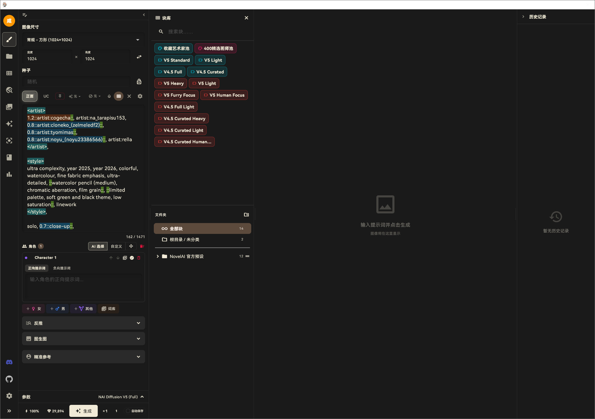
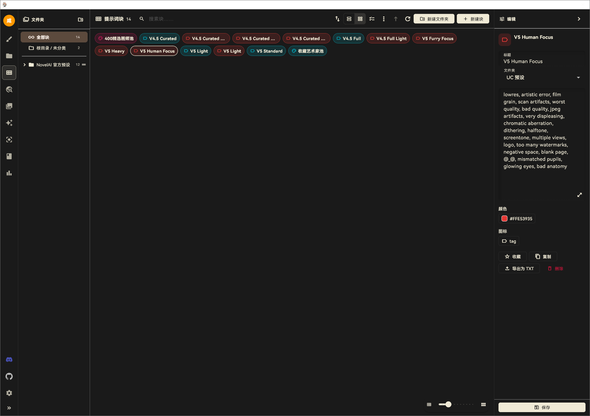
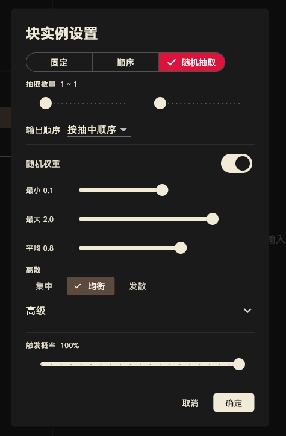
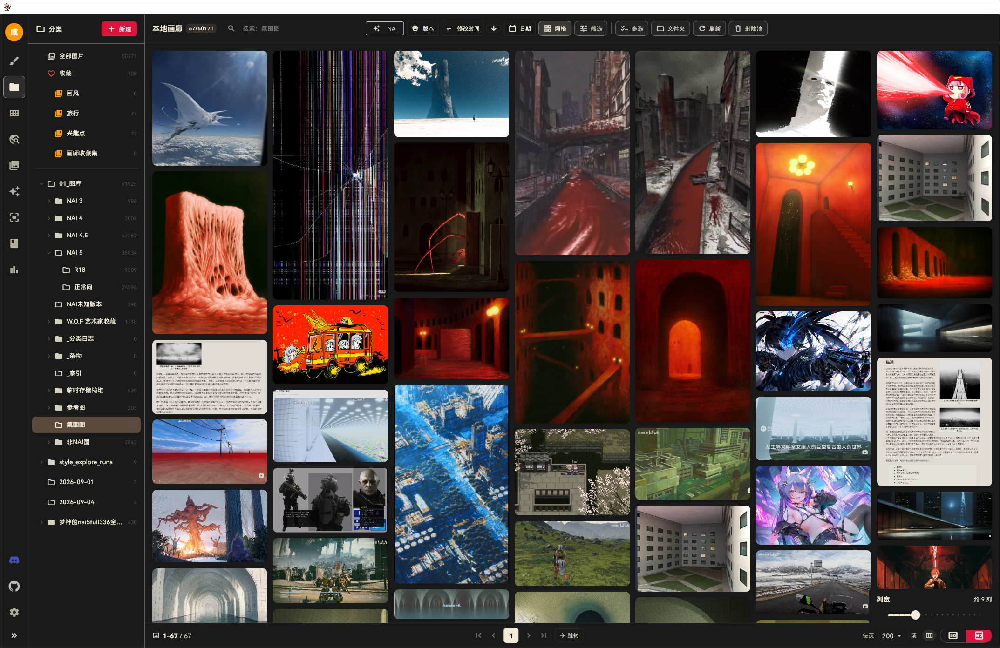

# W.O.F NAI Studio

<p align="center">
  简体中文 | <a href="README.en-US.md">English</a>
</p>

<p align="center">
  
</p>

<p align="center">
  <strong>面向 NovelAI 图像生成的第三方桌面客户端</strong>
</p>

<p align="center">
  <a href="https://github.com/z15087716457-stack/W.O.F_NAI_Launcher/releases"></a>
  
  
  
</p>

> **本仓库是 [Aaalice233/Aaalice_NAI_Launcher](https://github.com/Aaalice233/Aaalice_NAI_Launcher)（MIT）的个人分支（W.O.F 版）**，功能基线为上游 v1.5.3，版本号从 1.0.0 重新编排。本分支持续维护 V5 模型、桥接填参、画风探索遗传等扩展功能，与上游作者无关，问题反馈请提到本仓库的 Issues。
>
> 画风探索的遗传算法思路参考自 [monineko/PromptCard-Studio](https://github.com/monineko/PromptCard-Studio)（GPL-3.0），本仓库中的实现为 Dart 重写，未复制其源码，详见 [THIRD_PARTY_NOTICES.md](THIRD_PARTY_NOTICES.md)。

W.O.F NAI Studio 是一个使用 Flutter 构建的 NovelAI 第三方客户端。它把图像生成、图生图、局部重绘、Vibe / Precise Reference、本地图库、在线图库、生成队列、Krita 联动和统计工具整合在一个桌面应用里，适合日常生成、批量出图和长期管理本地作品。

> 本项目不是 NovelAI 官方产品。使用前请确保你拥有自己的 NovelAI 账号，并遵守 NovelAI 的服务条款。


> 本文描述当前源码能力。近期 Studio、翻译与图库改动仍列在 CHANGELOG 的 `[Unreleased]`；下载包具备哪些功能，以该包对应 Release 的说明为准。既有界面截图保留为早期示意。

> 当前版本为 **2.0 Preview**（Windows x64 本地便携预览通道），包含 UIUX 九页整合、完整 NAI Agent 及后续画布、图标、工具条、Vibe 编码和 OLD 对比修复。便携包解压后运行，配置仍使用原有应用数据目录；请使用自己的账号。来源见 [整合记录](docs/uiux-integration-2026-10-13.md)，本批交付见 [2.0 Preview 记录](docs/studio-2-preview-2026-10-14.md)。本地交付不代表已经发布 GitHub Release。

## ✨ 功能概览

| 能力 | 说明 |
| --- | --- |
| 🎨 图像生成 | 支持 NovelAI Diffusion V1/V2/V3/V4/V4.5/V5（Full / Curated）、Furry 系列、常用采样器、尺寸预设、多角色参数和 Anlas 估算。 |
| 🖼️ 图生图与编辑 | 支持图生图、局部重绘、Outpaint、虚拟画布扩图、硬边蒙版和点击式区域填充。 |
| 🌈 参考与风格 | 支持 Vibe Transfer、Precise Reference、多图参考、Vibe 整包导入导出、PNG 元数据嵌入导出。 |
| ✍️ Prompt 工具 | 内置完整离线 Danbooru/e621 合并标签、别名及 Danbooru 共现关系补全，支持 `Ctrl/⌘+Shift+Space` 查询光标前标签的相关词、固定来源标签后连续选词、Danbooru 在线相关标签补充与 AI 标签汉化，以及 NAI/SD 权重语法辅助、Token 统计、提示词框内搜索和固定词；另有贯穿全器的 pill 提示词块系统，见下方特色介绍。 |
| 📚 本地图库 | 支持多图库源递归扫描、侧栏/图片墙/详情三栏、按天分组连续浏览与时间轴、SQLite 全文搜索、分类/收藏集/删除池、模型版本过滤、详情面板一键复用参数、批量操作和大图预览。 |
| 🌐 在线图库 | 支持 Danbooru / Safebooru / Gelbooru / AI TAG 搜索、真实排行榜、多图详情、元数据复用和批量下载。 |
| 📦 生成队列 | 支持任务排序、批量生成、暂停/继续、失败策略、进度统计和队列导入导出。 |
| 🔌 外部联动 | 支持 Krita 全参数桥接（AI 接管）、ComfyUI 本地工作流、系统代理、图片复制和文件定位。 |

### 在线画廊来源

- **Danbooru / Safebooru**：支持标签、日期搜索，以及指定日期的日榜、周榜和月榜；Danbooru 可登录并管理收藏，Safebooru 使用 `safebooru.donmai.us` 匿名只读访问。
- **Gelbooru**：支持公开搜索；配置 API 凭据后可加速搜索并浏览只读网站收藏，不提供伪造的本地排行榜。
- **AI TAG**：支持作品/作者/标题/标签/模型综合搜索和原样 Prompt 语法搜索（如 `::artist:`），时间范围由来源实时配置；支持实时月榜、历史月榜和旧月份归档。多图详情可切换、预取和逐图复用 NAI / Stable Diffusion / ComfyUI 元数据，并支持下载当前图片或作品全部图片。本分支新增**本地收藏系统**：作品收藏（可归入子集）与作者收藏保存在本地独立数据库、收藏列表离线可看，无需站点账号；详情页可收藏作者并一键查看该作者的作品——直接在前端筛选呈现、不跳外部链接，搜索栏保留返回入口，随时回到你当前的浏览进度。

## 🚀 W.O.F 版特色

> 本分支基于上游 v1.5.3，围绕「提示词资产化 + 画风定向探索」重做了多个子系统。完整变更见 [CHANGELOG.md](CHANGELOG.md)。

### 💊 pill 提示词块系统 —— 贯穿全器的提示词中枢

把提示词拆成可复用的「块」：画师池、质量词、UC 预设、画风串都是块。生成页右侧常驻块库面板，点一下就把块插进当前提示词；块在正文里以药丸形态内联显示，分块高亮、即点即改，正向、负向、角色框全部通用。

- **三种实例模式**：固定原样输出；顺序按序轮转（药丸角标 →，卡片内 ←→ 逐幕步进）；随机抽取支持数量范围、Split-Beta 权重分布、触发概率，一次生成多张时逐张重抽。
- **块管理页**：文件夹树 + ⭐收藏集双区侧栏（比例可拖并持久化）、网格/列表/瀑布流三视图按子文件夹分段吸顶浏览、多选批量操作、块缩略图与取景裁剪、颜色与标签自定义、悬停预览 + 右侧详情面板、正负配对内容；内置 NovelAI 官方预设块。旧单块 TXT 导出入口已改为标签管理。
- **积木悬浮板 + 生图页块库面板**：常用块拖进积木悬浮板即点即插；块库面板按文件夹子树过滤、上下分割比例可拖且持久化。
- **实例级锁定与「进化目标」DNA 角标**：标定哪些块参与变异——这是画风探索的接口。

<p align="center">
  
  <br>
  <em>早期生图界面示意。当前源码采用 A 精修模块卡片、紧凑参数行与批次历史；本轮尚未安装，见 CHANGELOG。</em>
</p>

<table align="center">
  <tr>
    <td width="62%"></td>
    <td width="38%"></td>
  </tr>
  <tr>
    <td align="center"><em>块管理页：文件夹树、多选批量操作</em></td>
    <td align="center"><em>块实例设置：三种模式与权重分布</em></td>
  </tr>
</table>

### 🧬 画风探索 · 多池遗传

对着一个画风方向批量出候选，再用遗传算法逐代收敛：基础轮每张候选独立快照留档；挑中喜欢的设为父本，深度轮对父本做变异 / 交叉 / 随机注入产出下一代；两两比较打偏好分，谱系面板可回溯任意子代的完整祖先链。选定的画风串一键「收编为块」，回到 pill 系统直接参与生成。

- 三栏探索页 + 网格 / 牌堆双视图，分区可拖拽调宽。
- 全屏正式筛选：键盘 T/S/R 打标、固化模板、Reject 批量删图。
- 基础轮逐张快照、深度轮不污染当前草稿。
- 算法思路参考 [monineko/PromptCard-Studio](https://github.com/monineko/PromptCard-Studio)（GPL-3.0），本仓库为 Dart 重写实现，未复制其源码。

> 📖 不会用？看图文教程：[docs/style-exploration.md](docs/style-exploration.md)（从开遗传到建家族、深度迭代、收编为块全流程）。

### 🎨 NovelAI Diffusion V5（N5）完整支持

能力位注册表驱动：V5 Full / Curated（含 inpainting 互转）、最多 32 个角色框、token 上限 1471、官网口径 ×1.5 计价、透明背景开关（straight_alpha）、Enhance Max✨ 服务端 e2e 放大、V5 质量词与 UC 预设。

### 🔌 开放桥接 · 任意 Agent 直接接管

启动器内置本地桥接协议，**任何外部 Agent 工具、脚本或工作流都能直接接入**——使用每次启动生成的本地端口与 secret 认证，按当前协议控制支持的操作：

- **参数控制**：`set_params` 写入支持的提示词、尺寸、种子、采样与角色等字段，`generate` 经桥接返回图片路径；复杂参考图有独立读写边界，使用前核对当前 CLI 和 handler。
- **状态回读**：`get_params` 返回生效提示词、角色、模型参数、参考图与 Token 用量；能读不代表每个字段都能原样回写，角色数组写入会替换整表。
- **配套工具链**：`tool/nai_bridge_client.py` CLI（get / set / set-json / gen / ui-gen / cancel）、`tool/nai_fill.py` 一键读图填入、`tool/bridge_selfcheck.py` 按范围自检——照着 CLI 的源码即可写出任意语言的接入方。
- 应用内自动更新接入本仓库 Releases（v1.0.1 起），桥接扩展不会被上游更新覆盖。

### 🖼️ 画廊大版本

本地画廊采用资料库 / 收藏集 / 文件夹侧栏、连续图片墙和详情检查器。网格、瀑布流、火车流共用缩略图大小；默认火车流按等高行排版、保持原比例不裁切，未满末行靠左。没有分页，可按天 / 月分组、拖时间轴定位、单图查看、多选和复用参数；顶栏搜索自适应，标题和空白可拖窗。多图库源、删除池、NAI / 模型 / 标签 / 日期筛选、高清 / 标清缩略图、向外拖出与字节去重保留。在线画廊仍使用独立的本地收藏和 AI TAG 作者查询。

<p align="center">
  
  <br>
  <em>历史图库截图；当前为上文描述的三栏连续时间线布局。</em>
</p>

### ➕ 更多改进

- 角色卡官网式常驻编辑器：选中跟随焦点，输入框随内容自增高（3~12 行）。
- Opus 免费额度芯片：官方 `usage.percent` + 回充倒计时；免费资格对齐官方实证，PR / img2img / 局部重绘不再误取消免费。
- 游客模式：登录页可跳过登录，离线使用全部本地功能，纯内存会话不驻留。
- 统一 NAI 词法扫描器与数值权重尾守卫；移除失焦空格自动转下划线；元数据按 Magic Byte 解析 PNG / WebP / JPEG；AI TAG 在线画廊反防盗链。

### 🌐 翻译、模型配置与多语言

- 双语提示词块支持整组 / 单块切换、编辑、重译、原文还原与撤销；阅读译文不改变保存的生成原文。
- 「模型与接口」提供服务管理、目录 / 已选模型双栏、手动模型 ID、目录持久缓存和连接测试；上下文、最大输出、推理与采样参数属于模型，功能接口和提示词预设不覆盖参数。能力标记是配置记录，不代表内置 Agent 执行端已接入。
- 界面支持简体中文、台湾正体、英文、日文与韩文。主界面字号固定 100%，设置页、菜单与弹窗共用自己的缩放。
- 拖入、粘贴与画廊参数复用共用紧凑图片使用窗口，明确选择导入项；种子默认不勾选，角色可以替换或追加。

## 🧩 平台支持

| 平台 | 状态 | 说明 |
| --- | --- | --- |
| Windows | 可用 | 唯一开发和发布平台，支持系统托盘、窗口状态保存、视频播放、剪贴板和文件定位。 |

## 📦 下载与安装

前往 [Releases](https://github.com/z15087716457-stack/W.O.F_NAI_Launcher/releases) 下载最新版本。应用会在登录前后持续提示可用更新（更新源指向本仓库），并完整渲染 Release 中的 GitHub Flavored Markdown 更新日志（标题、列表、表格、引用、代码、链接与图片）。

| 平台 | 下载文件 | 使用方式 |
| --- | --- | --- |
| Windows | `NAI_Launcher_Windows_<version>_Setup.exe` | 安装版，推荐普通用户，安装到当前用户目录；支持应用内断点下载、校验、自动安装并重启。手动运行安装包时也会检测并关闭托盘中的旧版本。 |
| Windows | `NAI_Launcher_Windows_<version>_Portable.zip` | 便携版，解压后运行 `nai_launcher.exe`；应用内更新会暂存新版、保留用户文件、原子切换目录，失败时自动回滚并重启旧版。 |

首次登录可以使用 NovelAI 账号密码或 API Token。账号数据仅保存在本地设备，桌面端使用系统安全存储保存敏感信息。

### 标签、翻译与隐私

- 随包提供离线标签 / 别名 catalog 与本地英文 Wiki，不再分发或下载 ffdkj 中文词库。新增独立的中文语义补充资料，含 53,860 条标签的同义词、核心词及可用简释义；资料与按需读取入口已就绪，当前标签搜索尚未切换到新版检索链路。
- 可选的标签 / Wiki 自动翻译默认关闭。开启后使用配置的「标签翻译」「百科翻译」接口，按最新可见范围优先调度，默认最多 5 个并发；标签名称请求包含可用的完整本地 Wiki 作为语义背景，正文仅在打开时请求翻译。
- 提示词翻译向所选服务发送需要翻译的普通文字段与命中术语；双语块另存生成原文。共用术语表可带中文译名、简短释义及释义语言，缺少 / 过期中文释义时提供标明来源语言的短原文，不额外请求模型补表。
- 译文写入独立本地缓存，不覆盖标签库 / Wiki，旧结果继续可读。所选服务的请求可能产生费用，按该服务配置和价格使用。
- 可选 Danbooru 在线关联只发送相关标签，不发送完整提示词；相关控制与清缓存位于「设置 → 词库与缓存」。

## 🛠️ 从源码构建

### 环境要求

- Flutter `3.44.2`（项目最低要求 Flutter `3.35.0` / Dart `3.10.7`）
- Git LFS，用于拉取 `assets/databases/*.db`
- Visual Studio 2022 Desktop development with C++
- [NuGet CLI](https://learn.microsoft.com/nuget/install-nuget-client-tools)，`nuget.exe` 所在目录必须加入 `PATH`

### 通用步骤

```bash
git clone https://github.com/z15087716457-stack/W.O.F_NAI_Launcher.git
cd W.O.F_NAI_Launcher

git lfs install
git lfs pull --include="assets/databases/*.db"

flutter pub get
dart run build_runner build --delete-conflicting-outputs
flutter gen-l10n
flutter analyze
flutter test
```

### Windows

```powershell
pwsh -NoProfile -ExecutionPolicy Bypass -File scripts/verify_nuget.ps1
flutter build windows --release
```

`flutter_inappwebview` 的 Windows 实现会在编译阶段通过 NuGet 获取 WebView2 SDK 等原生依赖。`verify_nuget.ps1` 检查失败时，请先安装 NuGet CLI，并确认新 PowerShell 窗口中可以直接运行 `nuget help`。

产物目录：

```text
build/windows/x64/runner/Release/
```

Windows 桌面开发可启动独立热重载会话：

```powershell
pwsh -NoProfile -ExecutionPolicy Bypass -File scripts/dev_hot_reload_window.ps1
```

代码修改后可从任意终端安全触发现有会话，不会启动第二个 `flutter attach`：

```powershell
pwsh -NoProfile -ExecutionPolicy Bypass -File scripts/trigger_hot_reload.ps1
# 需要重置应用状态时：
pwsh -NoProfile -ExecutionPolicy Bypass -File scripts/trigger_hot_reload.ps1 -Restart
```

需要检查实际桌面窗口时，可直接截图到项目临时目录（窗口被遮挡时也可直接渲染）：

```powershell
pwsh -NoProfile -ExecutionPolicy Bypass -File scripts/capture_dev_window.ps1
# 自定义输出路径或不激活窗口：
pwsh -NoProfile -ExecutionPolicy Bypass -File scripts/capture_dev_window.ps1 -OutputPath tool/.tmp/ui.png -NoActivate
```

## 🚀 发布流程

发布由 GitHub Actions 的 `Release` workflow 处理。推送 `v*` tag 后，工作流会构建 Windows 安装版与便携版，并生成 `release_manifest.json`、`checksums.txt` 与 Release notes。Release 页面会生成带平台图标的 Setup / Portable 直达下载按钮。

```bash
git tag v1.0.0
git push origin main
git push origin v1.0.0
```

发布前请确保：

- `pubspec.yaml` 版本号已更新；tag 必须匹配去掉 `+build` 后的版本，例如 `1.0.0+17` 对应 `v1.0.0`。
- `CHANGELOG.md` 已按 `✨ 新增`、`🛠 改进`、`🐛 修复` 分类补好；发布文件表由脚本自动生成，不要写入 Changelog。
- `assets/databases/tag_catalog.db` 与 `assets/databases/cooccurrence.db` 是真实 SQLite 文件而不是 Git LFS pointer，并已通过 `dart run tool/tag_catalog/verify_bundled_databases.dart` 校验。
- Windows 安装器依赖 NSIS；本地打包可运行 `pwsh -NoProfile -ExecutionPolicy Bypass -File scripts/package_windows_release.ps1`。
- 正式签名可配置 GitHub Secrets `WINDOWS_SIGNING_CERT_BASE64`（PFX 的 Base64）和 `WINDOWS_SIGNING_CERT_PASSWORD`。工作流会在打包前签名便携版主程序、打包后签名安装器，并用 `signtool verify` 强制验证；未配置证书时保持当前无签名构建。
- 本地签名统一使用 `scripts/sign_windows_binary.ps1`，例如：`pwsh -File scripts/sign_windows_binary.ps1 -Path dist/setup.exe -CertificatePath cert.pfx -CertificatePassword '<password>'`。

## 🗂️ 项目结构

```text
nai_launcher/
├── assets/                 # 图标、截图、音效、标签数据、预置数据库
├── installer/              # 安装器脚本
├── krita_plugin/           # Krita 插件与打包/验收脚本
├── lib/
│   ├── core/               # 网络、数据库、缓存、加密、文件、快捷键等基础能力
│   ├── data/               # API、模型、仓库和业务数据服务
│   ├── l10n/               # 简中/繁中/英/日/韩界面文案与生成文件
│   └── presentation/       # 页面、组件、状态管理、主题和路由
├── scripts/                # 构建、打包、签名、热重载与校验脚本
├── test/                   # 单元测试和组件测试
├── tool/                   # 开发工具、数据处理、图标生成和诊断脚本
└── windows/                # Windows runner
```

## 💻 开发约定

常用命令：

```bash
flutter pub get
dart run build_runner build --delete-conflicting-outputs
dart format lib test
flutter analyze
flutter test
```

提交信息使用：

```text
type(scope): 中文描述
```

常用 type：`feat`、`fix`、`refactor`、`perf`、`style`、`docs`、`test`、`chore`。

## 🤝 贡献

欢迎通过 Issue 和 Pull Request 参与。提交 PR 前请说明变更目标、影响范围、验证方式；涉及 UI 行为时，尽量附上截图或录屏。

## 🙏 致谢

- 感谢 [Aaalice233](https://github.com/Aaalice233/Aaalice_NAI_Launcher) 创作并开源上游项目（MIT），本分支在其 v1.5.3 基线上开发。
- 画风探索的遗传算法思路参考自 [monineko/PromptCard-Studio](https://github.com/monineko/PromptCard-Studio)（GPL-3.0），实现为 Dart 重写，详见 [THIRD_PARTY_NOTICES.md](THIRD_PARTY_NOTICES.md)。
- [NovelAI](https://novelai.net/) 提供图像生成服务。
- [Flutter](https://flutter.dev/) 提供跨平台 UI 能力。
- [Riverpod](https://riverpod.dev/) 提供状态管理能力。
- 感谢所有贡献者和测试用户。

## 📄 许可证

本项目基于 MIT License 开源，详见 [LICENSE](LICENSE)。原版权归属上游 NAI Launcher Contributors，本分支新增部分的版权归 W.O.F (z15087716457-stack)。

第三方中文语义补充数据保留来源项目 DanbooruSearchOnline 的 GPL-3.0 许可；原始 CSV、固定来源与转换工具见 [数据说明](tool/tag_semantics/README.md)，完整归属见 [第三方声明](THIRD_PARTY_NOTICES.md)。

界面使用随包提供的 Geist Sans / Mono / Pixel Line、HarmonyOS Sans SC 与韩文 Pretendard 字体，界面图标沿用原有图标。字体遵循各自许可，见 [素材说明](tool/branding/README.md) 与 [许可文件](assets/licenses/)；应用「关于」页亦可查看。
