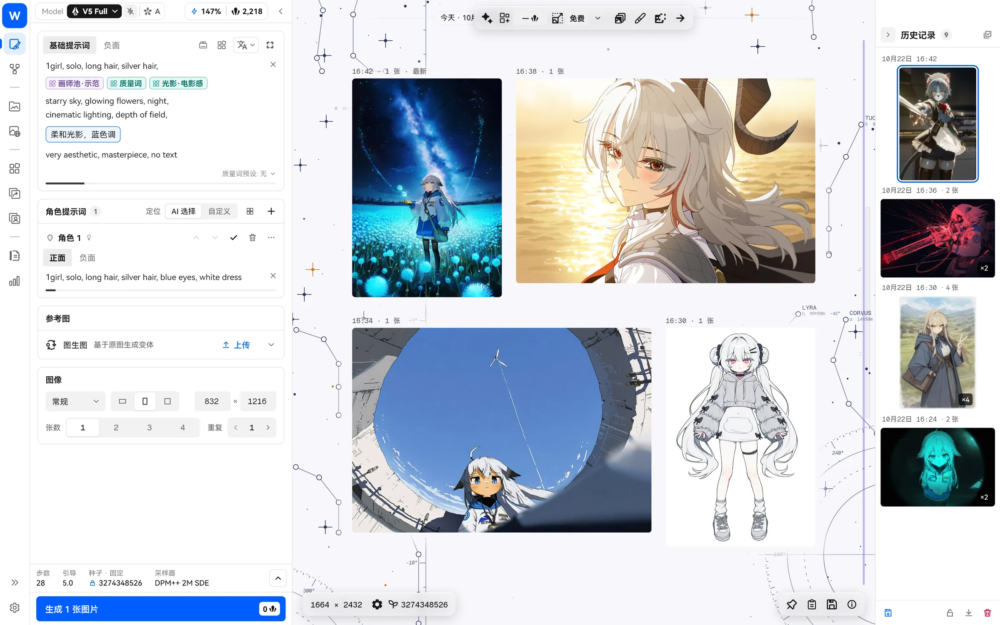
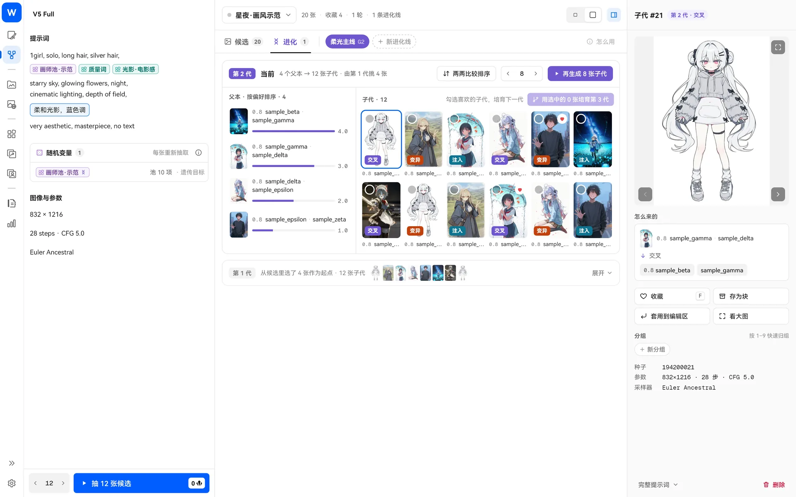
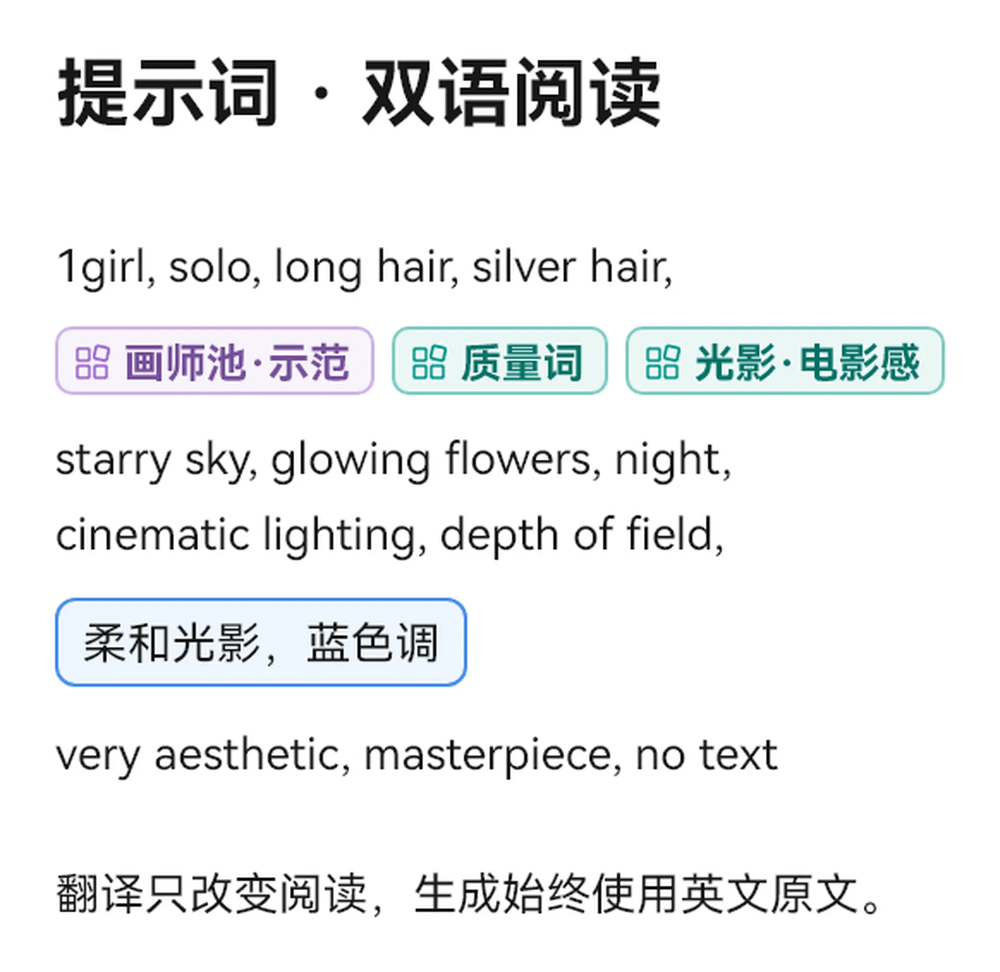
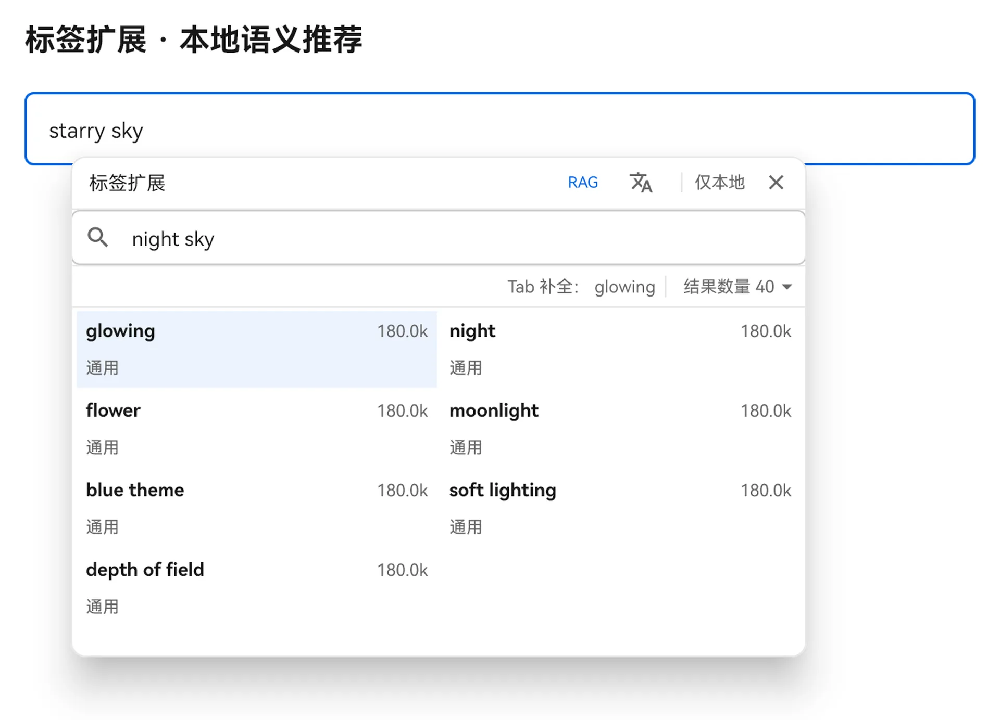
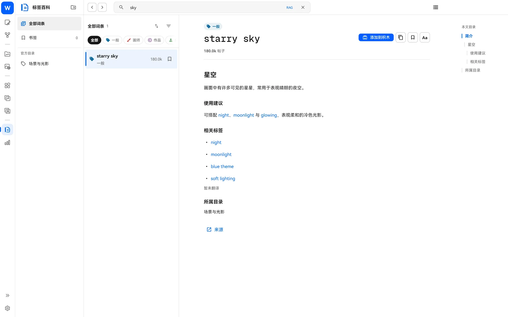
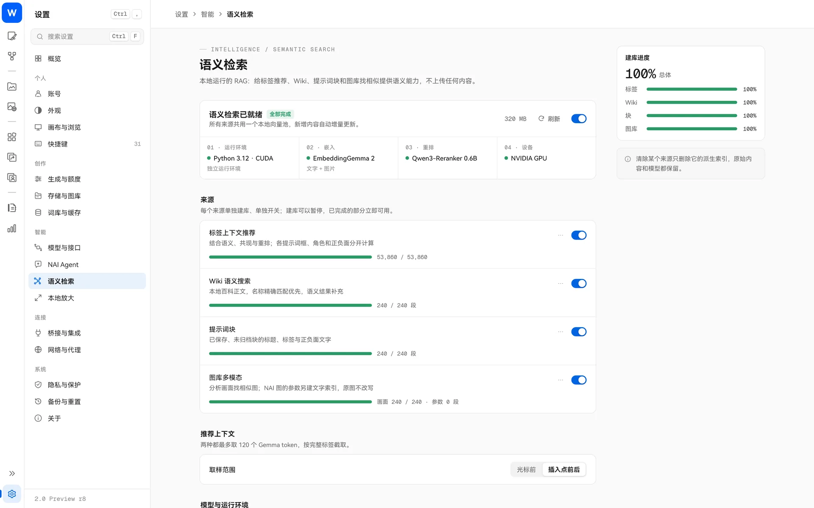
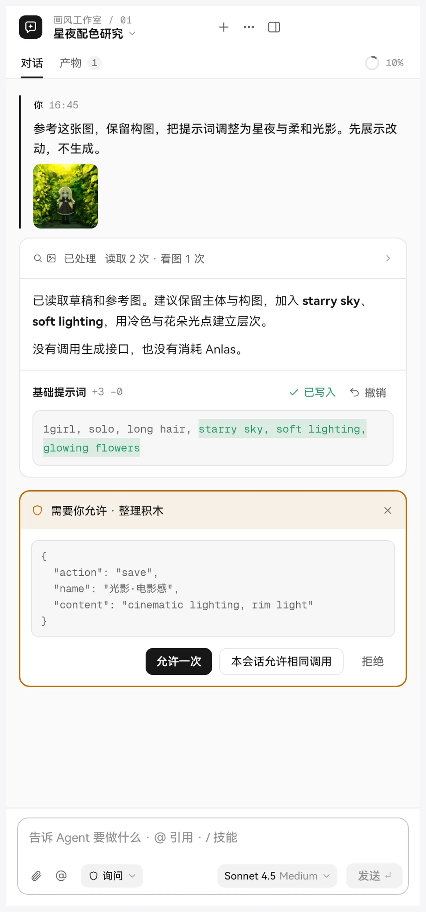
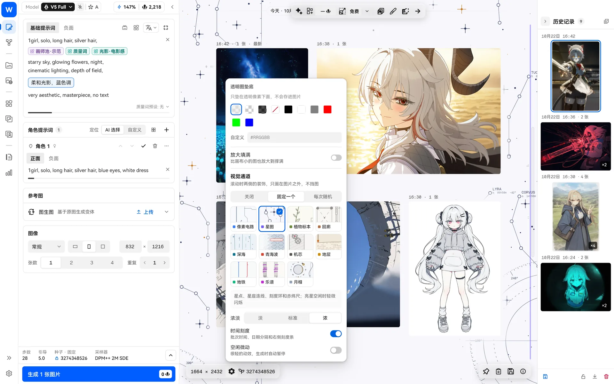

<p align="center">
  
</p>

<p align="center">
  <strong>简体中文</strong> ·
  <a href="README.zh-TW.md">繁體中文</a> ·
  <a href="README.en-US.md">English</a> ·
  <a href="README.ja.md">日本語</a> ·
  <a href="README.ko.md">한국어</a>
</p>

<h3 align="center">把 NovelAI 生图变成一套可以积累、可以复用的创作工作台</h3>

<p align="center">
  <a href="https://github.com/z15087716457-stack/W.O.F_NAI_Launcher/releases/latest"></a>
  
  
  <a href="LICENSE"></a>
</p>

<p align="center">
  
</p>

W.O.F NAI Studio 是一个 Windows 桌面上的 NovelAI 第三方客户端。它不只是把官网搬到桌面：常用的提示词可以存成**积木**反复使用，画师组合可以交给**画风遗传**一代代筛选，看不懂的标签有**翻译、标签百科和本地语义检索**帮忙，生成、整理、修图的杂活还可以交给内置的 **NAI Agent**。

> 这是非官方项目，与 NovelAI 无关。请使用你自己的 NovelAI 账号，并遵守 NovelAI 的服务条款。

## 下载

到 [Releases](https://github.com/z15087716457-stack/W.O.F_NAI_Launcher/releases/latest) 下载最新版本，二选一：

| 文件 | 适合谁 |
| --- | --- |
| `WOF_NAI_Studio_Windows_<版本>_Setup.exe` | **大多数人选这个。** 装到当前用户目录，不需要管理员权限，有开始菜单和桌面快捷方式。 |
| `WOF_NAI_Studio_Windows_<版本>_Portable.zip` | 想放在自己指定的文件夹、U 盘或多台电脑之间带着走。解压后运行 `nai_launcher.exe`。 |

两个版本都支持应用内更新。你的设置、图库数据库和 Agent 数据都放在程序旁边的 `user-data/` 和 `agent-data/` 里，升级和卸载都不会删除它们。

> 安装包暂未做代码签名，第一次运行时 Windows 可能提示“已保护你的电脑”。点“更多信息 → 仍要运行”即可。每个版本都附有 SHA-256 校验值。

## 三步上手

1. **登录**：用 NovelAI 的 API Token（推荐）或账号密码登录；也可以先用游客身份进入，体验本地功能。
2. **生成**：在左侧写提示词，按 `Ctrl+Enter`。结果会一批批铺在中间的画布上。
3. **积累**：把常用的画师串、质量词存成积木；满意的图自动进本地画廊，随时复用参数。

更详细的说明见 [快速上手](docs/guide/zh-CN/quick-start.md)。

## 能做什么

### 积木：写一次，反复用


把画师池、质量词、负面词、服装清单这些常用片段存成“积木”，拖进提示词就能用。每个积木可以设成三种方式：

- **固定**：每次原样放入，适合质量词和负面词；
- **顺序**：每次生成往后换一项，适合把一组服装或场景挨个试一遍；
- **随机**：每次从池里抽几项，还能设抽几个、出现概率和随机权重，适合批量试画师组合。

抽到满意的结果就**锁定**它，再去重抽别的积木。→ [积木教程](docs/guide/zh-CN/blocks.md)

### 画风遗传：让好看的组合自己“进化”



不知道哪几位画师混在一起好看？在画风探索里放一个随机画师池，一次抽几十张候选。挑出喜欢的几张，开始进化：程序会对它们的画师串做交叉、变异和注入新画师，生成下一代。你只管挑，几代之后画风就会朝你想要的方向靠拢。满意的组合可以一键存成积木。→ [画风遗传教程](docs/guide/zh-CN/style-explore.md)

### 翻译块、标签扩展与标签百科：看懂每一个标签

<table>
  <tr>
    <td width="50%"></td>
    <td width="50%"></td>
  </tr>
  <tr>
    <td>
      <b>翻译块</b>：把英文提示词翻成中文在原位显示，中键一点就能在原文和译文之间切换。生成时永远使用原文，翻译只帮你读。→ <a href="docs/guide/zh-CN/translation.md">教程</a>
    </td>
    <td>
      <b>标签扩展</b>：<code>Ctrl+单击</code>提示词里的标签，搜索本地标签库；<code>Ctrl+拖选</code>一段，看哪些标签常和它一起出现。→ <a href="docs/guide/zh-CN/tags-wiki.md">教程</a>
    </td>
  </tr>
</table>



**标签百科**随软件附带本地 Danbooru Wiki，离线就能查一个标签是什么意思、常和什么一起用，并一键加进积木。

### 本地语义检索（RAG）：用意思找东西



可选组件。开启后，标签推荐、标签百科、积木库和本地画廊都能按“意思”搜索：输入“下雨的街道”也能找到相关的英文标签、积木和你以前画过的图，还能用一张图找相似的图。全部在你的电脑上运行，不上传任何内容。→ [语义检索教程](docs/guide/zh-CN/rag.md)

### NAI Agent：把杂活交给 AI 助手

<table>
  <tr>
    <td width="62%"></td>
    <td width="38%"></td>
  </tr>
</table>

在生图页或画风探索页打开侧栏，用聊天的方式让 AI 帮你改提示词、查标签和百科、整理积木和图库、设置参考图，甚至准备一次生成。它使用你自己在“模型与接口”里配置的大模型服务。

- 修改、删除、运行命令前会先问你，权限分只读、询问、自动、完全四档；
- **花 Anlas 的生成在任何档位都要你在价格卡上亲自确认**；
- 支持技能（Skill）、MCP 服务器和 CodeMode，可以按自己的工作流扩展。

→ [NAI Agent 教程](docs/guide/zh-CN/nai-agent.md)

### 无限画布与视觉通道



生成结果按批次铺在一张可以无限拖动的画布上，滚轮平移、`Ctrl+滚轮`缩放、WASD 导航，按住空格看局部重绘前的原图。画布两侧可以开启“视觉通道”装饰：星图、像素电路、深海、地铁等 11 种主题，只画在图片之外，不挡图。→ [画布教程](docs/guide/zh-CN/canvas.md)

### 本地画廊与在线画廊

<table>
  <tr>
    <td width="50%"></td>
    <td width="50%"></td>
  </tr>
</table>

- **本地画廊**：多个图库文件夹统一浏览，按天或月分组的连续时间线，按提示词搜索，收藏集、批量移动和删除池；任何一张 NAI 图都能一键复用参数。
- **在线画廊**：Danbooru、Safebooru、Gelbooru、AI TAG 四个来源，支持排行榜、收藏和黑名单，看到喜欢的作品可以直接复用它的生成参数。

→ [画廊教程](docs/guide/zh-CN/gallery.md)

### 参考图、导演工具、局部重绘与放大

<table>
  <tr>
    <td width="50%"></td>
    <td width="50%"></td>
  </tr>
</table>

- **风格迁移与精准参考**：参考图库统一管理 Vibe 和精准参考，编码过的 Vibe 可以重复使用；
- **导演工具**：背景移除、线稿提取、上色、表情修复、像素对齐等；
- **局部重绘**：画笔、选区、魔棒、图层齐全的全屏编辑器，画完直接“应用并生成”；
- **放大**：NovelAI 云端放大，或在本机用 Real-ESRGAN、NVIDIA RTX Video、SeedVR2 放大，不花 Anlas。

→ [图像工具教程](docs/guide/zh-CN/image-tools.md)

### 还有这些

- **NovelAI 全模型**：V1 到 V4.5、V5（Full / Curated）、多角色框和角色定位、透明背景、Anlas 实时估算和高消耗提醒；
- **统计**：创作日历、模型与产量、Anlas 消耗，点图表直接跳到当天的图；
- **本机桥接**：外部脚本或 AI 工具可以通过随附的 `studio-bridge.exe` 读写参数，生图前同样要报价确认；也支持 Krita 插件联动；
- **快捷键**：按 `F1` 查看全部快捷键，都能自定义；
- **五种界面语言、浅色和深色主题**。

## 隐私与网络

- 账号 Token 和各家 API 密钥保存在 Windows 系统安全存储里，只在本机使用。
- 只有这些情况会联网：调用 NovelAI 接口；使用你自己配置的翻译或 Agent 模型服务；浏览在线画廊；检查更新；以及你主动点击下载的可选组件（语义检索模型、放大模型等）。
- 语义检索、本地放大、图库整理都在本机完成。
- 自动翻译默认关闭；Danbooru 在线关联标签只发送相关的标签，不发送完整提示词。

更多问题见 [常见问题](docs/guide/zh-CN/faq.md)。

## 教程目录

| 教程 | 内容 |
| --- | --- |
| [快速上手](docs/guide/zh-CN/quick-start.md) | 安装、登录、第一次生成、数据位置 |
| [积木](docs/guide/zh-CN/blocks.md) | 固定 / 顺序 / 随机、锁定、权重规则、典型用法 |
| [画风遗传](docs/guide/zh-CN/style-explore.md) | 抽候选、开始进化、两两比较、存为积木 |
| [翻译块](docs/guide/zh-CN/translation.md) | 配置翻译模型、双语阅读、切换与还原 |
| [标签扩展与标签百科](docs/guide/zh-CN/tags-wiki.md) | 本地标签搜索、关联标签、离线百科 |
| [本地语义检索](docs/guide/zh-CN/rag.md) | 安装、建库、在哪些地方能用 |
| [NAI Agent](docs/guide/zh-CN/nai-agent.md) | 配置模型、权限、生图确认、技能与 MCP |
| [无限画布与视觉通道](docs/guide/zh-CN/canvas.md) | 画布操作、原图对比、装饰主题 |
| [画廊](docs/guide/zh-CN/gallery.md) | 本地画廊整理、在线画廊浏览与复用 |
| [图像工具](docs/guide/zh-CN/image-tools.md) | 参考图、导演工具、局部重绘、放大 |
| [常见问题](docs/guide/zh-CN/faq.md) | 安装提示、数据备份、旧版迁移、隐私 |

<details>
<summary><b>从源码构建</b></summary>

需要 Windows 10/11 x64、Flutter 3.47.7（见 `tool/flutter-sdk.json`）、Visual Studio 2022 的“使用 C++ 的桌面开发”、Git LFS 和 NuGet CLI。

```bash
git clone https://github.com/z15087716457-stack/W.O.F_NAI_Launcher.git
cd W.O.F_NAI_Launcher
git lfs install && git lfs pull
flutter pub get
dart run tool/generate.dart
flutter gen-l10n
flutter build windows --release --no-tree-shake-icons
```

打包安装版与便携版用 `scripts/package_windows_release.ps1`。开发约定见 [DEVELOPMENT.md](DEVELOPMENT.md)，版本记录见 [CHANGELOG.md](CHANGELOG.md)。

</details>

## 致谢与许可

- 本项目分支自 [Aaalice233/Aaalice_NAI_Launcher](https://github.com/Aaalice233/Aaalice_NAI_Launcher)（MIT），感谢原作者的开源工作。本分支与上游作者无关，问题请提到本仓库的 Issues。
- 画风遗传的算法思路参考 [monineko/PromptCard-Studio](https://github.com/monineko/PromptCard-Studio)（GPL-3.0），本项目为独立的 Dart 实现，未复制其源码。
- NAI Agent 基于 [Pi](https://github.com/earendil-works/pi)（MIT）。
- 本项目以 [MIT License](LICENSE) 开源；随附的数据、字体和组件遵循各自许可，详见 [第三方声明](THIRD_PARTY_NOTICES.md)。

README 中的界面截图使用演示数据渲染，示例提示词与画师名均为虚构。
