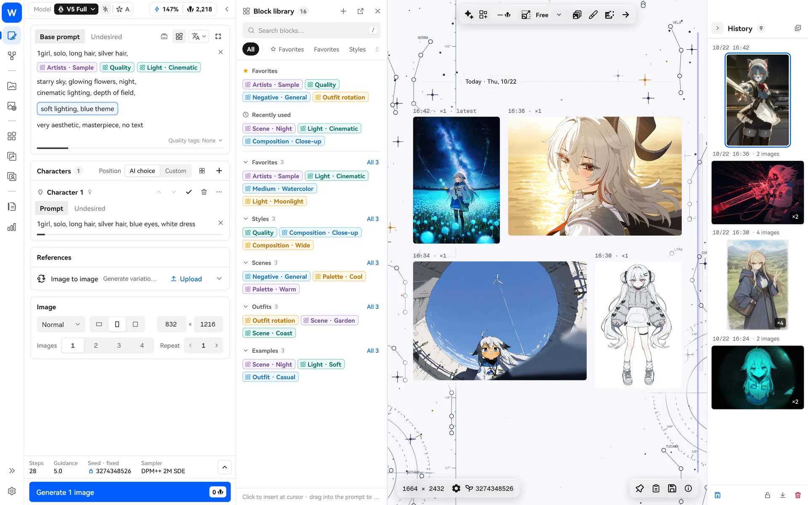
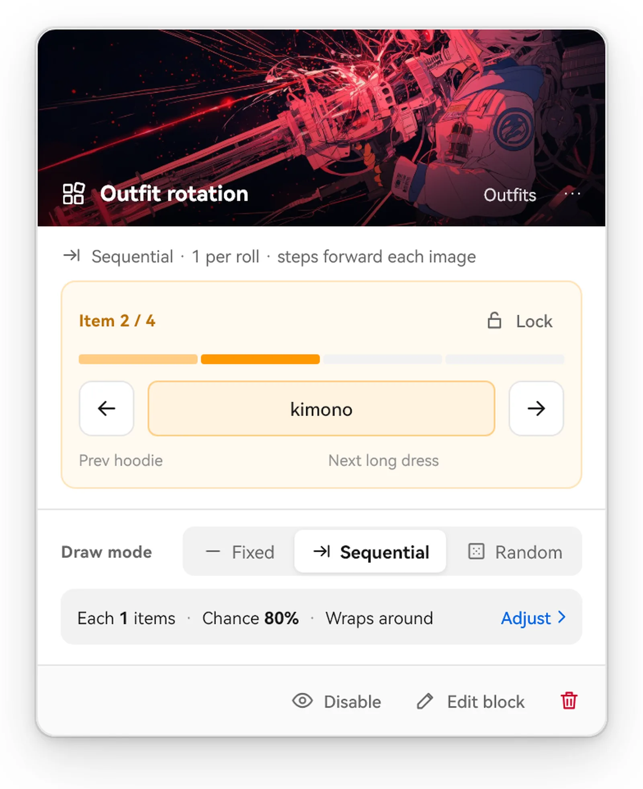
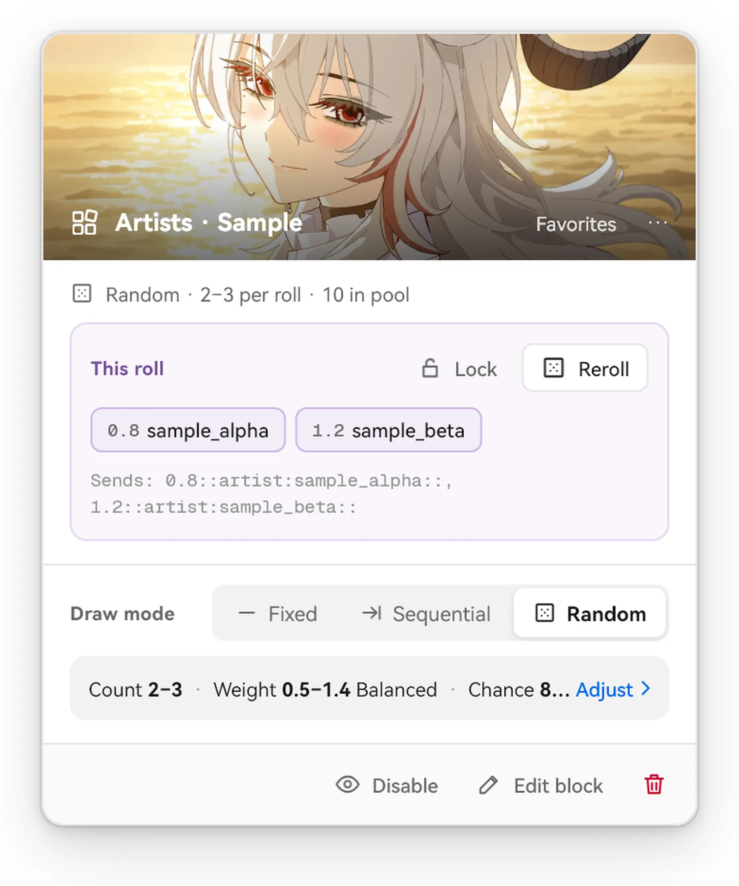
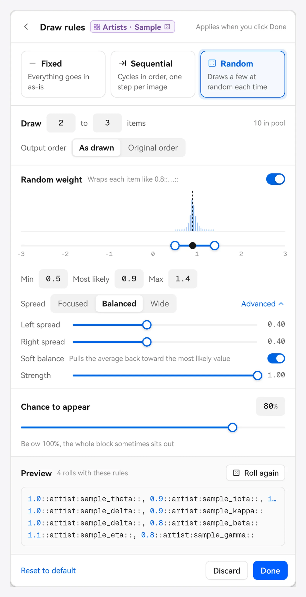
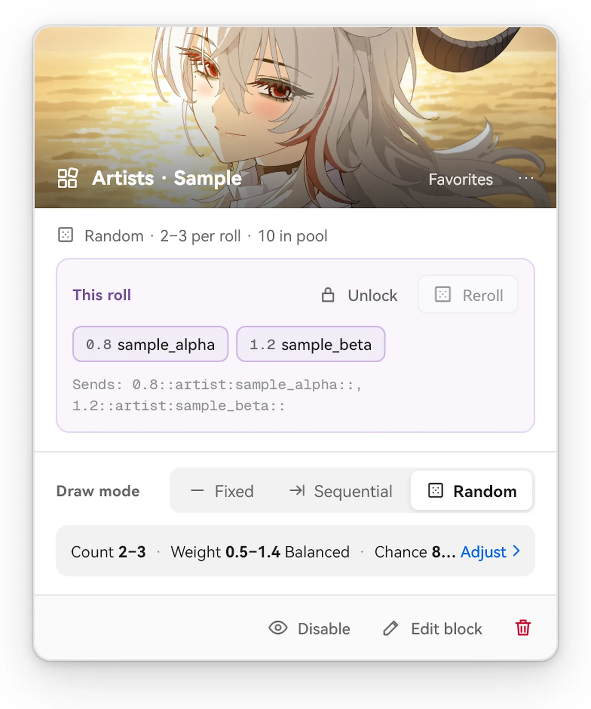

> [← Back to home](../../../README.md) · [Guide index](README.md)

# Blocks

Blocks (labeled “Blocks” in the interface) let you save and reuse common prompt snippets. Artist pools, quality tags, negative tags, clothing lists, composition descriptions—write them once, save them as blocks, then click or drag to put them back into a prompt.

## Where to find blocks

- **Block library page**: “Prompt Blocks” in the left navigation. Create and edit blocks, sort them into folders and collections, and change their colors and preview images here.
- **Block library sidebar on the generation page**: On the right of the generation page. Click to insert at the cursor, or drag into a prompt to place it where you want.
- **Block palette**: A small floating panel for your most-used blocks.

## Create a block

- Press `Ctrl+N` in the block library to create one.
- Or select some prompt text, right-click and choose “Save as block.”

A block can contain multiple items (for example, an artist pool with 30 artists), along with negative content and generation settings. Attached settings are not applied automatically when you insert the block; click “Apply attached settings” in the block when needed.

## Three modes: Fixed, Sequential and Random

An inserted block appears as a “pill” in your prompt. Click it to open its settings and choose how to get its content this time:

| Mode | Behavior | Good for |
| --- | --- | --- |
| **Fixed** | Inserts all content unchanged each time | Quality tags, negative tags, fixed character descriptions |
| **Sequential** | Cycles through items in order, advancing one step per generation and looping at the end | Trying outfits, scenes or poses one by one |
| **Random** | Randomly draws a few items from the pool each time | Trying artist combinations in batches, random backgrounds |

You can set different modes for separate insertions of the same block.

### Sequential

- Advances one step each time you start a generation. If one request produces multiple images, that batch uses the same item; the next request advances.
- Use ← → on the card to switch items manually.
- Locking stops automatic advancement.

**Example**: Save `school uniform`, `hoodie`, `kimono` and `maid outfit` as a sequential block. Generate four times in a row to get the same character in four outfits.

### Random

Random mode has a set of “Draw rules.” Click “Done” after editing to apply them:

- **Count**: How many items to draw each time; can be a range such as 2–3.
- **Chance**: The chance that this block appears. Below 100%, the whole block may sometimes be omitted.
- **Weight**: Automatically wraps each drawn item in a weight such as `0.8::…::`. Weights vary randomly between “Min ~ Max,” centered on “Most likely.”
- **Output order**: Use the order drawn or the original order in the block.
- Preview with “4 rolls with these rules” in the rules section; click “Roll again” if you want another preview.

Expand “Advanced” to adjust the shape of the weight distribution:

- **Focused / Balanced / Wide**: Pull weights toward the center or spread them toward the ends.
- **Left spread / Right spread**: Fine-tune the shape on either side of the center.
- **Soft balance**: Pulls back the overall weight when several drawn artists have unusually high or low weights. This keeps the overall style strength steady without changing the relative differences between them.

### Lock, reroll and disable

- **Lock**: Freezes the current draw so later generations do not reroll it. Useful for “keep this pose, but try a few more outfits.”
- **Reroll**: Draw again manually (unlock first if locked).
- **Disable**: Temporarily excludes this block from generation without removing it from your prompt.

## Organize the block library

- Folders and collections are on the left; view blocks in a grid, list or masonry layout.
- Select multiple blocks to insert them in order, merge them into a new block, or change their colors and appearance together.
- Import TXT files (one item per line) or folders, and export the entire library as a backup.
- If you delete a block already used in a prompt, its pill shows “Block deleted.” You can undo the deletion.

## Common uses

1. **Artist pool**: Random, draw 2–3 items, weights 0.6–1.2, chance 100%. Works well with [style evolution](style-explore.md).
2. **Quality + negative tags**: One fixed block for each, placed at the end of every prompt.
3. **Outfit / scene rotation**: A sequential block to try the whole set in one run.
4. **Occasional details**: Random, draw 1 item, chance 30%, to add a little variety to some images.
5. **A great combination**: Lock the artist pool and reroll only clothing and backgrounds.

## Working with other features

- In Style Explore, sequential and random blocks can be set as a “Genetic target” for style evolution (fixed blocks cannot).
- Enable [local semantic search](rag.md) to search the block library by meaning.
- Add useful tags from [Tag Wiki](tags-wiki.md) to a block in one click.
- [NAI Agent](nai-agent.md) can help you find and organize blocks.
