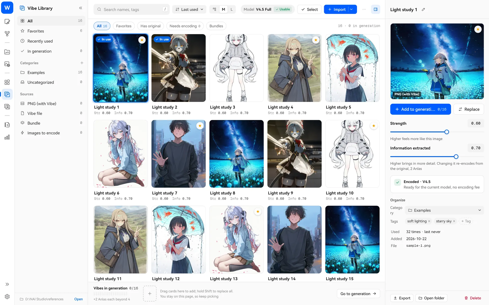
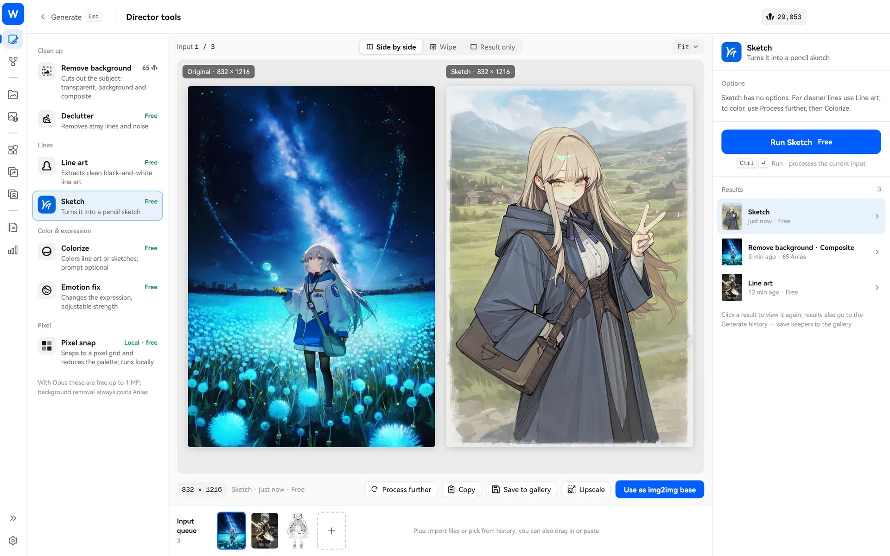

> [← Back to home](../../../README.md) · [Guide index](README.md)

# Image tools

## Vibe Transfer and Precise Reference

- **Vibe Transfer (Vibe)**: Reference the style and mood of one or more images. Adjust strength and information extraction; once encoded, reuse a Vibe without additional Anlas costs.
- **Precise Reference**: Reference a character or art style, with adjustable fidelity and per-image billing.
- When both are set, Precise Reference takes priority and Vibe Transfer is not sent (the interface shows a notice).

“Vibe Library” and “Precise References” in the left navigation manage the two types of reference images. Search, group, and import or export Vibe bundles.

## Director Tools

NovelAI’s seven Director Tools: background removal, decluttering, line-art extraction, sketching, colorization, expression correction, and locally run pixel alignment. Most are free up to 1MP with an Opus subscription (background removal always costs Anlas). Copy or save results, add them to the input queue, or use them directly for image-to-image.

## Inpainting and editing

A full-screen editor with a full set of tools: brush, eraser, fill, magic wand (optional smart-object mode downloads an approximately 133 MB model on first use), selection, lasso, clone stamp, blur, layers, canvas size, and hue/saturation.

After painting a mask, choose “Apply” or go straight to “Apply and generate.” Hold on a generated result in the canvas to compare it with the original.

## Upscaling

| Method | Details | Requirements |
| --- | --- | --- |
| NovelAI upscaling | Cloud 2× upscaling, charged by image size | Sign-in |
| Local · Real-ESRGAN | Bundled engine and models (anime quality, anime fast, general photography), 1–4×, preserves transparency, no Anlas cost | Vulkan-capable GPU |
| Local · RTX | Fast NVIDIA RTX Video upscaling; requires downloading about 64 MB of components | NVIDIA RTX GPU |
| Local · SeedVR2 | High-quality upscaling with 3B / 7B / 7B Sharp variants (3.4–8.2 GB weights), plus advanced settings for color correction, VRAM strategy and more | NVIDIA GPU (INT8 requires Turing or newer) |

Download local upscaling components and models as needed in “Settings → Local upscale.” You can also choose a local option under “Enhance” on the generation page to upscale each generated image locally afterward.
