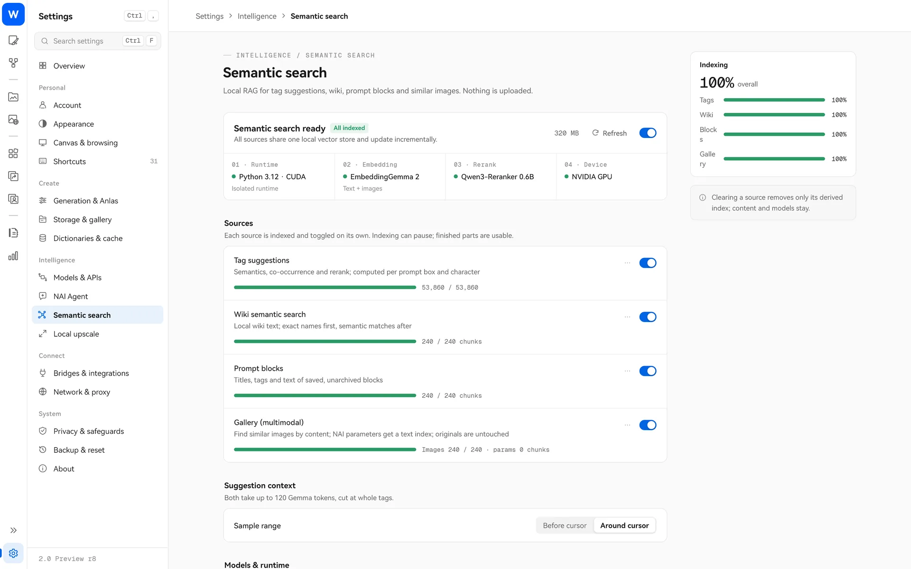

> [← Back to home](../../../README.md) · [Guide index](README.md)

# Local semantic search (RAG)

Regular search matches literal text; semantic search looks for **meaning**. Once enabled, entering “a rainy street” can find tags, blocks and wiki entries related to `rain`, `wet street` and `umbrella`, as well as similar images you have made before.

**Everything runs on your computer; nothing is uploaded.** This is an optional component. Leaving it off does not affect other features.

This screenshot is from an earlier version. The current version has one embedding model and one global RAG switch; follow the instructions below and the current interface.

## Where you can use it

| Source | What it does |
| --- | --- |
| Semantic tag search and suggestions | Search descriptions by meaning; an empty query uses local co-occurrence for complementary tags |
| Wiki semantic search | Searches Tag Wiki by meaning, with exact name matches first |
| Prompt blocks | Searches the block library by meaning (indexes only saved blocks’ titles, tags and text) |
| Multimodal gallery search | Finds Local Gallery images by visual content, or finds similar images from a selected image; NAI image settings get a separate text index |

Each source has its own index, and indexed content is available directly. There is one global RAG switch. Regular autocomplete still matches names, aliases and keywords without a model. NAI Agent uses `studio_search` for semantic retrieval; `tag_query` looks up names and aliases, while `tag_related` uses local co-occurrence. The latter two do not require RAG.

## Install

Open “Settings → Semantic search” and complete these steps in order:

1. **Runtime**: On Windows, choose **CUDA** for an NVIDIA GPU or **CPU**. Apple silicon Macs use the managed runtime with **Auto/CPU** device options. Managed installation is unavailable on Intel Macs, but an existing compatible Python can be checked. This step installs Python and inference dependencies, not model weights.
2. **Embedding model**: Only **EmbeddingGemma 2** is required for text and images. Select **Download** or an existing model folder. Downloaded files are verified individually; the model and runtime are managed separately.
3. **Enable the global semantic-search switch**, then select **Build index** on the required source. Review its scope and explicitly select **Start**. Sources have no extra switches; an unbuilt source will not start indexing automatically.

You can pause indexing at any time, and completed parts are usable immediately. After the first build, sources update incrementally, including changes to gallery images or NAI parameters. Clearing a source’s index removes the derived data and keeps the originals and models.

In the Local Gallery’s RAG menu, choose **Visual content only** and try searching for “neon reflections on a rainy street at night.” If you have a sample image, use **Choose an image to find similar**.

## Settings

- **Device**: Auto, CUDA or CPU on Windows; Auto or CPU on Mac.
- **Python interpreter**: Uses the automatically installed standalone environment by default; you can also specify an existing `python.exe`.

## Upgrades and retries

Legacy tag indexes show an upgrade action. After confirmation, the new index is built and validated before retiring only old tag data for the same model. Wiki, blocks, gallery and translation data stay. A partial index already built with the new scheme can continue without deletion.

After an interrupted or failed build, keep the index and use **Continue/Retry**. Only an explicit **Rebuild** clears that source’s current index. If old-tag cleanup fails, the new index remains searchable and cleanup can be retried separately.

## FAQ

- **Initial indexing is slow**: The tag database has hundreds of thousands of entries, and a gallery may have tens of thousands of images. The first run takes time; you can pause and resume.
- **Progress does not move during preparation**: Loading models and existing indexes takes time. Please wait.
- **Can I use it without an NVIDIA GPU?** Yes, with CPU, though it will be slower.
- **Will it send my images anywhere?** No. Network access is needed only to download models and the runtime.
