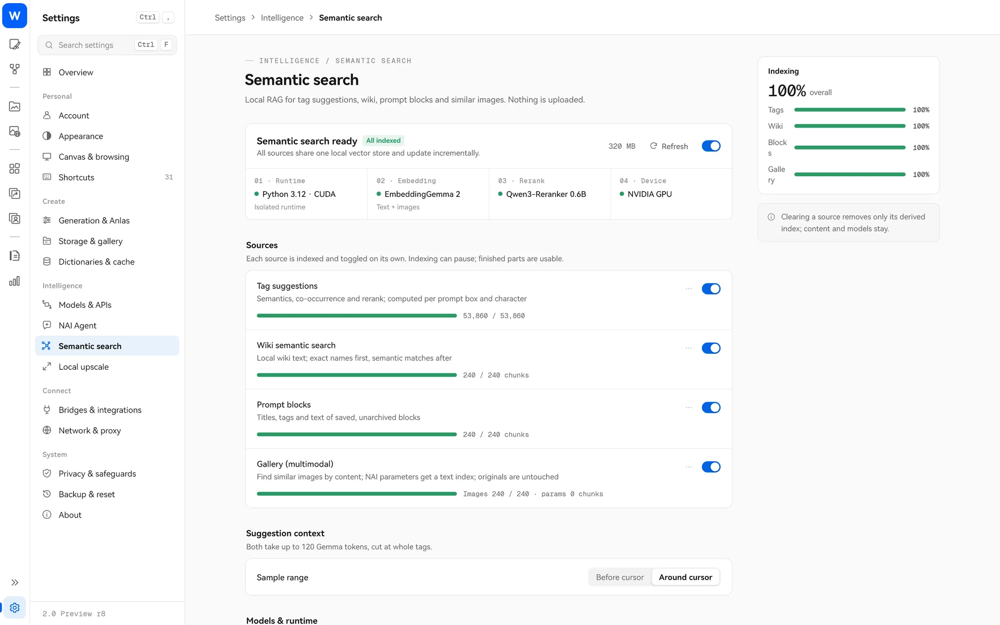

> [← Back to home](../../../README.md) · [Guide index](README.md)

# Local semantic search (RAG)

Regular search matches literal text; semantic search looks for **meaning**. Once enabled, entering “a rainy street” can find tags, blocks and wiki entries related to `rain`, `wet street` and `umbrella`, as well as similar images you have made before.

**Everything runs on your computer; nothing is uploaded.** This is an optional component. Leaving it off does not affect other features.

## Where you can use it

| Source | What it does |
| --- | --- |
| Contextual tag suggestions | Tag expansion suggests tags based on the prompt near your cursor; each prompt field, character field, positive and negative prompt is handled separately |
| Wiki semantic search | Searches Tag Wiki by meaning, with exact name matches first |
| Prompt blocks | Searches the block library by meaning (indexes only saved blocks’ titles, tags and text) |
| Multimodal gallery search | Finds Local Gallery images by visual content, or finds similar images from a selected image; NAI image settings get a separate text index |

Each source is enabled and indexed separately. NAI Agent’s semantic search tools also use it.

## Install

Open “Settings → Semantic search” and complete these steps in order:

1. **Runtime**: Click “Install.” For an NVIDIA GPU, choose **CUDA** (a download of several GB); for other GPUs, choose **CPU** (a smaller download). This installs only Python and inference dependencies, not models.
2. **Models**: Two models are needed. Click “Download” to get them automatically, or select folders you have already downloaded:
   - EmbeddingGemma 2 (about 1.5 GB), for understanding text and images.
   - Qwen3-Reranker-0.6B (about 1.2 GB), for reranking text results.
   Downloaded files are verified individually.
3. **Enable RAG**, choose what to include under **Sources**, and select **Build index**. For the first index, review the preview and select **Start**.

You can pause indexing at any time, and completed parts are usable immediately. After the first build, sources update incrementally, including changes to gallery images or NAI parameters. Clearing a source’s index removes the derived data and keeps the originals and models.

In the Local Gallery’s RAG menu, choose **Visual content only** and try searching for “neon reflections on a rainy street at night.” If you have a sample image, use **Choose an image to find similar**.

## Settings

- **Device**: Auto, CUDA or CPU.
- **Suggestion context**: Use content before the cursor or around the insertion point (up to about 120 tokens, keeping tags whole).
- **Python interpreter**: Uses the automatically installed standalone environment by default; you can also specify an existing `python.exe`.

## FAQ

- **Initial indexing is slow**: The tag database has hundreds of thousands of entries, and a gallery may have tens of thousands of images. The first run takes time; you can pause and resume.
- **Progress does not move during preparation**: Loading models and existing indexes takes time. Please wait.
- **Can I use it without an NVIDIA GPU?** Yes, with CPU, though it will be slower.
- **Will it send my images anywhere?** No. Network access is needed only to download models and the runtime.
