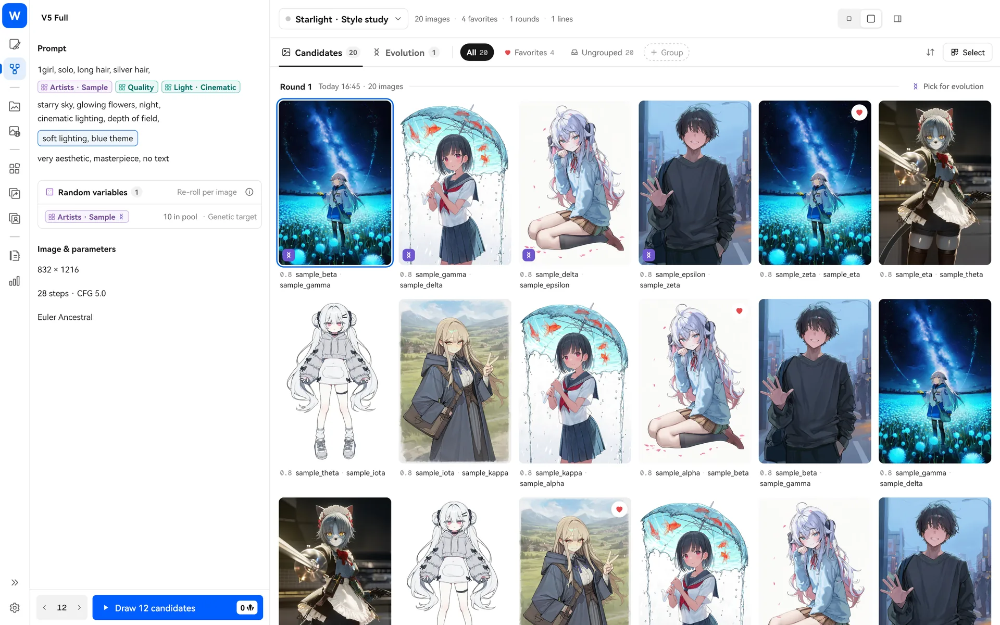
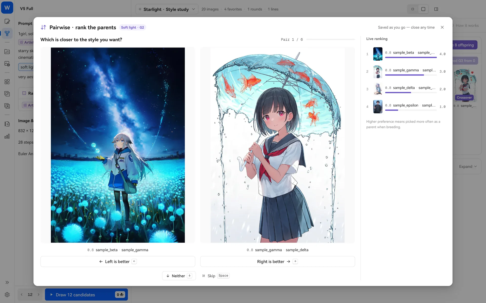

> [← Back to home](../../../README.md) · [Guide index](README.md)

# Style evolution (Style Explore)

Style Explore helps answer one question: **which artists look best together?** Use a random artist pool to draw a batch of candidates, pick your favorites, and let the app create the next generation through “crossover and mutation.” You just choose, and the style moves toward what you want over generations.



Open “Style Explore” in the left navigation. The explore and generation pages share the same prompt and settings.

## Prepare: add a random block

Insert a random-mode block into your prompt, such as a pool containing dozens of artists (see [Blocks](blocks.md)). For example:

```
1girl, solo, silver hair, starry sky, night, {画师池·示范}, very aesthetic, masterpiece
```

Set the artist pool to Random, drawing 2–3 artists each time with random weights.

## Step 1: draw candidates

Click “Draw N candidates” at the bottom left. Each image draws artists again, so every image has a different style. The estimated Anlas cost appears beside the count; the button turns red if your balance is too low.

Once the candidates are ready:

- Click to view one. The inspector on the right shows **which artists it drew**, its seed and its full prompt.
- Click the heart to favorite it; press `1`–`9` to quickly assign it to a group.
- Change the card size if the grid feels crowded; double-click for a larger view.

## Step 2: start evolution

Select a few favorites (multi-select) and click “Start evolution”:

1. The artist string drawn for each candidate becomes a **parent**.
2. Offspring come from **crossover** (taking parts from two parents), **mutation** (adjusting weights and occasionally removing an artist) and **injecting new artists**.
3. Tick offspring you like and **breed the next generation**.


A few rules:

- Each parent gets at least one offspring, so more parents mean more images needed per round.
- You can build the next generation only from the latest one. Older generations remain viewable, but you cannot branch from the middle.
- If you see “can’t produce enough distinct children,” the gene pool is too small. Add more artists to the pool.
- Multiple blocks in a prompt can be set as a “Genetic target” (sequential or random). Their drawn results merge into a single parent string.

> Want to add a parent manually? Click “Add a custom artist string” in the start-evolution dialog, for example `0.8::artist:sample_alpha::, artist:sample_beta`.

## Step 3: pairwise comparison (optional)

If you cannot decide, click “Rank by comparing.” See two parent images side by side each time and choose the one closer to what you want. Higher-preference parents are selected more often when breeding the next generation. Results are saved as you go, so you can close it partway through.



## Step 4: save the result

When you find a style you like, click “Save as block”:

- **Drawn artists only**: Saves an artist block; selecting multiple images merges and deduplicates them.
- **Full positive prompt**: Available only with a single candidate.

The saved block is ready to use back on the generation page.

## FAQ

- **The evolution button is disabled**: Your prompt has no enabled sequential or random block, or genetics is not enabled.
- **Will deleting an exploration delete my images?** No. It removes only candidate copies in that exploration task; originals in Local Gallery are unaffected.
- **The first generation looks bad**: That is normal. Try choosing through a few generations before deciding; mutations often bring surprises.
- **Will exploration change my generation-page draft?** Evolution rounds run in separate data and do not change your current blocks’ locks or drawn results.

The algorithm draws on ideas from [monineko/PromptCard-Studio](https://github.com/monineko/PromptCard-Studio) (GPL-3.0). This project uses an independent Dart implementation.
