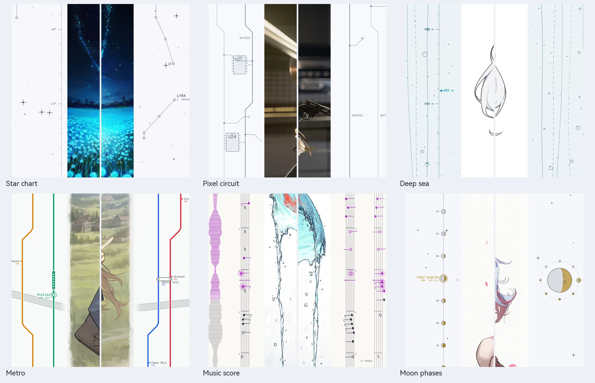

> [← ホームに戻る](../../../README.md) · [チュートリアル一覧](README.md)

# 無限キャンバスとビジュアルチャンネル

## 無限キャンバス

画像生成ページの中央には無限にドラッグできるキャンバスがあり、生成結果がバッチごとに並びます。

| 操作 | 方法 |
| --- | --- |
| 移動 | ホイールで上下、`Shift+ホイール`で左右に移動します。または中ボタン / `Shift+左ボタン`でドラッグします |
| ズーム | `Ctrl+ホイール` |
| ナビゲーション | `W A S D` |
| 全体表示 | `Ctrl+0` |
| 原画像を見る | インペイントなど原画像がある結果では、マウスボタン、スペース、Enter を押し続けると原画像と今回の描き直し範囲を表示します（画像に OLD と表示します） |

- 生成をクリックすると、先にプレースホルダーを置いて最新のグループへ移動します。生成中のプレビューも最終結果も、その位置に表示されます。
- 気に入った画像をキャンバスに「画像を固定」できます。履歴を消しても残ります。
- 透明背景の画像には、市松模様や単色などの下地を選べます。表示専用で、画像には書き込みません。
- 「キャンバス表示」で、拡大して埋める、動きを減らす、キャンバスカメラのロックを切り替えられます。

## ビジュアルチャンネル

ビジュアルチャンネルは、キャンバス両側でスクロールに合わせて動く装飾です。**画像の外側だけに描き、画像を隠しません。**

キャンバス左下の歯車 →「キャンバス表示」→「ビジュアルチャンネル」で開きます。

- **テーマ**：回路、星図、植物標本、回廊、深海、青海波、ムーブメント、地層、地下鉄、楽譜、月相の 11 種類です。
- **モード**：オフ、固定、毎回ランダムから選びます。ランダムでは最低 2 テーマが必要で、「入れ替え」で選び直せます。
- **濃さ**：淡・標準・濃から選びます。
- **時刻目盛り**：バッチ時刻、日付の区切り、右側の目盛りバーを表示します。
- **アイドル時の動き**：生成していないときは装飾がゆっくり動き、生成中は自動で一時停止します。

