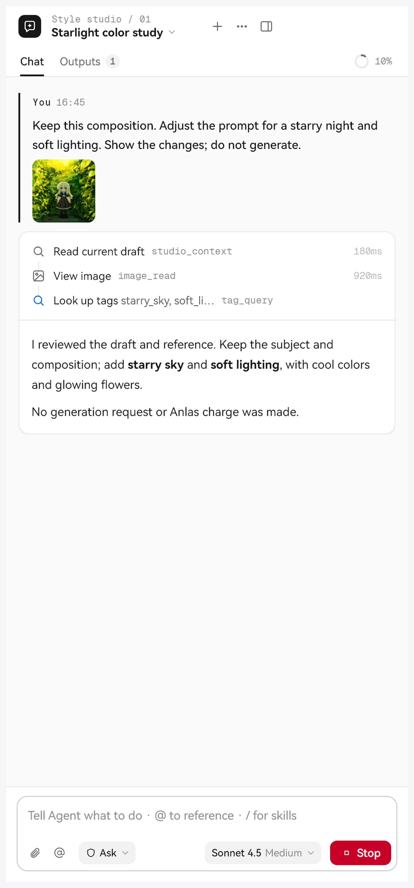
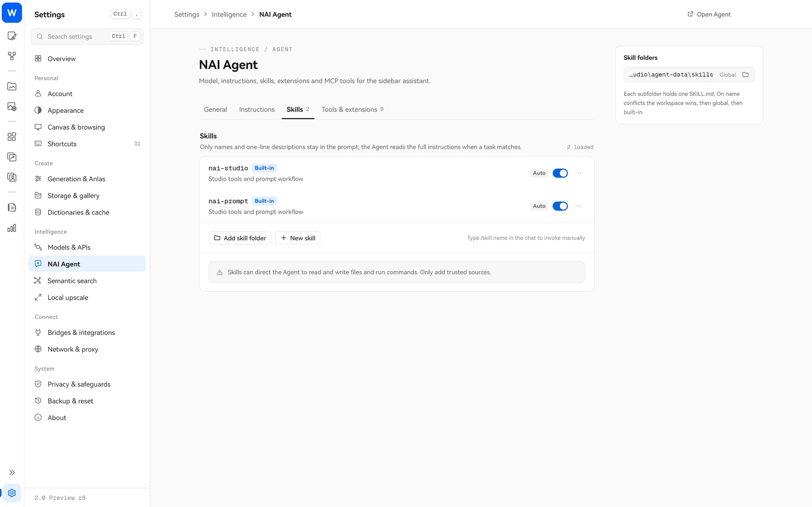

> [← ホームに戻る](../../../README.md) · [チュートリアル一覧](README.md)

# NAI Agent

NAI Agent は Studio 内蔵の AI アシスタントです。チャットでやりたいことを伝えると、Studio のツールを使ってプロンプトの修正、タグや百科の検索、ブロックやギャラリーの整理、参照画像の設定、生成の準備などを行います。

## 準備

1. 「設定 → モデルと API」で大規模言語モデルのプロバイダーを追加し、モデルを選びます（OpenAI 互換 API、Responses、Anthropic、Gemini、Ollama に対応）。
2. 画像生成ページまたは画風探索ページの上部にある「NAI Agent」ボタンをクリックすると、右側にサイドバーが開きます。
3. サイドバー下部で使うモデルを選び、チャットを始めます。

Agent はご自身のモデルサービスを使います。会話の料金は、そのサービスの価格に従います。

## 頼めること

たとえば、次のように頼めます。

- 「今のプロンプトを雨の夜の街角の雰囲気にして、キャラクターの説明は残してください」
- 「`wet hair` の百科を調べて、もっとよく使う書き方があるか教えてください」
- 「ブロックライブラリの絵師ブロックをすべて『画風』フォルダーへ移してください」
- 「この画像を Vibe Transfer の参照にしてください」（画像を直接貼り付けたり、ドラッグしたりできます）
- 「先週作った夜景の画像をギャラリーからすべて探して、新しいフォルダーへ移してください」
- 「今の設定で 4 枚生成する準備をして、見積もりを出してください」

使える Studio ツールには、現在の下書きの読み取り、画像の確認、プロンプトの書き換え、下書きのスナップショット、百科・タグ・ブロックの検索、ブロックの整理、設定の読み取り / 変更、画風探索、生成の準備、画像生成、生成のキャンセル、ギャラリーの検索と整理、セマンティック検索、参照画像の設定、参照ライブラリ、画像ツール、バリエーション / エンハンスがあります。ワークスペース内のファイルの読み書き、コマンド実行、必要に応じたユーザーへの質問もできます。

## 権限と確認

サイドバー下部で権限を選べます。

| 段階 | 動作 |
| --- | --- |
| **閲覧のみ** | 読み取りと相談だけを行い、変更や生成はしません |
| **確認** | 変更、コマンド、未知のツールは先に確認します |
| **自動** | ワークスペース内の通常の変更は直接実行します。支払いには確認が必要です |
| **フルアクセス** | 確認せずにすべての操作を実行しますが、Anlas の消費には確認が必要です（切り替え前にリスクを表示します） |

確認が必要になるとカードが表示され、「今回のみ許可」「このセッションで同一の呼び出しを許可」「拒否」を選べます。削除や移動、コマンド実行は確認対象の操作です。

### 画像生成には必ず本人の確認が必要です

Agent が画像を生成しようとすると、先に「生成の準備」を行い、Studio に価格カードを表示します。カードには 1 リクエストあたりの Anlas、推定合計、現在の残高が表示されます。**価格カードで本人が確認するまで実際の生成は始まりません**。どの権限でも同じです。見積もりの有効期限は 5 分です。生成中は停止をクリックするか、メイン画面の停止を押して中断できます。

## スキル（Skill）

スキルは Agent 向けの「操作マニュアル」で、必要なときだけ読み込みます。

- **nai-studio**（Studio の各ツールの使い方とルール）と **nai-prompt**（V4 / V4.5 / V5 のプロンプトの書き方）が内蔵されています。
- 自分のスキルも作れます。`agent-data/skills/`（全体用）または各ワークスペースの `skills/` フォルダーに置きます。同名の場合はワークスペース、全体用、内蔵の順に優先します。
- スキルごとにオン・オフを切り替えたり、「手動のみ」に設定して入力欄から `/skill:名称` で呼び出したりできます。

入力欄の `@` でファイルや画像を参照し、`/` でスキルを呼び出します。

## MCP と CodeMode

- **MCP**：「設定 → NAI Agent」で外部 MCP サーバーを追加し、Agent に外部ツールを使わせられます。stdio と Streamable HTTP、OAuth ログインに対応しています。設定は暗号化ストレージに保存します。
- **CodeMode**：Agent は既定で安全なスクリプトサンドボックスを使い、必要に応じてツールを見つけて呼び出します。複数の操作を一度に行い、会話の往復を減らします。

## ワークスペースとデータ

- ワークスペースごとにチャット、成果物、ルールがあり、作成・名前変更・削除ができます（削除後は回収エリアから取り消せます）。
- データはプログラムフォルダーの `agent-data/` に保存します。
- 「指示」ページに全体の指示やワークスペースのルールを書くと、それ以降のリクエストに反映されます。
- 1 回の実行でのモデルリクエストは既定で最大 32 回です。設定で 1–200 回に変更できます。

## ヒント

- まず「確認」で動作を把握し、それから「自動」の利用を検討してください。
- 外部の Pi 拡張や MCP サーバーはローカルコードを実行できます。信頼できる提供元のものだけをインストールしてください。
- 外部の AI ツールやスクリプトも「ローカルブリッジ」（付属の `studio-bridge.exe`）経由で Studio を操作できます。画像生成には同じく見積もり確認が必要です。
