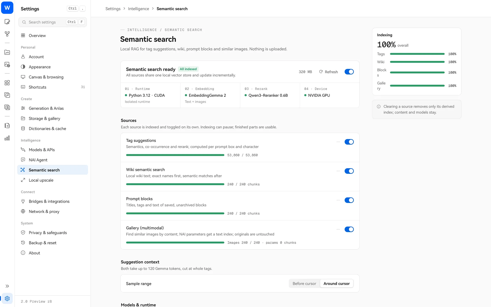

> [← ホームに戻る](../../../README.md) · [チュートリアル一覧](README.md)

# ローカルのセマンティック検索（RAG）

通常の検索は文字の一致が必要ですが、セマンティック検索は**意味**で探します。有効にすると、「雨の降る通り」と入力して `rain`、`wet street`、`umbrella` に関連するタグ、ブロック、百科の記事、以前作った似た画像を探せます。

**すべて PC 上で動作し、内容は一切アップロードしません。** オプション機能なので、有効にしなくてもほかの機能に影響はありません。

画像は旧バージョンです。現在は埋め込みモデルと全体の RAG スイッチが各 1 つです。以下の説明と現在の画面を参照してください。

## 利用できる場所

| ソース | 効果 |
| --- | --- |
| タグのセマンティック検索と提案 | 説明を意味で検索します。空欄ではローカルの共起から組み合わせを提案します |
| Wiki のセマンティック検索 | タグ百科を意味で検索します。名前の完全一致を優先します |
| プロンプトブロック | ライブラリ内のブロックを意味で検索します（保存済みブロックのタイトル・タグ・テキストだけを収録します） |
| ギャラリーのマルチモーダル検索 | ローカルギャラリーで画像の内容から探したり、選んだ画像に似た画像を探したりします。NAI 画像のパラメータは別のテキスト索引にします |

ソースごとに索引を作成し、作成済みの内容はそのまま検索に使えます。RAG のスイッチは全体で 1 つです。通常の入力補完は引き続き名前・別名・キーワードを照合し、モデルを使いません。NAI Agent の `studio_search` は意味検索、`tag_query` は名前と別名の検索、`tag_related` はローカル共起です。後者 2 つは RAG を必要としません。

## インストール

「設定 → セマンティック検索」を開き、順番に設定します。

1. **実行環境**：Windows の NVIDIA GPU は **CUDA** または **CPU** を選べます。Apple シリコン Mac は管理環境をインストールし、デバイスは「自動／CPU」です。Intel Mac では管理環境をインストールできませんが、既存の互換 Python を検査できます。この段階では Python と推論用依存関係のみをインストールし、モデルはダウンロードしません。
2. **埋め込みモデル**：必要なのは文字と画像用の **EmbeddingGemma 2** だけです。「ダウンロード」または既存のモデルフォルダーを選びます。取得したファイルは個別に検証し、モデルと実行環境は別々に管理します。
3. **全体のセマンティック検索を有効にし**、必要なソースで「索引を構築」を選びます。範囲を確認して手動で開始します。ソース別のスイッチはなく、未構築の索引が自動的に作成されることはありません。

索引構築はいつでも一時停止でき、完了した部分はすぐに使えます。初回以降は差分更新され、ギャラリーの画像や NAI パラメーターの変更も反映されます。ソースの索引を消すと派生データが削除され、元の内容やモデルは残ります。

ローカルギャラリーの RAG メニューで「画像内容のみ」を選び、「雨の夜道に映るネオン」などを検索してみてください。見本があれば「画像を選んで類似検索」を使えます。

## 設定項目

- **実行デバイス**：Windows は自動・CUDA・CPU、Mac は自動・CPU です。
- **Python インタープリター**：既定では自動インストールした独立環境を使います。既存の `python.exe` も指定できます。

## アップグレードと再試行

旧タグ索引にはアップグレード操作が表示されます。確認後、新索引の構築と検証が完了してから、同じモデルの旧タグデータだけを整理します。Wiki・ブロック・ギャラリー・翻訳データは残ります。新方式で作成済みの途中の索引は、削除せずに続行できます。

構築が中断・失敗したら索引を残し、「続行／再試行」を使ってください。明示的に「再構築」を選んだ場合だけ、そのソースの現索引を消去します。旧タグの整理に失敗しても新索引は検索でき、整理だけを再試行できます。

## よくある質問

- **初回の索引構築が遅い**：タグは数十万件、ギャラリーは数万枚になる場合があり、初回には時間がかかります。一時停止して後から再開できます。
- **準備中の進捗が動かない**：モデルと既存索引の読み込みには時間がかかります。そのままお待ちください。
- **NVIDIA GPU がなくても使えますか**：CPU でも使えますが、速度は遅くなります。
- **画像が外部へ送られますか**：送られません。通信が必要なのはモデルと実行環境のダウンロード時だけです。
