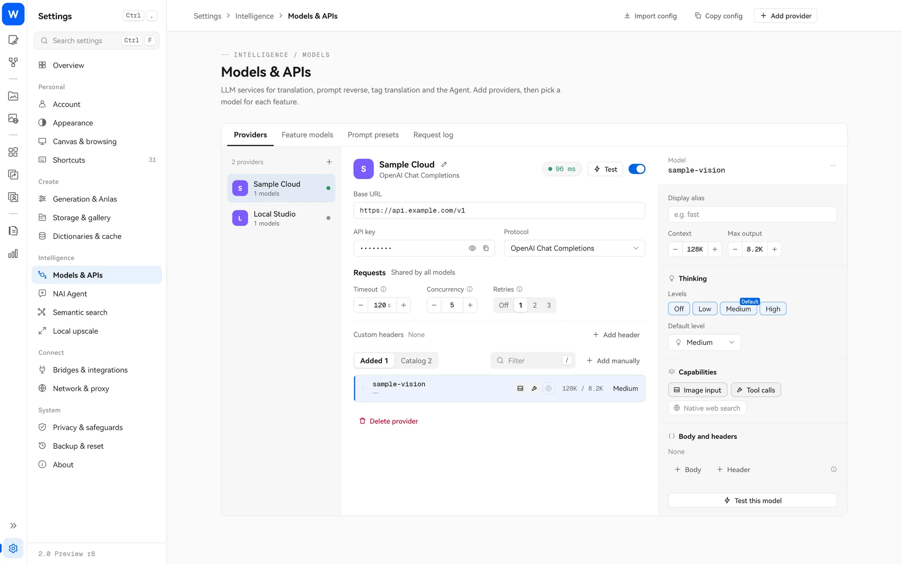

> [← ホームに戻る](../../../README.md) · [チュートリアル一覧](README.md)

# 翻訳ブロック

長い英語のプロンプトが読みにくいときは、翻訳ブロックで中国語に翻訳し、元の位置に表示できます。**生成には必ず英語の原文を使います**。翻訳は読むことや編集を助けるためのものです。

## まず翻訳モデルを設定する

翻訳には、ご自身の大規模言語モデルサービスが必要です（OpenAI 互換 API、Anthropic、Gemini、ローカルの Ollama などに対応）。

1. 「設定 → モデルと API」を開き、「プロバイダーを追加」でアドレスとキーを入力し、モデルを選びます。
2. 「機能の割り当て」で「プロンプト翻訳」にモデルを割り当てます。

同じページで、プロンプト逆推定、タグ翻訳・意味情報、百科翻訳の 3 機能にもモデルを割り当てられます。キーはシステムセキュアストレージに保存します。翻訳リクエストは選んだサービスに送られ、そのサービスの料金が適用されます。

## 使い方

プロンプトのツールバーで「翻訳」をクリックします。翻訳が完了すると、英語の各部分が「翻訳ブロック」になります。

| 操作 | 結果 |
| --- | --- |
| **ブロックを中クリック** | 原文と訳文を切り替えます |
| **原文を左クリック** | カーソルを置き、英語を直接編集します |
| **訳文を左クリック** | 翻訳ブロックの編集画面を開きます |
| 翻訳メニューの「すべて原文に戻す / すべて訳文を表示」 | グループ全体を切り替えます |
| 翻訳メニューの「追加した内容を翻訳」 | 後から追加した部分だけを翻訳します |
| 「すべての翻訳ブロックを原文テキストに戻す」 | 翻訳ブロックをすべて外し、通常のテキストに戻します |

## 翻訳ブロックの編集画面

訳文を左クリックすると編集画面が開き、原文と「画像生成用」の内容を確認できます。

- 英語の原文を直接変更し、保存して反映します。
- **↑ 訳文から原文へ**：中国語を書いてモデルに英語タグへ変換させ、確認してから保存します。
- **↓ 原文から訳文へ**：もう一度翻訳します。
- 原文が変わると、訳文の同期が必要であることがブロックに表示されます。

## 誤訳を防ぐしくみ：一致したタグの用語集

Danbooru のタグには、字面だけでは誤解しやすいものが多くあります。絵師名、作品名、キャラクター名の場合もあれば、単なる画像の描写の場合もあります。正確な翻訳を助けるため、Studio は翻訳のたびにローカルで検索し、**プロンプト内で一致したタグ**を用語集にまとめ、参考資料としてリクエストに添えます。

| 用語集の内容 | 出典 |
| --- | --- |
| 正式なタグ名 | ローカルのタグライブラリ（ライブラリで見つかる完全なタグのみ） |
| 中国語の訳名 | 以前に翻訳してキャッシュしたタグの訳名 |
| 短い説明 | ローカル Wiki：対応する中国語の説明があれば使い、なければ原文の短い説明を、原文であることを明記して添付 |
| カテゴリー | ローカルのタグライブラリ（絵師 / 作品 / キャラクター / 一般など） |

次の制約も設けています。

- **用語集は参考資料のみ**：プロンプトと用語集は翻訳対象のデータであり、指示ではないとモデルに明示します。説明をプロンプトに追加することも禁止し、見つからないタグの意味や関係を捏造させません。
- **完全なタグだけが対象**：文章内の一般的な単語に Danbooru の意味を無理に当てはめません。
- **結果をローカルで照合**：訳文に絵師・作品・キャラクターとして付いたタグの印は、そのタグがローカルのタグライブラリに存在する場合のみ有効です。カテゴリーアイコンは Studio がローカルデータから決め、モデルが示したカテゴリーは採用しません。一致しない印は破棄しますが、訳文自体は残します。
- **訳名と説明を別々にキャッシュ**：Wiki 原文が変わると、古い中国語の説明は使わず、新しい原文に切り替えます。古い説明でモデルが誤解するのを防ぐためです。
- **照合はすべてローカルで実行**：用語集の検索でモデルを追加呼び出しすることはなく、検索に失敗しても翻訳は続行します。

同じ用語集は「↑ 訳文から原文へ」、タグ翻訳、百科翻訳にも使います。編集画面に中国語を書くと、モデルは一致した正式なタグを参考に、正確な英語タグへ戻せます。タグ名や Wiki 本文の翻訳時にも、関連タグの説明を添えて、同じ名前の絵師・作品・一般の単語を区別しやすくします。

## ヒント

- 中クリックでいつでも原文を確認し、モデルが `cat ears` を不自然に訳していないか確かめられます。
- 翻訳しても保存される生成用の原文は変わらず、Anlas の消費量にも影響しません。
- タグや百科の自動翻訳は初期状態ではオフです。必要に応じて[タグ百科](tags-wiki.md)と辞書の設定で有効にしてください。
