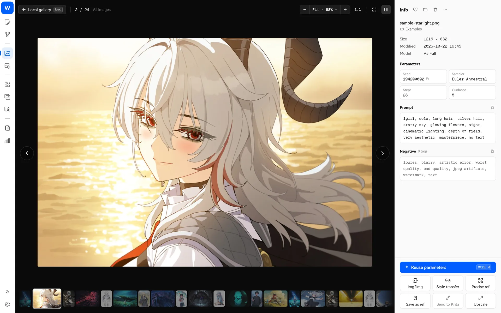

> [← 홈으로](../../../README.md) · [사용 안내 목록](README.md)

# 갤러리

## 로컬 갤러리

왼쪽 탐색 메뉴의 “로컬 갤러리”(`Ctrl+2`)로 들어갑니다.

**탐색**

- 왼쪽은 라이브러리·컬렉션·폴더, 가운데는 연속 이미지 타임라인, 오른쪽은 상세 정보입니다.
- 일별·월별로 묶거나 그룹 없이 볼 수 있습니다. 오른쪽 시간축을 끌어 빠르게 이동하고 `Ctrl+G`로 지정한 날짜로 이동합니다.
- 레이아웃은 같은 높이의 행으로 자르지 않고 배치하는 방식, 그리드, 워터폴의 세 가지입니다. 썸네일 크기와 선명도를 조정할 수 있습니다.

**찾기**

- 파일명이나 프롬프트로 검색하며 캐릭터 프롬프트도 검색합니다.
- NAI 이미지만, 모델 버전, 날짜 범위, 태그로 필터링합니다.
- [로컬 시맨틱 검색](rag.md)을 켜면 화면 내용으로 이미지를 찾거나 선택한 이미지와 비슷한 이미지를 찾습니다.

**정리**

- 여러 이미지 폴더를 지원합니다(“설정 → 갤러리 소스”). 새 이미지는 기본적으로 주 라이브러리의 “미분류 폴더”에 저장합니다.
- 폴더가 곧 분류이며 새로 만들기·이동·복사가 가능합니다.
- 즐겨찾기는 하트와 컬렉션으로 관리하며 컬렉션은 제한 없이 중첩할 수 있습니다.
- 여러 장을 선택해 일괄 이동, 압축 묶음 만들기, 메타데이터 편집, 컬렉션 추가를 할 수 있습니다.
- 삭제한 이미지는 먼저 “휴지통”에 들어가 복원할 수 있으며 다음 실행 때 실제로 삭제합니다.

**재사용**

- 상세 패널에 전체 생성 파라미터를 표시합니다. “파라미터 재사용”을 선택하거나 프롬프트와 시드를 복사합니다.
- 한 번의 클릭으로 이미지 투 이미지, Vibe 트랜스퍼, 정밀 참조에 사용하거나 참조 라이브러리에 저장합니다. 우클릭의 “캔버스에 배치”도 사용할 수 있습니다.
- 이미지 생성 페이지로 끌면 가져올 내용을 선택하는 창이 열립니다(시드는 기본적으로 선택하지 않습니다).

주요 조작: 클릭으로 선택, 두 번 클릭 / 스페이스 / Enter로 크게 보기, 방향키로 전환, `Delete`로 삭제, `Ctrl+A`로 전체 선택, `Esc`로 다중 선택 종료입니다.

## 온라인 갤러리

왼쪽 탐색 메뉴의 “온라인 갤러리”(`Ctrl+3`)로 들어갑니다.

- **소스**: Danbooru, Safebooru, Gelbooru, AI TAG를 지원합니다.
- **탐색**: 태그 검색(태그 확장도 지원), 일 / 주 / 월 순위, 인기 작품을 제공합니다.
- **즐겨찾기**: 로컬 즐겨찾기(사이트 계정 불필요, 오프라인 열람 가능)와 사이트 즐겨찾기를 지원합니다. AI TAG에서는 작가를 즐겨찾기에 추가하고 작품을 볼 수 있습니다.
- **블랙리스트**: 보고 싶지 않은 태그를 차단합니다.
- **재사용**: 생성 파라미터가 있는 작품은 바로 재사용합니다. 여러 이미지가 있는 작품은 한 장씩 전환합니다.
- **일괄 다운로드**를 지원합니다.
- 태그와 프롬프트에 마우스를 올리면 번역 버튼을 표시하며 클릭할 때만 번역합니다.

Danbooru 로그인 정보와 Gelbooru API 인증 정보는 로컬에만 저장합니다.
