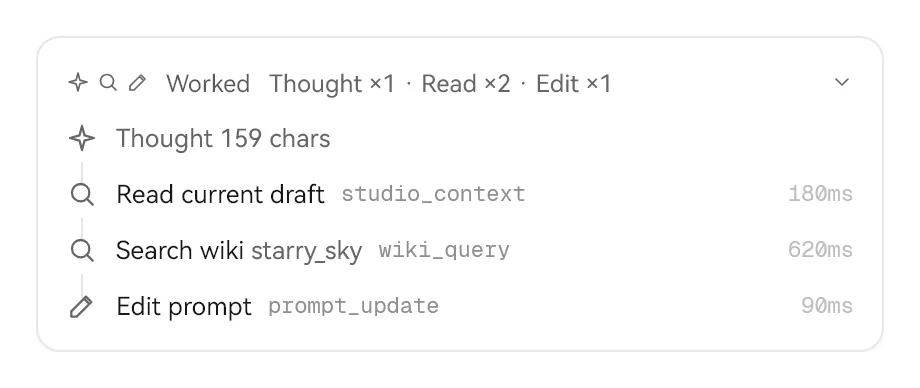
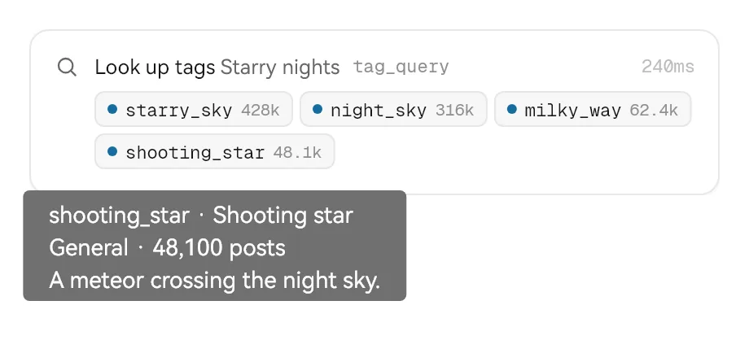
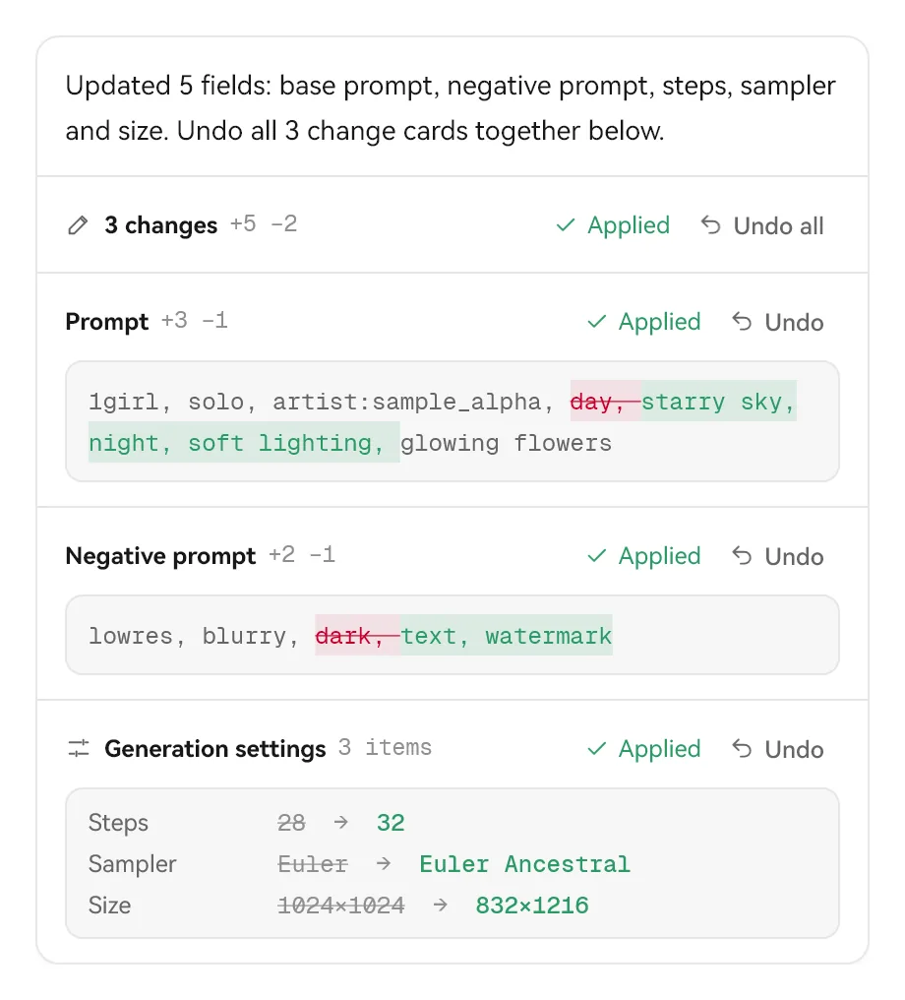
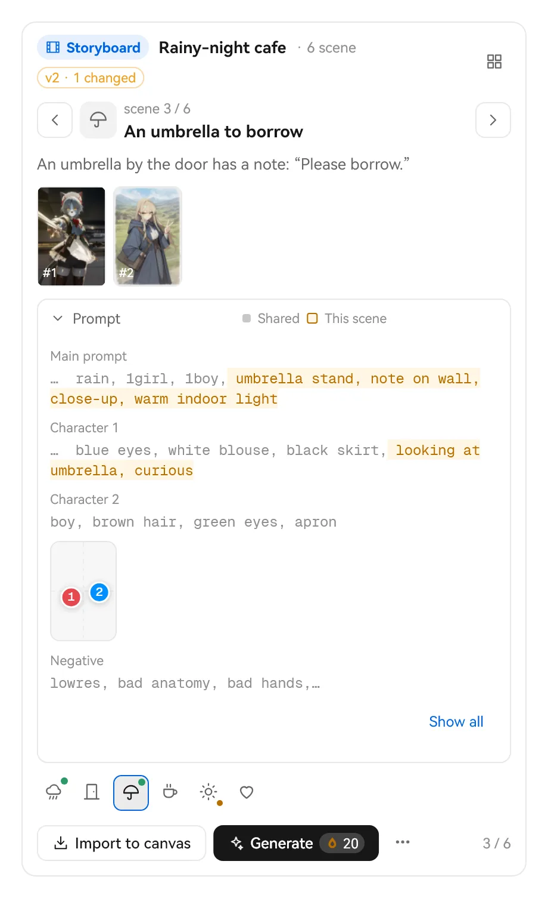
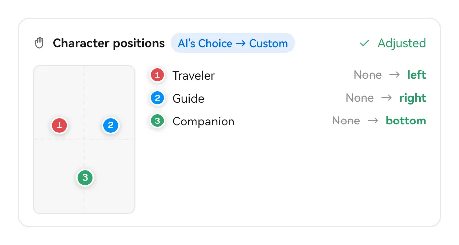
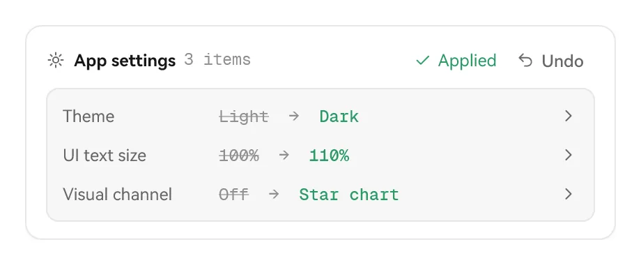
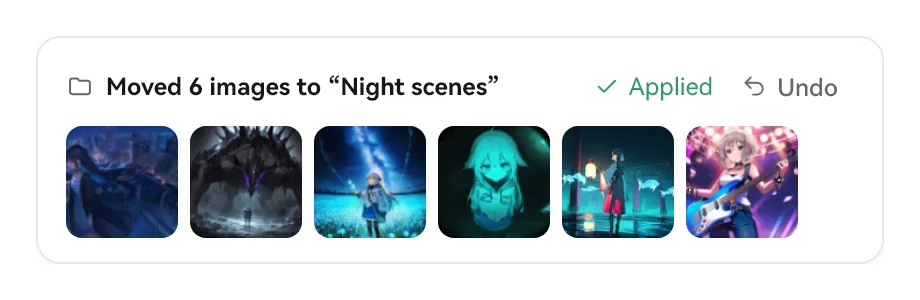
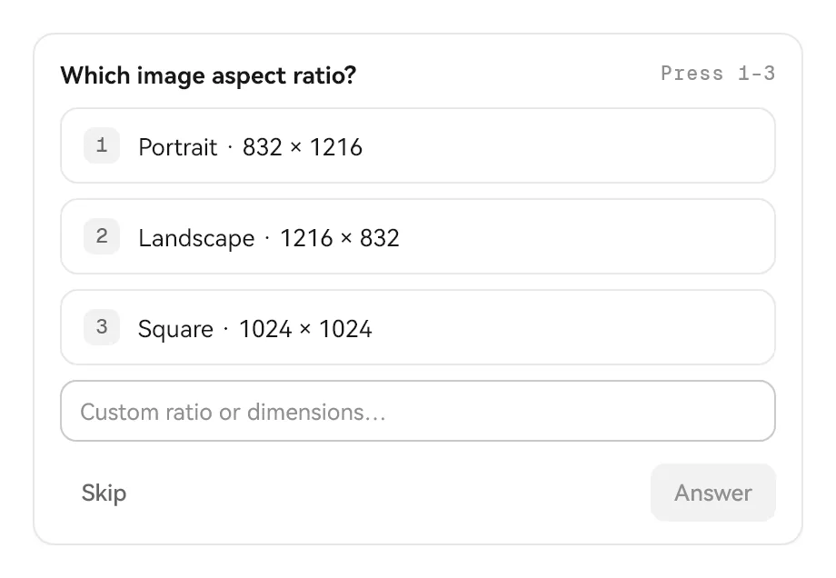
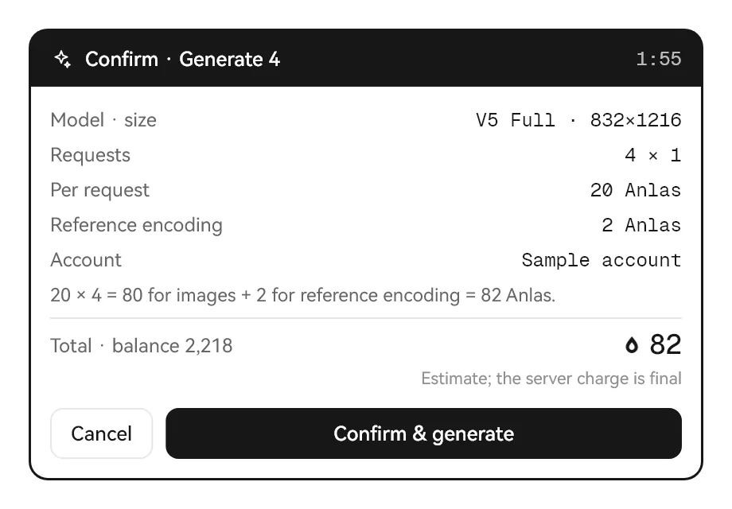
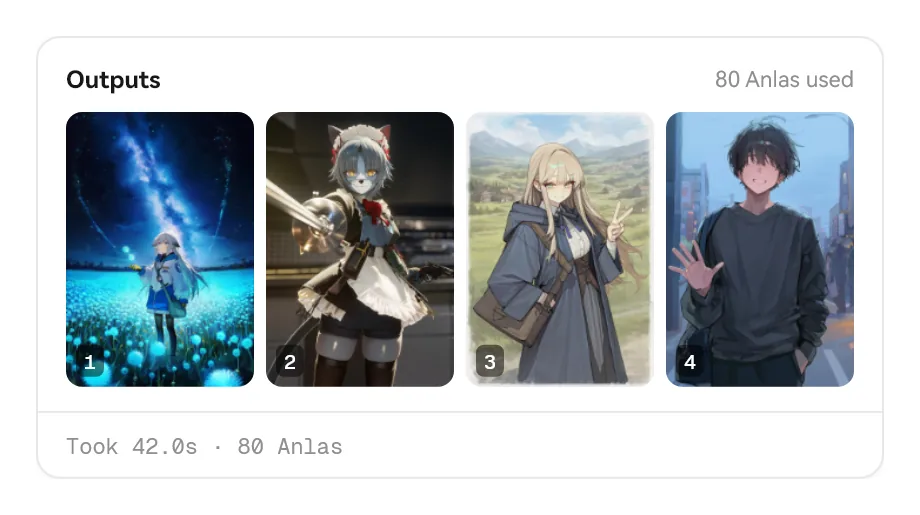

> [← 홈으로](../../../README.md) · [사용 안내 목록](README.md)

# NAI Agent

NAI Agent는 Studio에 내장된 AI 도우미입니다. 채팅으로 할 일을 알려 주면 Studio 도구를 호출해 프롬프트 수정, 태그와 백과 검색, 블록과 갤러리 정리, 참조 이미지 설정, 생성 준비 등을 수행합니다. 작업할 때마다 대화에 해당 **카드**가 나타나 무엇을 바꿨는지 알려 주며, 대부분 한 번의 클릭으로 실행 취소할 수 있습니다.

## 준비

1. “설정 → 모델과 API”에서 대규모 언어 모델 공급자를 추가하고 모델을 선택합니다(OpenAI 호환 API, Responses, Anthropic, Gemini, Ollama 지원).
2. 이미지 생성 페이지나 화풍 탐색 페이지 위쪽의 “NAI Agent” 버튼을 클릭하면 오른쪽 사이드바가 펼쳐집니다.
3. 사이드바 아래에서 사용할 모델을 선택하고 채팅을 시작합니다.

Agent는 본인의 모델 서비스를 사용합니다. 대화 비용은 해당 서비스의 요금에 따라 계산됩니다.

## 맡길 수 있는 작업

다음과 같이 요청할 수 있습니다.

- “현재 프롬프트를 비 오는 밤 거리 분위기로 바꾸되 캐릭터 설명은 유지해 주십시오”
- “`wet hair`의 백과를 찾아 더 자주 쓰는 표현이 있는지 확인해 주십시오”
- “블록 라이브러리의 작가 블록을 모두 ‘화풍’ 폴더로 옮겨 주십시오”
- “이 이미지를 Vibe 트랜스퍼 참조로 설정해 주십시오”(이미지를 바로 붙여 넣거나 끌어올 수 있습니다)
- “갤러리에서 지난주에 만든 야경 이미지를 모두 찾아 새 폴더로 옮겨 주십시오”
- “현재 설정으로 4장 생성을 준비하고 견적을 내 주십시오”
- “비 오는 밤 카페를 배경으로 8개 장면의 짧은 이야기를 만들어 주십시오” “같은 캐릭터의 여름옷을 6벌 만들어 주십시오. 하나씩 입혀 보고 싶습니다”

사용 가능한 Studio 도구에는 현재 초안 읽기, 이미지 보기, 프롬프트 수정, 프롬프트 세트, 초안 스냅숏, 백과 검색, 태그 검색, 블록 찾기, 블록 편집, 설정 읽기 / 설정 변경, 화풍 탐색, 생성 준비, 이미지 생성, 생성 취소, 갤러리 검색, 갤러리 정리, 의미 검색, 참조 이미지 설정, 참조 이미지 라이브러리, 이미지 도구, 변형 / 향상이 있습니다. 작업 공간에서 파일을 읽고 쓰거나 명령을 실행하며 필요할 때 사용자에게 질문할 수도 있습니다.

## 대화에 표시되는 카드

Agent는 몰래 내용을 바꾸지 않습니다. 대화에서는 다음과 같은 카드를 볼 수 있습니다.

### 진행 과정: 생각과 단계

모델의 생각 과정은 기본적으로 접혀 있고 “생각함”만 표시됩니다. 호출한 도구는 순서대로 단계로 나열됩니다(예: 현재 초안 읽기 → 백과 검색 → 프롬프트 수정). 펼치면 파라미터와 결과를 확인할 수 있습니다.

### 태그 검색 결과

태그 검색이나 의미 검색 결과는 해당 단계 바로 아래에 표시됩니다. 표준 태그 이름, 중국어 이름, 게시물 수가 나오며 마우스를 올리면 Wiki 요약을 볼 수 있습니다.

### 프롬프트와 파라미터 변경

프롬프트 입력란을 수정할 때마다 차이 카드가 나타나며 추가한 부분은 초록색, 삭제한 부분은 빨간색으로 표시됩니다. 스텝 수, 샘플러, 크기 같은 파라미터 변경은 별도 카드에 이전 값 → 새 값으로 표시됩니다. 한 번에 여러 곳을 바꾸면 맨 위에 “이번 변경 · N곳”이 표시됩니다. **모두 실행 취소**하거나 개별 카드에서 “실행 취소”를 선택할 수 있습니다. 이후 초안을 직접 수정했다면 새 수정 내용을 덮어쓰지 않도록 실행 취소가 잠깁니다.

### 프롬프트 세트: 이야기·의상 입혀 보기·스토리보드

여러 프롬프트를 한 번에 작성하도록 요청하면(이야기의 여러 장면, 의상 세트, 전투 장면의 여러 컷, 표정 세트 등) 대화에 프롬프트 세트 카드가 표시됩니다. 카드 이름(스토리보드 카드, 의상 테스트 카드, 전투 장면 카드 등)과 각 항목의 제목, 아이콘, 설명은 Agent가 정합니다.

- **전환**: 좌우 화살표, 아래쪽의 작은 아이콘을 사용하거나 카드를 선택한 뒤 키보드 ← → 키를 누릅니다. 오른쪽 위의 격자 버튼으로 모든 항목을 한 번에 볼 수 있습니다.
- **프롬프트**: 기본적으로 접혀 있습니다. 펼치면 모든 항목이 공유하는 설정(화풍, 캐릭터 외모, 네거티브 프롬프트)은 회색으로, 해당 항목만의 부분은 강조해서 표시합니다. 멀리 떨어진 공통 내용은 “…”로 생략하며 “모두 보기”를 클릭하면 원문 전체를 확인할 수 있습니다.
- **캔버스로 가져오기**: 이 항목의 메인 프롬프트, 캐릭터, 네거티브 프롬프트만 초안에 씁니다. 파라미터, 시드, 크기, 참조 이미지는 바꾸지 않으며 가져온 뒤 카드에서 실행 취소할 수 있습니다.
- **생성**: 먼저 이 항목을 가져온 뒤 가격 카드를 표시합니다. 확인하면 **1장**을 생성합니다. 마음에 들지 않으면 다시 클릭해 새로 생성할 수 있습니다. 생성한 이미지는 해당 항목 아래에 남고 작은 아이콘에는 초록색 점이 표시됩니다.
- **⋯ 메뉴**: “블록으로 저장”(항목마다 한 개의 엔트리로 저장하며 나중에 순서 또는 무작위로 설정할 수 있습니다), “이 항목의 프롬프트 복사” 또는 “모두 복사”, “이 항목 수정을 Agent에 요청”을 선택할 수 있습니다.
- **수정**: Agent에 “5번째 장면을 낮으로 바꿔 주십시오”라고 요청하면 같은 카드가 바로 업데이트됩니다. 카드에는 “v2 · 1개 수정”이 표시되고 수정한 항목에는 노란색 점이 붙습니다. 다시 시작한 뒤에도 카드와 생성한 이미지는 그대로 남습니다.

### 캐릭터 위치

캐릭터 배치를 조정하면 작은 미리 보기에 각 캐릭터의 위치가 표시되어 누가 왼쪽에 있고 누가 오른쪽에 있는지 한눈에 확인할 수 있습니다.

### 앱 설정

설정 변경(예: 어두운 테마로 전환하거나 비주얼 채널 켜기)을 요청하면 항목마다 이전 값 → 새 값이 나열됩니다. 카드 전체를 실행 취소하거나 “설정 열기”를 클릭해 해당 설정 항목으로 이동할 수 있습니다.

### 갤러리 정리

즐겨찾기, 이동, 복사, 삭제, 컬렉션 추가 후에는 영향을 받은 이미지의 썸네일과 장수가 표시됩니다. 삭제한 항목은 휴지통 영역으로 이동하며 대부분의 작업은 실행 취소할 수 있습니다.

### 사용자에게 질문

확실하지 않은 부분이 있으면 Agent는 멈추고 질문합니다. 제시된 몇 가지 선택지에서 고르거나 직접 답을 입력할 수 있습니다.

### 허용이 필요한 경우

“확인” 단계에서는 수정, 삭제, 이동, 명령 실행 전에 이 카드가 표시됩니다. 실행할 구체적인 파라미터를 확인하고 “한 번 허용”, “이 세션에서 동일한 호출 허용”, “거부”를 선택할 수 있습니다.

### Anlas를 쓰기 전에: 가격 카드

Agent가 이미지 생성, 변형 / 향상 또는 클라우드 이미지 도구를 사용하려고 하면 먼저 이 가격 카드를 표시합니다. 모델과 크기, 요청 횟수, 단가, 참조 이미지 인코딩 비용, 합계, 현재 잔액이 나옵니다. 가격은 Studio가 계산하며 모델이 바꿀 수 없습니다. **“확인 후 생성”을 클릭해야만 실제로 Anlas를 소비합니다**. 모든 권한 단계에서 같습니다. 견적에는 유효 기간이 있으므로 설정이 바뀌거나 견적이 만료되면 Agent에게 다시 준비해 달라고 요청해야 합니다.

### 산출물과 요약

생성한 이미지는 대화에 나타나며(“산출물” 페이지에도 저장됩니다) 이번 실행에 소비한 Anlas도 함께 표시됩니다. 실행이 끝날 때마다 소요 시간, Anlas, 변경한 곳의 수, 도구 호출 횟수, 사용한 토큰 수를 한 줄로 요약합니다.

## 권한 단계

사이드바 아래에서 권한 단계를 선택합니다.

| 단계 | 동작 |
| --- | --- |
| **읽기 전용** | 읽기와 대화만 하며 수정하거나 생성하지 않습니다 |
| **확인** | 수정·명령·알 수 없는 도구는 먼저 확인합니다 |
| **자동** | 작업 공간 안의 일반 수정은 바로 실행하며 비용 지출은 여전히 승인이 필요합니다 |
| **전체 권한** | 묻지 않고 모든 작업을 바로 실행하지만 Anlas 소비는 여전히 승인이 필요합니다(전환 전에 위험을 안내합니다) |

생성 중에는 Agent의 정지 버튼이나 메인 화면의 정지 버튼을 눌러 대기 중인 생성을 중단할 수 있습니다.

## 스킬(Skill)

스킬은 Agent가 읽는 “작업 설명서”이며 필요할 때만 불러옵니다.

- **nai-studio**(Studio 각 도구의 사용법과 규칙)와 **nai-prompt**(V4 / V4.5 / V5 프롬프트 작성법)가 내장되어 있습니다.
- 직접 스킬을 만들어 `agent-data/skills/`(전역) 또는 특정 작업 공간의 `skills/` 폴더에 넣을 수 있습니다. 이름이 같으면 작업 공간, 전역, 내장 순으로 우선합니다.
- 스킬마다 켜고 끄거나 “수동 전용”으로 설정해 입력란에서 `/skill:이름`으로 호출할 수 있습니다.

입력란에서 `@`로 파일이나 이미지를 참조하고 `/`로 스킬을 호출합니다.

## MCP와 CodeMode

- **MCP**: “설정 → NAI Agent”에서 외부 MCP 서버를 추가하면 Agent가 더 많은 외부 도구를 사용할 수 있습니다. stdio와 Streamable HTTP, OAuth 로그인을 지원하며 구성은 암호화 저장소에 저장합니다.
- **CodeMode**: Agent는 기본적으로 안전한 스크립트 샌드박스에서 필요에 따라 도구를 찾고 호출합니다. 여러 단계 작업을 한 번에 처리하여 대화 왕복을 줄입니다.

## 작업 공간과 데이터

- 작업 공간마다 채팅, 산출물, 규칙이 따로 있으며 새로 만들기·이름 변경·삭제가 가능합니다(삭제 후에는 휴지통 영역에서 실행 취소할 수 있습니다).
- 데이터는 프로그램 폴더의 `agent-data/`에 저장합니다.
- “지시” 페이지에 전역 지시와 작업 공간 규칙을 작성하면 이후 요청에 영향을 줍니다.
- 한 번 실행할 때 모델 요청은 기본적으로 최대 32회이며 설정에서 1–200회로 조정할 수 있습니다.
- 보낸 메시지는 “편집” 후 다시 보낼 수 있습니다(이후 대화는 대체됩니다). 마지막 답변에는 “답변 다시 생성”을 사용할 수 있습니다.

## 팁

- 먼저 “확인” 단계로 어떤 작업을 하는지 익힌 다음 “자동”을 고려합니다.
- 외부 Pi 확장과 MCP 서버는 로컬 코드를 실행할 수 있으므로 신뢰할 수 있는 출처만 설치합니다.
- 외부 AI 도구나 스크립트도 “로컬 브리지”(포함된 `studio-bridge.exe`)를 통해 Studio를 제어할 수 있습니다. 이미지 생성에는 마찬가지로 견적 승인이 필요합니다.
