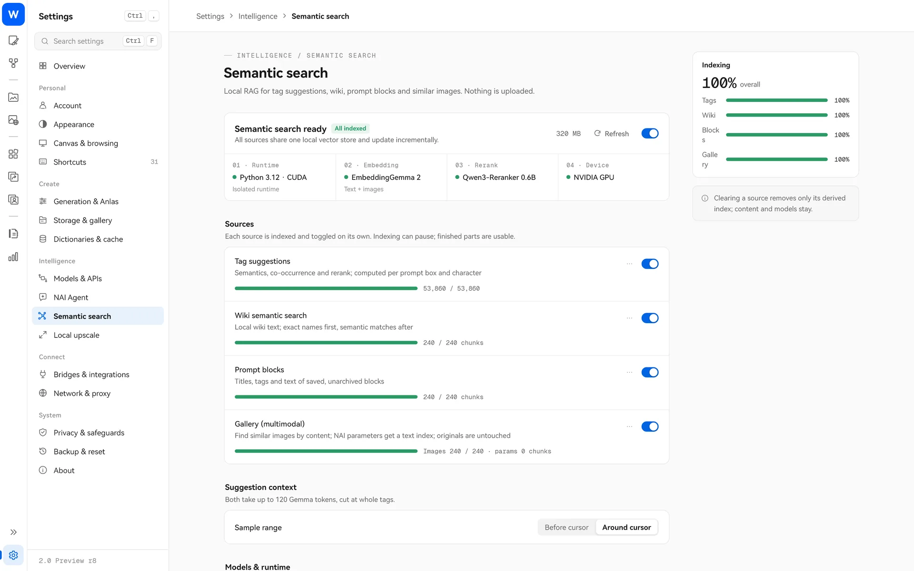

> [← 홈으로](../../../README.md) · [사용 안내 목록](README.md)

# 로컬 시맨틱 검색(RAG)

일반 검색은 글자가 일치해야 하지만 시맨틱 검색은 **의미**로 찾습니다. 켜면 “비 오는 거리”를 입력해 `rain`, `wet street`, `umbrella` 관련 태그, 블록, 백과 항목과 예전에 만든 비슷한 이미지를 찾을 수 있습니다.

**모두 본인의 PC에서 실행하며 어떤 내용도 업로드하지 않습니다.** 선택 기능이므로 켜지 않아도 다른 기능에는 영향을 주지 않습니다.

이 스크린샷은 이전 버전입니다. 현재는 임베딩 모델과 RAG 전체 스위치가 각각 하나이므로 아래 설명과 현재 화면을 기준으로 사용하세요.

## 사용할 수 있는 곳

| 소스 | 효과 |
| --- | --- |
| 태그 시맨틱 검색 및 추천 | 설명의 의미로 태그를 찾으며, 빈 검색어에서는 로컬 동시 출현으로 조합을 추천합니다 |
| Wiki 시맨틱 검색 | 태그 백과를 의미로 검색하며 이름의 정확한 일치를 우선합니다 |
| 프롬프트 블록 | 블록 라이브러리에서 의미로 찾습니다(저장한 블록의 제목·태그·텍스트만 수록합니다) |
| 갤러리 멀티모달 검색 | 로컬 갤러리에서 화면 내용으로 이미지를 찾거나 선택한 이미지와 비슷한 이미지를 찾습니다. NAI 이미지의 파라미터는 별도 텍스트 색인을 만듭니다 |

소스마다 색인을 만들고, 색인된 내용은 바로 검색에 사용합니다. RAG 전체 스위치는 하나입니다. 일반 자동 완성은 이름·별칭·키워드를 대조하며 모델을 사용하지 않습니다. NAI Agent의 `studio_search`는 의미 검색, `tag_query`는 이름과 별칭 검색, `tag_related`는 로컬 동시 출현 검색입니다. 뒤의 두 도구는 RAG가 필요하지 않습니다.

## 설치

“설정 → 시맨틱 검색”을 열고 순서대로 진행합니다.

1. **실행 환경**: Windows의 NVIDIA GPU는 **CUDA** 또는 **CPU**를 선택합니다. Apple Silicon Mac은 관리 환경을 설치하고 장치를 **자동/CPU**로 설정합니다. Intel Mac에서는 관리 환경을 설치할 수 없지만 기존의 호환 Python을 검사할 수 있습니다. 이 단계에서는 Python과 추론 의존성만 설치하며 모델은 다운로드하지 않습니다.
2. **임베딩 모델**: 텍스트와 이미지용 **EmbeddingGemma 2** 하나만 필요합니다. **다운로드** 또는 기존 모델 폴더를 선택하세요. 다운로드한 파일은 개별 검증하며 모델과 실행 환경은 별도로 관리합니다.
3. **전체 시맨틱 검색 스위치를 켠 뒤**, 필요한 소스에서 **색인 만들기**를 선택합니다. 범위를 확인하고 직접 시작하세요. 소스별 스위치는 없으며 아직 만들지 않은 색인은 자동으로 생성되지 않습니다.

색인 생성은 언제든 일시 정지할 수 있고 완료한 부분은 바로 사용할 수 있습니다. 첫 색인을 만든 뒤에는 변경분을 갱신하며, 갤러리 이미지나 NAI 매개변수의 변경도 반영합니다. 소스의 색인을 지우면 파생 데이터가 삭제되며 원본과 모델은 유지됩니다.

로컬 갤러리의 RAG 메뉴에서 **이미지 내용만**을 선택해 ‘비 오는 밤거리의 네온 반사’를 찾아보세요. 예시 이미지가 있다면 **이미지를 선택하여 유사 검색**을 사용할 수 있습니다.

## 설정 항목

- **실행 장치**: Windows는 자동·CUDA·CPU, Mac은 자동·CPU입니다.
- **Python 인터프리터**: 기본적으로 자동 설치된 독립 환경을 사용하며 기존 `python.exe`를 지정할 수도 있습니다.

## 업그레이드와 재시도

이전 태그 색인에는 업그레이드 동작이 표시됩니다. 확인 후 새 색인을 만들고 검증한 다음 같은 모델의 이전 태그 데이터만 정리합니다. Wiki·블록·갤러리·번역 데이터는 유지합니다. 새 방식으로 일부 만든 색인은 삭제하지 않고 이어서 만들 수 있습니다.

작업이 중단되거나 실패하면 기존 색인을 유지하고 **계속/재시도**를 사용하세요. 명시적으로 **다시 만들기**를 선택할 때만 해당 소스의 기존 색인을 비웁니다. 이전 태그 정리에 실패해도 새 색인은 검색할 수 있으며 정리만 별도로 재시도할 수 있습니다.

## 자주 묻는 질문

- **첫 색인 생성이 느립니다**: 태그가 수십만 개이고 이미지도 수만 장일 수 있어 처음에는 시간이 오래 걸립니다. 일시 정지했다가 이어서 진행할 수 있습니다.
- **준비 단계에서 진행률이 멈췄습니다**: 모델과 기존 색인을 불러오는 데 시간이 필요합니다. 잠시 기다립니다.
- **NVIDIA 그래픽카드 없이도 사용할 수 있습니까**: CPU로 사용할 수 있지만 속도는 느려집니다.
- **이미지를 외부로 보냅니까**: 보내지 않습니다. 모델과 런타임을 다운로드할 때만 인터넷이 필요합니다.
