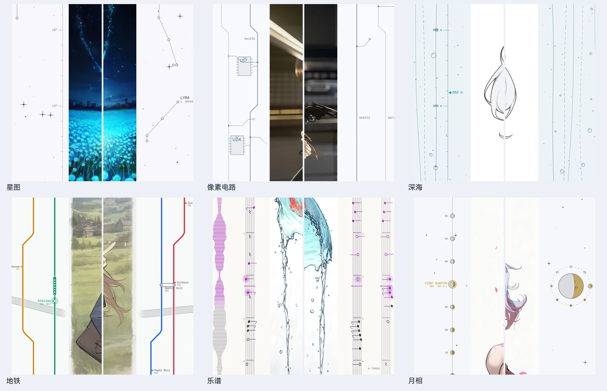

> [← 返回首页](../../../README.md) · [教程目录](README.md)

# 无限画布与视觉通道

## 无限画布

生图页中间是一张可以无限拖动的画布，每次生成的结果按批次铺开。

| 操作 | 方式 |
| --- | --- |
| 平移 | 滚轮上下，`Shift+滚轮`左右；或中键 / `Shift+左键`拖动 |
| 缩放 | `Ctrl+滚轮` |
| 导航 | `W A S D` |
| 总览全部 | `Ctrl+0` |
| 看原图 | 对局部重绘等有原图的结果，按住鼠标、空格或回车，显示原图和本次重绘范围（图上会标 OLD） |

- 点击生成后会先放一个占位并飞到最新一组，生成过程中的预览和最终结果都在原位出现；
- 可以把喜欢的图“固定”在画布上，即使历史记录被清空也还在；
- 透明背景的图可以选择垫底样式（棋盘格、纯色等），只是显示，不会写进图片；
- “画布显示”里可以开关放大填满、减少动效、锁定画布相机。

## 视觉通道

视觉通道是画布两侧跟着滚动的装饰，**只画在图片之外，不挡图**。

打开方式：画布左下角齿轮 → “画布显示” → “视觉通道”。

- **主题**：像素电路、星图、植物标本、回廊、深海、青海波、机芯、地层、地铁、乐谱、月相，共 11 种；
- **模式**：关闭、固定一个、每次随机（随机时至少保留两个主题，可以“换一组”）；
- **浓淡**：淡、标准、浓；
- **时间刻度**：显示批次时间、日期分隔和右侧刻度条；
- **空闲微动**：没在生成时装饰会轻微动起来，生成时自动暂停。

