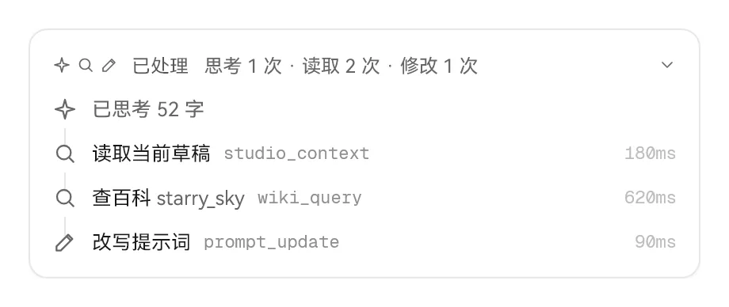
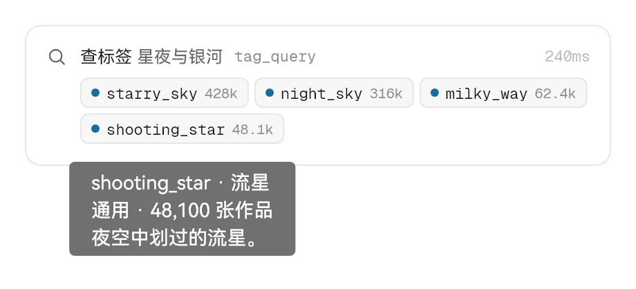
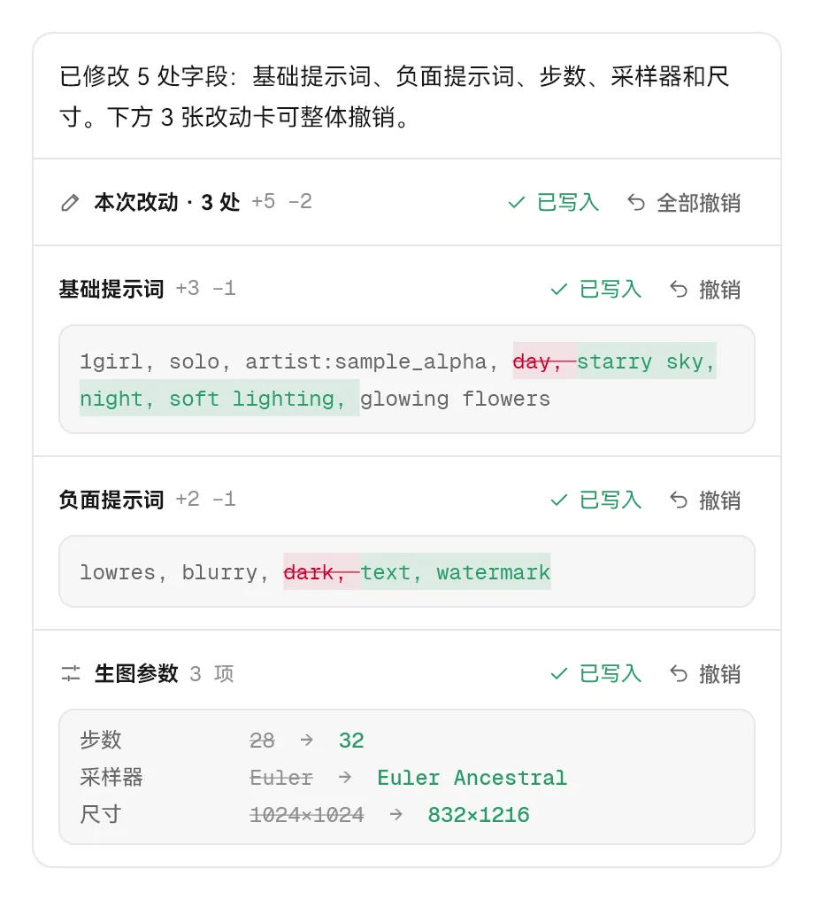
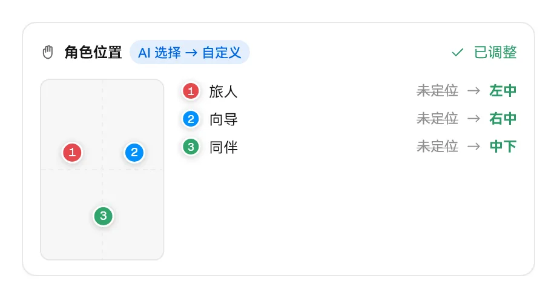
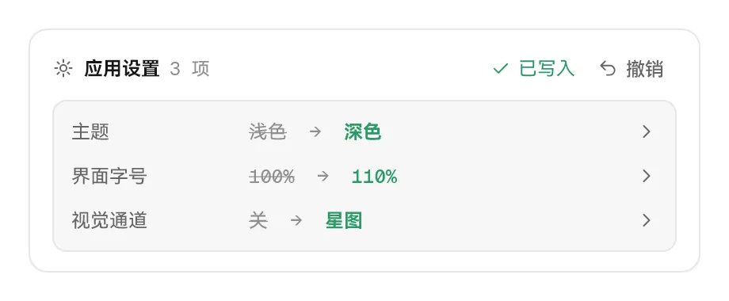
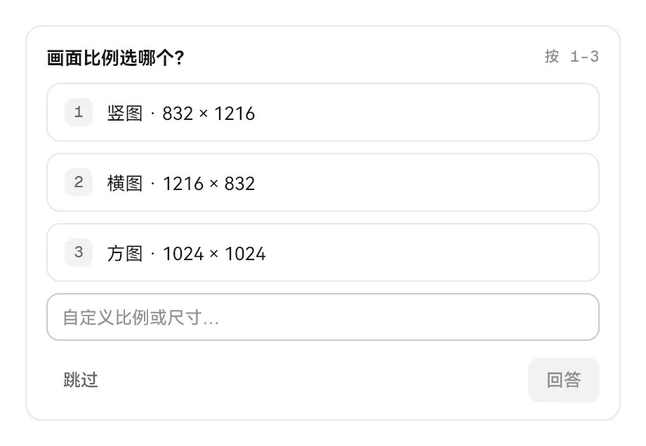
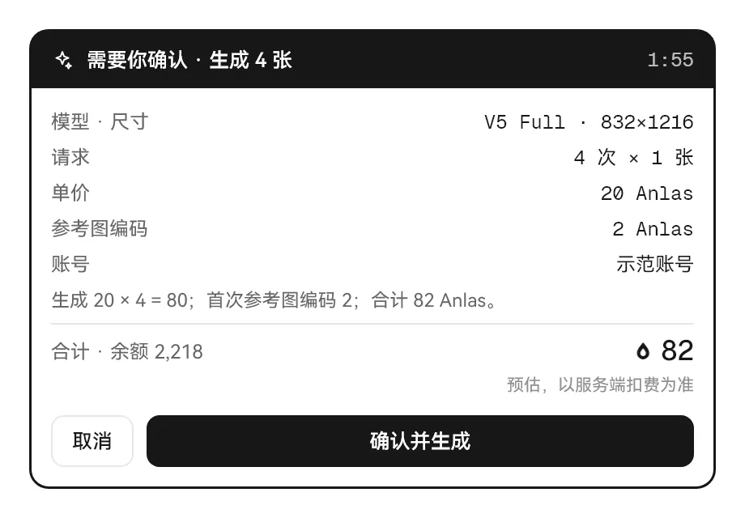
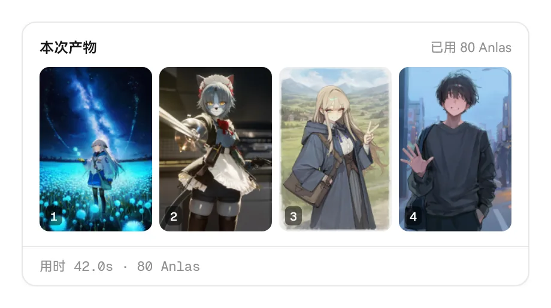
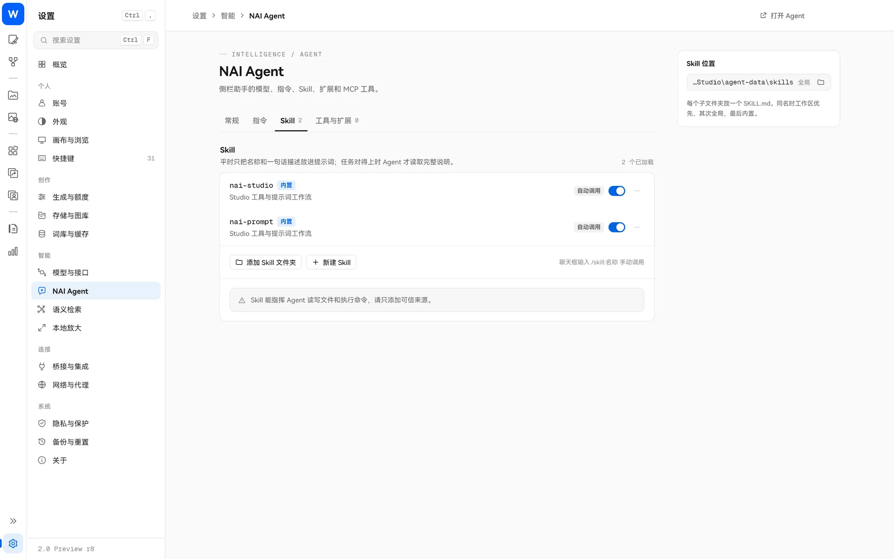

> [← 返回首页](../../../README.md) · [教程目录](README.md)

# NAI Agent

NAI Agent 是内置在 Studio 里的 AI 助手。你用聊天的方式告诉它要做什么，它会调用 Studio 的工具去完成：改提示词、查标签和百科、整理积木和图库、设置参考图、准备生成……每做一件事，对话里都会出现一张对应的**卡片**，告诉你它改了什么，并且大多可以一键撤销。

## 准备

1. 在“设置 → 模型与接口”添加一个大模型服务商（支持 OpenAI 兼容接口、Responses、Anthropic、Gemini 和 Ollama），选好模型；
2. 在生图页或画风探索页顶部点“NAI Agent”按钮，右侧会展开侧栏；
3. 在侧栏底部选择要用的模型，开始聊天。

Agent 使用你自己的模型服务，对话产生的费用按该服务的价格计算。

## 能让它做什么

几个例子：

- “把现在的提示词改成雨夜街头的氛围，保留角色描述”
- “查一下 `wet hair` 的百科，有没有更常用的写法”
- “把积木库里所有画师积木挪到‘画风’文件夹”
- “把这张图设成风格迁移参考”（可以直接粘贴或拖入图片）
- “找出图库里上周画的所有夜景图，移到新文件夹”
- “按现在的设置准备生成 4 张，报个价”

它能用的 Studio 工具包括：读取当前草稿、查看图片、改写提示词、草稿快照、查百科、查标签、查积木、整理积木、读取 / 修改设置、画风探索、准备生成、生成图片、取消生成、查图库、整理图库、语义搜索、设置参考图、参考图库、图像工具、变体 / 增强。此外还能在工作区里读写文件、运行命令，必要时向你提问。

## 对话里的卡片

Agent 不会悄悄改东西。下面是你会在对话里看到的几种卡片。

### 过程：思考和步骤

模型的思考过程默认折叠，只显示“已思考”；它调用的每个工具按顺序列成步骤（例如 读取当前草稿 → 查百科 → 改写提示词），点开可以看参数和结果。

### 查到的标签

查标签或语义搜索的结果直接挂在那一步下面：标准标签名、中文名、作品数，悬停能看 Wiki 简介。

### 提示词和参数改动

每改一栏提示词就出一张差异卡，绿色是新增、红色是删除；步数、采样器、尺寸这类参数改动单独一张，列出旧值 → 新值。一次改了好几处时，最上面会有“本次改动 · N 处”，可以**全部撤销**，也可以只撤销其中一张。如果你在这之后又手动改了草稿，撤销会被锁住，避免覆盖你的新修改。

### 角色位置

调整角色定位时，会画一块迷你画面，标出每个角色的落点，一眼看出谁在左、谁在右。

### 应用设置

让它改设置（比如切到深色主题、打开视觉通道），会列出每一项的旧值 → 新值，可以整张撤销，也可以点“去设置”跳到对应的设置项。

### 整理图库

收藏、移动、复制、删除、加入收藏集之后，会显示受影响的图片缩略图和张数。删除走回收区，大多数操作都能撤销。

### 向你提问

遇到拿不准的地方，它会停下来问你，给出几个选项，也可以自己填答案。

### 需要你允许

在“询问”档位下，修改、删除、移动、运行命令前会弹出这张卡，显示它准备执行的具体参数，选“允许一次”“本会话允许相同调用”或“拒绝”。

### 花 Anlas 之前：价格卡

Agent 想生成图片、做变体 / 增强或使用云端图像工具时，会先弹出这张价格卡：模型和尺寸、请求次数、单价、参考图编码费、合计和当前余额。价格由 Studio 计算，模型改不了。**只有你点“确认并生成”才会真正花 Anlas**，任何权限档位都一样。报价有有效期，配置变了或过期了需要让 Agent 重新准备。

### 产物和小结

生成的图会出现在对话里（也会进“产物”页），附上本轮花了多少 Anlas。每轮结束有一行小结：用时、Anlas、改动几处、调用了几次工具、用了多少 token。

## 权限档位

侧栏底部可以选择权限档位：

| 档位 | 行为 |
| --- | --- |
| **只读** | 只读取和讨论，不修改、不生成 |
| **询问** | 修改、命令和未知工具先问你 |
| **自动** | 工作区内的常规修改直接执行；花钱仍要确认 |
| **完全权限** | 不再询问，所有操作直接执行；花 Anlas 仍要确认（切换前会提示风险） |

生成途中点 Agent 的停止，或者按主界面的停止，都能中断等待中的生成。

## 技能（Skill）

技能是写给 Agent 看的“操作手册”，需要时才读取：

- 内置 **nai-studio**（Studio 各工具的用法和规则）和 **nai-prompt**（V4 / V4.5 / V5 提示词写法）；
- 你也可以写自己的技能：放在 `agent-data/skills/`（全局）或某个工作区的 `skills/` 文件夹里。同名时工作区优先，其次全局，最后内置；
- 每个技能可以开关，或设为“仅手动”，在输入框里用 `/skill:名称` 调用。

输入框里 `@` 引用文件或图片，`/` 调用技能。

## MCP 与 CodeMode

- **MCP**：在“设置 → NAI Agent”里添加外部 MCP 服务器（支持 stdio 和 Streamable HTTP，支持 OAuth 登录），让 Agent 使用更多外部工具。配置保存在加密存储里。
- **CodeMode**：Agent 默认通过一个安全的脚本沙盒按需发现和调用工具，一次完成多步操作，减少来回对话。

## 工作区与数据

- 每个工作区有自己的聊天、产物和规则，可以新建、改名、删除（删除后可以从回收区撤销）；
- 数据都在程序目录下的 `agent-data/` 里；
- “指令”页可以写全局指令和工作区规则，影响之后的请求；
- 每次运行默认最多 32 个模型请求，可以在设置里调整（1–200）；
- 发出去的消息可以“编辑”后重发（之后的对话会被替换），最后一条回复可以“重新回答”。

## 小贴士

- 先用“询问”档熟悉它会做什么，再考虑“自动”。
- 外部 Pi 扩展和 MCP 服务器能运行本地代码，只安装可信来源的。
- 外部 AI 工具或脚本也可以通过“本机桥接”（随附 `studio-bridge.exe`）控制 Studio，同样要报价确认才能生图。
