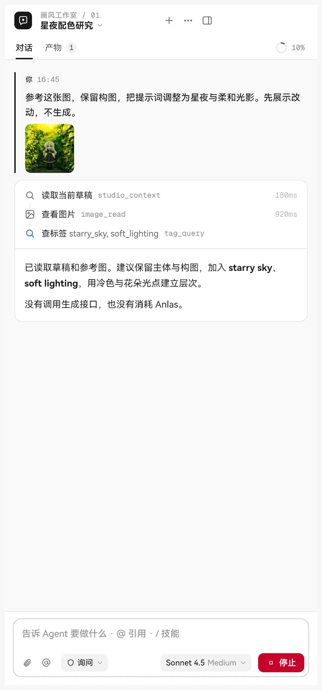

> [← 返回首页](../../../README.md) · [教程目录](README.md)

# NAI Agent

NAI Agent 是内置在 Studio 里的 AI 助手。你用聊天的方式告诉它要做什么，它会调用 Studio 的工具去完成：改提示词、查标签和百科、整理积木和图库、设置参考图、准备生成……

## 准备

1. 在“设置 → 模型与接口”添加一个大模型服务商（支持 OpenAI 兼容接口、Responses、Anthropic、Gemini 和 Ollama），选好模型；
2. 在生图页或画风探索页顶部点“NAI Agent”按钮，右侧会展开侧栏；
3. 在侧栏底部选择要用的模型，开始聊天。

Agent 使用你自己的模型服务，对话产生的费用按该服务的价格计算。

## 能让它做什么

几个例子：

- “把现在的提示词改成雨夜街头的氛围，保留角色描述”
- “查一下 `wet hair` 的百科，有没有更常用的写法”
- “把积木库里所有画师积木挪到‘画风’文件夹”
- “把这张图设成风格迁移参考”（可以直接粘贴或拖入图片）
- “找出图库里上周画的所有夜景图，移到新文件夹”
- “按现在的设置准备生成 4 张，报个价”

它能用的 Studio 工具包括：读取当前草稿、查看图片、改写提示词、草稿快照、查百科、查标签、查积木、整理积木、读取 / 修改设置、画风探索、准备生成、生成图片、取消生成、查图库、整理图库、语义搜索、设置参考图、参考图库、图像工具、变体 / 增强。此外还能在工作区里读写文件、运行命令，必要时向你提问。

## 权限与确认

侧栏底部可以选择权限档位：

| 档位 | 行为 |
| --- | --- |
| **只读** | 只读取和讨论，不修改、不生成 |
| **询问** | 修改、命令和未知工具先问你 |
| **自动** | 工作区内的常规修改直接执行；花钱仍要确认 |
| **完全权限** | 不再询问，所有操作直接执行；花 Anlas 仍要确认（切换前会提示风险） |

需要确认时会弹出卡片，可以选“允许一次”“本会话允许相同调用”或“拒绝”。删除、移动这类操作和运行命令都属于需要确认的操作。

### 生成图片一定要你确认

Agent 想生成图片时，会先“准备生成”，在 Studio 里弹出价格卡：每次请求多少 Anlas、预计总价、当前余额。**只有你在价格卡上确认后才会真正生成**，任何权限档位都一样。报价 5 分钟内有效。生成途中点停止，或者按主界面的停止，都能中断。

## 技能（Skill）

技能是写给 Agent 看的“操作手册”，需要时才读取：

- 内置 **nai-studio**（Studio 各工具的用法和规则）和 **nai-prompt**（V4 / V4.5 / V5 提示词写法）；
- 你也可以写自己的技能：放在 `agent-data/skills/`（全局）或某个工作区的 `skills/` 文件夹里。同名时工作区优先，其次全局，最后内置；
- 每个技能可以开关，或设为“仅手动”，在输入框里用 `/skill:名称` 调用。

输入框里 `@` 引用文件或图片，`/` 调用技能。

## MCP 与 CodeMode

- **MCP**：在“设置 → NAI Agent”里添加外部 MCP 服务器（支持 stdio 和 Streamable HTTP，支持 OAuth 登录），让 Agent 使用更多外部工具。配置保存在加密存储里。
- **CodeMode**：Agent 默认通过一个安全的脚本沙盒按需发现和调用工具，一次完成多步操作，减少来回对话。

## 工作区与数据

- 每个工作区有自己的聊天、产物和规则，可以新建、改名、删除（删除后可以从回收区撤销）；
- 数据都在程序目录下的 `agent-data/` 里；
- “指令”页可以写全局指令和工作区规则，影响之后的请求；
- 每次运行默认最多 32 个模型请求，可以在设置里调整（1–200）。

## 小贴士

- 先用“询问”档熟悉它会做什么，再考虑“自动”。
- 外部 Pi 扩展和 MCP 服务器能运行本地代码，只安装可信来源的。
- 外部 AI 工具或脚本也可以通过“本机桥接”（随附 `studio-bridge.exe`）控制 Studio，同样要报价确认才能生图。
