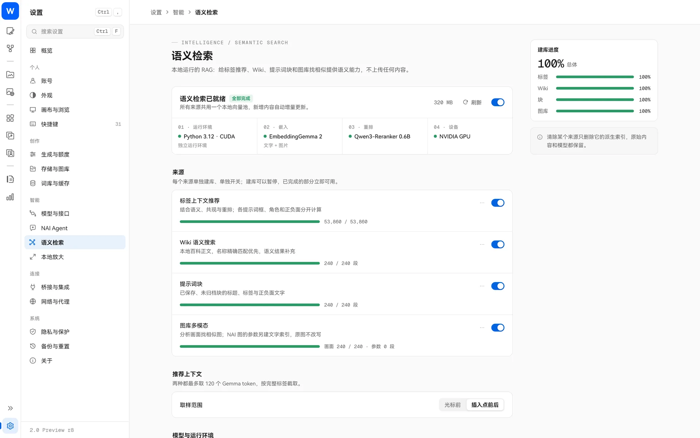

> [← 返回首页](../../../README.md) · [教程目录](README.md)

# 本地语义检索（RAG）

普通搜索要求字面匹配；语义检索按**意思**找。开启后，输入“下雨的街道”也能找到 `rain`、`wet street`、`umbrella` 相关的标签、积木、百科词条，以及你以前画过的类似的图。

**全部在你的电脑上运行，不上传任何内容。** 这是可选组件，不开启也不影响其他功能。

## 能用在哪里

| 来源 | 效果 |
| --- | --- |
| 标签上下文推荐 | 标签扩展结合你光标附近的提示词推荐标签；各提示词框、角色框和正负面分开计算 |
| Wiki 语义搜索 | 标签百科按意思搜索，名称精确匹配优先 |
| 提示词块 | 块库按意思搜索积木（只收录已保存积木的标题、标签和文字） |
| 图库多模态 | 本地画廊按画面内容找图，或选一张图找相似；NAI 图的参数另建文字索引 |

每个来源单独开关、单独建库。NAI Agent 的语义搜索工具也会用到它。

## 安装

打开“设置 → 语义检索”，按顺序完成：

1. **运行环境**：点“安装”。NVIDIA 显卡选 **CUDA**（下载约需数 GB），其他显卡选 **CPU**（下载较小）。这一步只装 Python 和推理依赖，不下载模型。
2. **模型**：需要两个模型，可以点“下载”自动获取，也可以选你已经下载好的目录：
   - EmbeddingGemma 2（约 1.5 GB），负责理解文字和图片；
   - Qwen3-Reranker-0.6B（约 1.2 GB），负责给文字结果重新排序。
   下载的文件会逐个校验。
3. **启用 RAG**，在「来源」里选择要收录的内容，点「建立索引」。首次建库需要预览范围后手动点「开始」。

建库可以随时暂停，已经完成的部分立即可用。之后会增量更新，图库会同步图片或 NAI 参数的变化。清除某个来源的索引只删除派生数据，原始内容和模型都保留。

试试在本地画廊的 RAG 菜单中选「仅画面」，搜索「雨夜街道上的霓虹倒影」。手头有样图时，可以选「选择图片找相似」。

## 设置项

- **运行设备**：自动、CUDA 或 CPU；
- **推荐上下文**：取光标前的内容，或插入点前后的内容（最多约 120 个 token，按完整标签截取）；
- **Python 解释器**：默认用自动安装的独立环境，也可以指定已有的 `python.exe`。

## 常见问题

- **首次建库很慢**：标签库有几十万条，图库可能有上万张，第一次需要较长时间，可以暂停后再继续。
- **准备阶段进度不动**：载入模型和已有索引需要时间，请耐心等待。
- **没有 NVIDIA 显卡能用吗**：可以用 CPU，速度会慢一些。
- **会把我的图片发出去吗**：不会。只有下载模型和运行环境时需要联网。
