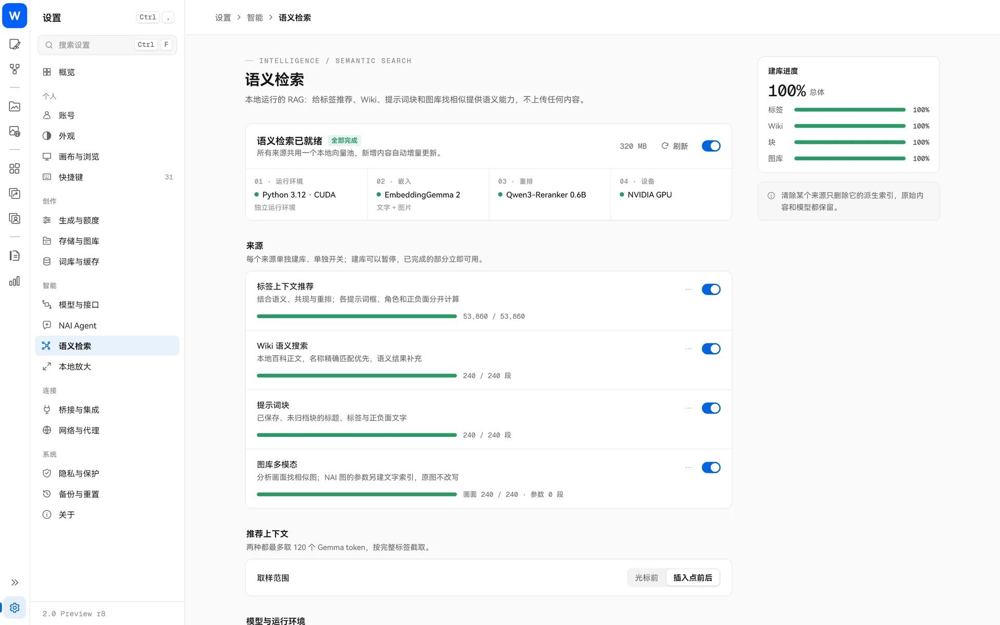

> [← 返回首页](../../../README.md) · [教程目录](README.md)

# 本地语义检索（RAG）

普通搜索要求字面匹配；语义检索按**意思**找。开启后，输入“下雨的街道”也能找到 `rain`、`wet street`、`umbrella` 相关的标签、积木、百科词条，以及你以前画过的类似的图。

**全部在你的电脑上运行，不上传任何内容。** 这是可选组件，不开启也不影响其他功能。

截图为较早版本；当前版本只有一个嵌入模型和一个 RAG 总开关，以以下说明及实际界面为准。

## 能用在哪里

| 来源 | 效果 |
| --- | --- |
| 标签语义搜索与推荐 | 输入描述时按意思找标签；空框使用本地共现提供搭配 |
| Wiki 语义搜索 | 标签百科按意思搜索，名称精确匹配优先 |
| 提示词块 | 块库按意思搜索积木（只收录已保存积木的标题、标签和文字） |
| 图库多模态 | 本地画廊按画面内容找图，或选一张图找相似；NAI 图的参数另建文字索引 |

各来源单独建库，已建内容直接用于检索；只有一个 RAG 总开关。输入时的普通补全仍按名称、别名和关键词匹配，不需要模型。NAI Agent 通过 `studio_search` 调用语义检索；`tag_query` 查名称和别名，`tag_related` 查本地共现，两者不依赖 RAG。

## 安装

打开“设置 → 语义检索”，按顺序完成：

1. **运行环境**：Windows 的 NVIDIA 显卡可选 **CUDA**，也可使用 **CPU**；Apple 芯片 Mac 使用自动安装环境和「自动／CPU」设备选项。Intel Mac 不提供托管环境安装，可检测已有的兼容 Python。这一步只装 Python 和推理依赖，不下载模型。
2. **嵌入模型**：只需 **EmbeddingGemma 2**，用于文字和图片。可以点「下载」，或选择已有模型目录；下载文件会逐个校验。模型与运行环境分开管理。
3. **启用语义检索总开关**，在需要的来源行点「建立索引」。先预览范围，再手动点「开始」。来源没有额外开关，未建库的来源不会自动开工。

建库可以随时暂停，已经完成的部分立即可用。之后会增量更新，图库会同步图片或 NAI 参数的变化。清除某个来源的索引只删除派生数据，原始内容和模型都保留。

试试在本地画廊的 RAG 菜单中选「仅画面」，搜索「雨夜街道上的霓虹倒影」。手头有样图时，可以选「选择图片找相似」。

## 设置项

- **运行设备**：Windows 为自动、CUDA 或 CPU；Mac 为自动或 CPU。
- **Python 解释器**：默认用自动安装的独立环境，也可以指定已有的 `python.exe`。

## 升级与重试

旧标签索引会显示升级入口。确认后建立新版，完成并校验后只清理同模型的退役标签数据；Wiki、提示词块、图库和翻译资料保留。已经用新版建立的部分索引可以继续，无需先删除。

建库中断或报错后，保留已有索引，使用「继续／重试」。只有明确选择「重建」才会清掉该来源的现有索引。清理旧标签失败时，新版索引仍可检索，可以单独重试清理。

## 常见问题

- **首次建库很慢**：标签库有几十万条，图库可能有上万张，第一次需要较长时间，可以暂停后再继续。
- **准备阶段进度不动**：载入模型和已有索引需要时间，请耐心等待。
- **没有 NVIDIA 显卡能用吗**：可以用 CPU，速度会慢一些。
- **会把我的图片发出去吗**：不会。只有下载模型和运行环境时需要联网。
