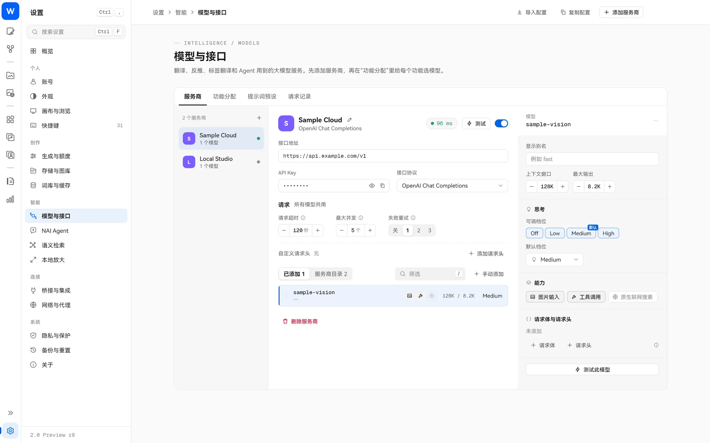

> [← 返回首页](../../../README.md) · [教程目录](README.md)

# 翻译块

看不懂一长串英文提示词？翻译块会把它翻成中文，直接显示在原来的位置上。**生成时永远使用英文原文**，翻译只帮你读和改。

## 先配置一个翻译模型

翻译需要你自己的大模型服务（OpenAI 兼容接口、Anthropic、Gemini、本地 Ollama 等都可以）：

1. 打开“设置 → 模型与接口”，点“添加服务商”，填入地址和密钥，选好模型；
2. 在“功能分配”里给“提示词翻译”选一个模型。

同一页还能给另外三个功能分配模型：提示词反推、标签翻译与语义补充、百科翻译。密钥保存在系统安全存储里。翻译请求会发到你选的服务，费用按该服务的价格计算。

## 使用

点提示词工具栏上的“翻译”。翻译完成后，每段英文变成一个“翻译块”：

| 操作 | 效果 |
| --- | --- |
| **中键点块** | 在原文和译文之间切换 |
| **左键点原文** | 定位光标，直接修改英文 |
| **左键点译文** | 打开翻译块编辑窗 |
| 翻译菜单“全部显示原文 / 译文” | 整组切换 |
| 翻译菜单“翻译新增内容” | 只翻译后来新写的部分 |
| “全部翻译块还原为原文文本” | 去掉所有翻译块，回到普通文字 |

## 翻译块编辑窗

左键点译文会打开编辑窗，可以看到原文和“生图使用”的内容：

- 直接改英文原文，保存后生效；
- **↑ 中文转原文**：写中文，让模型转成英文标签，检查后保存；
- **↓ 原文转中文**：重新翻译；
- 原文被改动后，块上会提示译文待同步。

## 怎么防止模型翻错：命中术语表

很多 Danbooru 标签单看字面容易误解：一个词可能是画师名、作品名、角色名，也可能只是普通的画面描述。为了让模型翻得准，每次翻译时 Studio 都会先在本地查一遍，把**提示词里命中的标签**整理成一份术语表，随请求一起发给模型参考：

| 术语表里的内容 | 来源 |
| --- | --- |
| 标准标签名 | 本地标签库（只收录在库里查得到的完整标签） |
| 中文译名 | 之前翻译并缓存过的标签译名 |
| 简短释义 | 本地 Wiki：有对应的中文释义就用中文，没有就附上原文短释义，并注明是原文 |
| 类别 | 本地标签库（画师 / 作品 / 角色 / 一般等） |

同时还有几条约束：

- **术语表只是参考资料**：明确告诉模型，提示词和术语表都只是要翻译的数据，不是指令，也不能把释义追加进提示词；查不到的标签不许编造含义或关系；
- **只对完整标签生效**：句子里的普通单词不会被强行套用 Danbooru 的含义；
- **结果要回本地核对**：译文里标出的画师、作品、角色标签必须能在本地标签库里查到，类别图标由 Studio 根据本地数据决定，不采信模型给的类别；对不上的标记直接丢弃，译文本身照常保留；
- **译名和释义分开缓存**：Wiki 原文变了，旧的中文释义就不再使用，改用新原文，避免过期解释误导模型；
- **全部在本地完成**：查术语表不会额外调用模型，查询失败也不会阻断翻译。

同一套术语表也用在“↑ 中文转原文”、标签翻译和百科翻译里：你在编辑窗里写中文，模型能参考命中的标准标签把它还原成准确的英文标签；翻译标签名或 Wiki 正文时，也会附上相关标签的释义来区分同名的画师、作品和普通词。

## 小贴士

- 中键随时偷看一眼原文，确认模型没把 `cat ears` 翻成奇怪的东西。
- 翻译不会改变保存的生成原文，也不会影响 Anlas 消耗。
- 标签和百科的自动翻译默认关闭，需要时在 [标签百科](tags-wiki.md) 和词库设置里打开。
