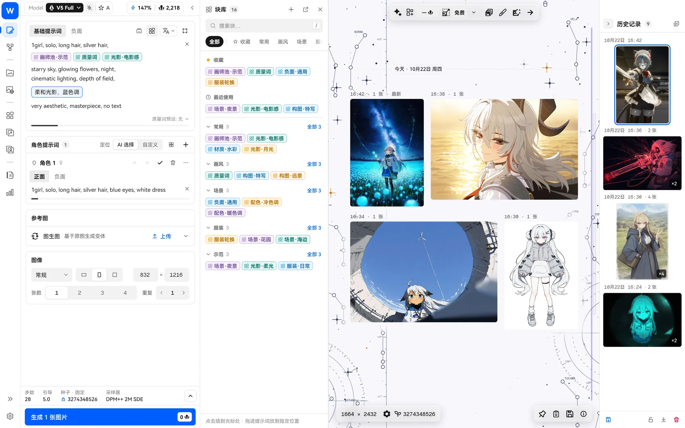
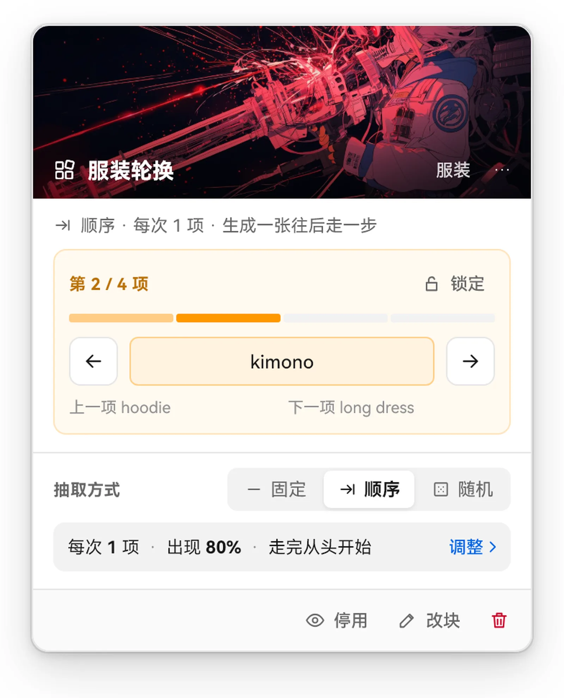
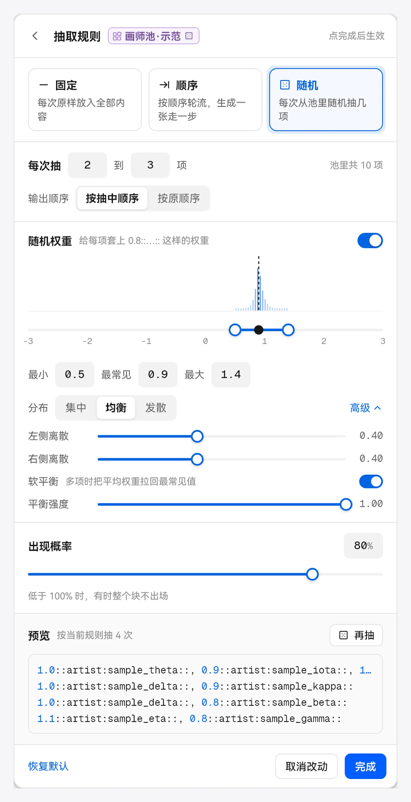
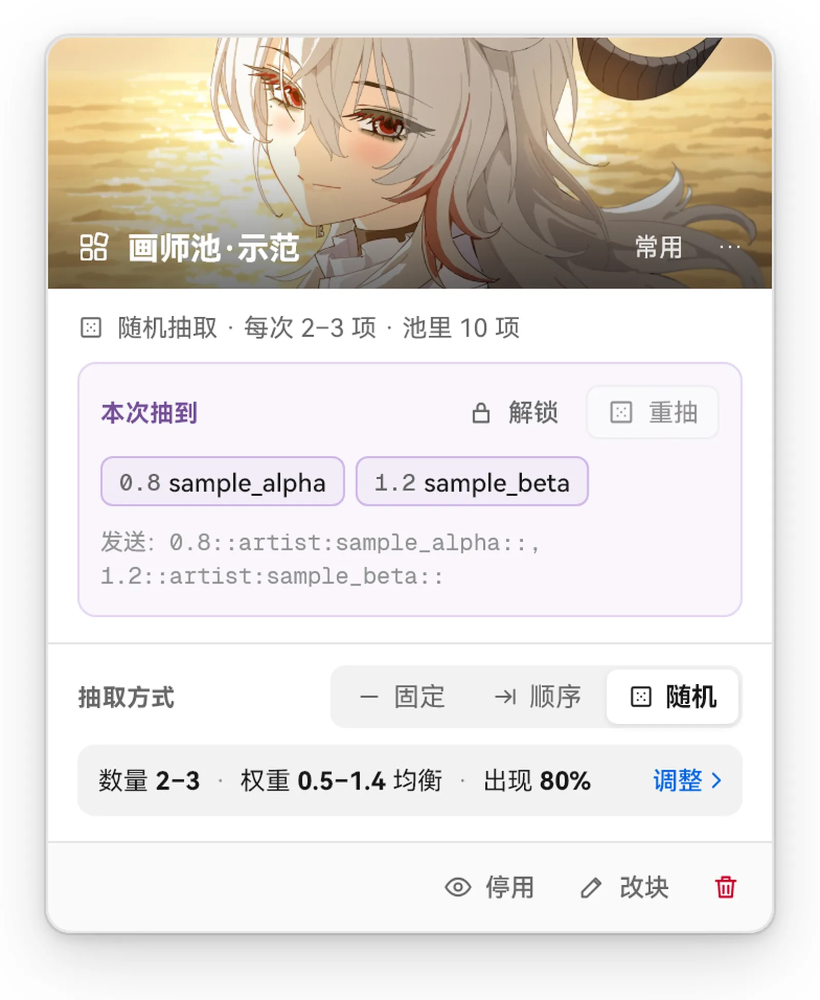

> [← 返回首頁](../../../README.md) · [教學目錄](README.md)

# 積木

積木（介面上也稱為「塊」）是將常用提示詞片段儲存下來、重複使用的功能。畫師池、品質詞、負面詞、服裝清單、構圖描述……寫一次存成積木，以後點一下或拖曳一下就能放回提示詞。


## 積木放在哪裡

- **積木庫頁面**：左側導覽的「提示詞塊」。在這裡新增、編輯、分資料夾、加入收藏集、修改顏色和預覽圖。
- **生圖頁的塊庫側欄**：位於生圖頁右側，點一下插入游標位置，或拖進提示詞放到指定位置。
- **積木板**：可以浮在視窗上的小面板，放幾個最常用的積木。



## 新增積木

- 在積木庫裡按 `Ctrl+N` 新增；
- 或在提示詞裡選取一段文字，按右鍵選「存為塊」。

一個積木可以有多項內容（例如在畫師池裡放 30 位畫師），也可以同時附帶**負面內容**和**生圖參數**，詳見下方的 [畫風塊](#畫風塊正面負面參數打包)。

輸入內容時，按 Enter 或逗號就會新增一項；貼上整段文字時，會自動依逗號和換行拆分。若想讓含逗號的一段內容算作**一項**，請用 `1::…::` 包起來，例如 `1::sunrise, on a hill, wind::`（權重 1 不會改變強度），逐行寫好後一次貼上。

## 三種方式：固定、順序、隨機

積木插入提示詞後會顯示為「膠囊」。點選它開啟設定，選擇這次如何取用內容：

| 方式 | 行為 | 適合 |
| --- | --- | --- |
| **固定** | 每次原樣插入全部內容 | 品質詞、負面詞、固定角色描述 |
| **順序** | 依序輪替，每次生成前進一步，結束後從頭開始 | 逐一試過一組服裝、場景或姿勢 |
| **隨機** | 每次從池裡隨機抽取幾項 | 批次測試畫師組合、隨機更換背景 |

同一個積木插入不同位置時，可以各自設定不同方式。

### 順序



- 每發起一次生成就前進一步。一次請求產生多張圖片時，這一批使用同一項，下一次請求才會前進。
- 卡片上的 ← → 可以手動切換前後項目。
- 鎖定後不會自動前進。

**範例**：把 `school uniform`、`hoodie`、`kimono`、`maid outfit` 存成一個順序積木，連續生成四次，就能得到同一角色穿四套衣服的圖片。

#### 用順序積木推進故事

順序積木不只能換衣服，也可以用在**任何需要依序進行的內容**。把故事拆成幾幕，每一幕寫成一項，積木名稱就用故事名稱，每生成一次就推進一幕：

```text
積木名稱：雨夜歸途（順序）
1::train station, night, rain, holding umbrella, waiting::
1::walking, wet street, neon lights, reflection::
1::convenience store, warm light, buying drink::
1::apartment door, looking back, smile, rain stopped::
```

- 一幕有多個標籤時，用 `1::…::` 包起來，整幕就算作一項，不會被逗號拆開；
- 卡片上的 ← → 可以隨時跳到某一幕重畫，不滿意時可鎖定目前這一幕，反覆生成；
- **搭配更換角色**：再放一個角色積木。設為隨機，就是「同一個故事，每幕換不同角色」；鎖定故事積木、只重抽角色，就是「同一幕，換幾個角色演」；兩個順序積木一起前進，則是角色和場景依固定搭配逐幕推進。

同樣的思路也適用於表情序列、一天中的時間（清晨 → 正午 → 黃昏 → 深夜）、鏡頭遠近（全身 → 半身 → 特寫）、四季等。

### 隨機


隨機模式有一組「抽取規則」，修改後點選「完成」生效：

- **數量**：每次抽幾項，可以是範圍，例如 2–3；
- **出現**：這個積木出現的機率。低於 100% 時，有時整個積木都不會出現；
- **權重**：自動為抽到的每一項加上 `0.8::…::` 這樣的權重，權重在「最小 ~ 最大」之間隨機，以「最常見」為中心；
- **輸出順序**：依抽中順序，或依積木內原本的順序；
- 規則區可以用「按當前規則抽 4 次」預覽效果，不滿意再點「再抽」。



展開「進階」可以調整權重的分布形狀：

- **集中 / 均衡 / 發散**：讓權重集中到中心值，或分散到兩端；
- **左側 / 右側離散**：分別微調中心值兩側的形狀；
- **軟平衡**：一次抽到的多位畫師權重整體偏高或偏低時，將它們拉回，維持整體畫風強度穩定，同時不改變彼此的相對差距。

### 鎖定、重抽、停用



- **鎖定**：固定這次抽到的結果，之後生成不再重抽。適合「保留這個姿勢，再換幾套衣服」。
- **重抽**：手動重新抽取一次（鎖定時須先解鎖）。
- **停用**：暫時讓這個積木不參與生成，不用從提示詞裡刪除。

## 畫風塊：正面、負面、參數打包

一個積木除了正面內容，還可以附帶**負面內容**和**生圖參數**。因此，你可以把喜歡的整套畫風（畫師串、品質詞、對應的負面詞和最適合的參數）存成一個「畫風塊」，以後一鍵重複使用。

- **負面內容**：插入積木時，正面部分放在游標位置，負面部分會自動放入配對的負面框（主提示詞對應主負面，角色框對應該角色的負面），兩邊會作為一組一起管理。
- **生圖參數**：可以附帶模型、步數、引導、重縮放、採樣器和噪聲。編輯積木時點選「從當前讀取」，即可儲存目前生圖頁的參數。
- **一鍵套用參數**：插入積木時**不會**自動更改你的參數，避免誤改。需要時，在積木庫的右鍵選單或詳細資料裡點選「應用附帶參數」，也可以在提示詞裡點開這個積木的卡片套用，目前參數就會換成積木裡儲存的那一套。參數與目前模型不相容時，按鈕無法使用。

**使用範例**：調出滿意的圖片後，選取畫師串和品質詞，存成積木，在編輯視窗補上負面詞，點選「從當前讀取」儲存參數，命名為「水彩·清透」。以後建立任何提示詞，插入這個積木，再點一次「應用附帶參數」，就能回到同一套畫風。

## 整理積木庫

- 左側是資料夾和收藏集，可以用網格、清單或瀑布流檢視；
- 多選後可以依序插入提示詞、合併為新積木、統一修改顏色和外觀；
- 支援匯入 TXT（每行一項）、匯入資料夾、匯出整個積木庫備份；
- 刪除已用於提示詞的積木時，提示詞裡的膠囊會顯示「塊已刪除」，可以復原。

## 典型用法

1. **畫師池**：隨機，每次抽 2–3 個，權重 0.6–1.2，出現 100%。搭配 [畫風遺傳](style-explore.md) 效果更好。
2. **品質詞 + 負面詞**：各一個固定積木，放在每個提示詞末尾。
3. **服裝 / 場景輪替**：順序積木，一次試過整套方案。
4. **偶爾的點綴**：隨機，抽 1 項，出現 30%，讓部分圖片多一點驚喜。
5. **找到絕佳組合**：鎖定畫師池，只重抽服裝和背景。
6. **故事分鏡**：在一個順序積木中寫好幾幕劇情，再搭配角色積木，一幕一幕生成圖片。
7. **畫風塊**：將畫師串 + 負面詞 + 參數打包成一個積木，切換畫風時插入並套用參數即可。

## 與其他功能搭配

- 在畫風探索裡，順序和隨機積木可以設為「遺傳目標」，參與畫風進化（固定積木不行）。
- 啟用 [本機語義檢索](rag.md) 後，塊庫可以依意思搜尋。
- 在 [標籤百科](tags-wiki.md) 看到合適的標籤，可以一鍵新增到積木。
- [NAI Agent](nai-agent.md) 可以幫你查詢和整理積木。
