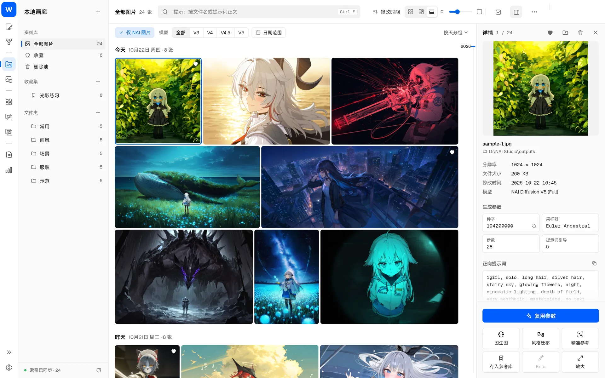
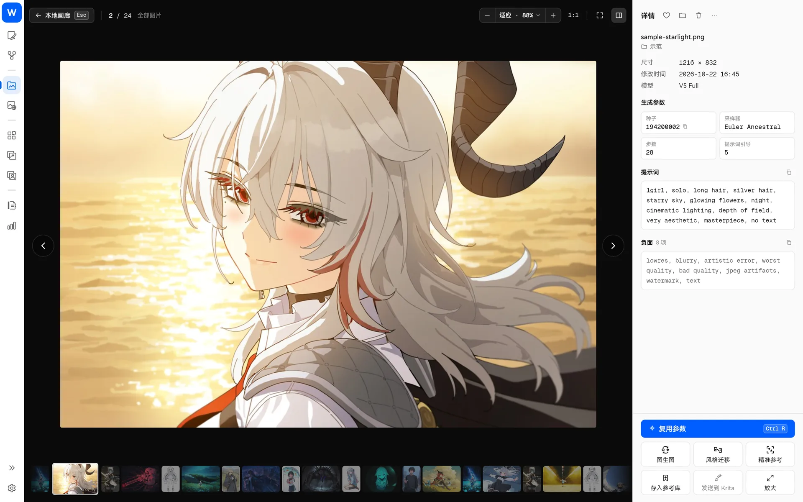
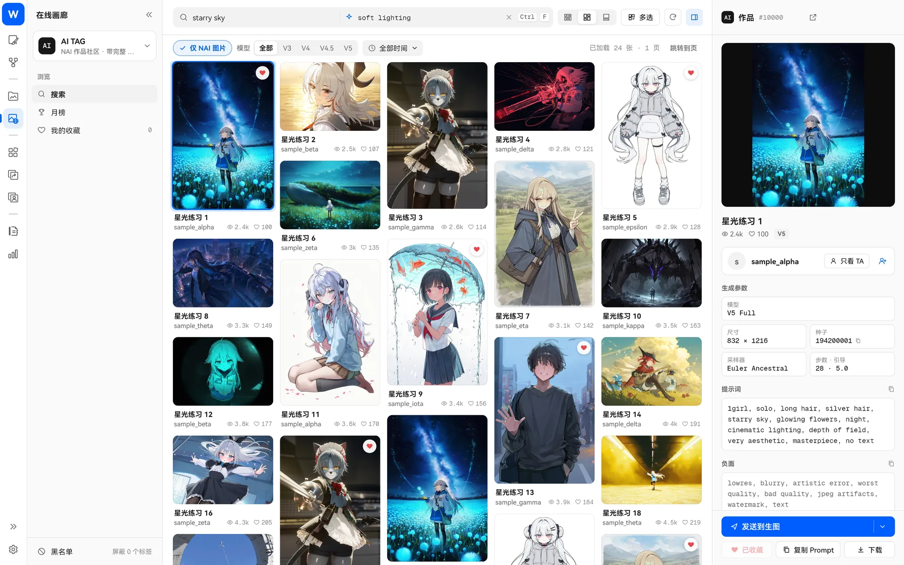

> [← 返回首頁](../../../README.md) · [教學目錄](README.md)

# 畫廊

## 本地畫廊

入口：左側導覽的「本地畫廊」（`Ctrl+2`）。

**瀏覽**

- 左側是資料庫、收藏集和資料夾，中間是連續的圖片時間軸，右側是詳細資訊；
- 可以依日、依月分組或不分組，拖曳右側時間軸快速定位，`Ctrl+G` 跳到指定日期；
- 三種排版：火車流（等高列、不裁切）、網格、瀑布流；縮圖大小和清晰度都能調整。

**尋找**

- 依檔名或提示詞搜尋，也能搜尋角色提示詞；
- 篩選：僅 NAI 圖、模型版本、日期範圍、標籤；
- 啟用 [本機語義檢索](rag.md) 後，可以依畫面內容找圖，或選一張圖尋找相似圖片。

**整理**

- 支援多個圖庫資料夾（「設定 → 圖庫源管理」）；新圖片預設存入主圖庫的「未分類資料夾」；
- 資料夾就是分類，可以新增、移動、複製；
- 收藏：愛心 + 收藏集，收藏集可以無限巢狀；
- 多選後可以批次移動、封裝、編輯中繼資料、加入收藏集；
- 刪除的圖片會先進入「刪除池」，可以還原，下次啟動時才會真正刪除。

**重複使用**

- 詳細資訊面板顯示完整生成參數，可以選擇「複用參數」、複製提示詞或種子；
- 一鍵用於圖生圖、風格遷移、精準參考，或存入參考圖庫；右鍵選「放入畫布」；
- 拖曳到生圖頁時會開啟視窗，讓你選擇要匯入哪些內容（預設不勾選種子）。

常用按鍵：點一下選取，按兩下 / 空白鍵 / Enter 看大圖，方向鍵切換，`Delete` 刪除，`Ctrl+A` 全選，`Esc` 結束多選。

## 線上畫廊

入口：左側導覽的「線上畫廊」（`Ctrl+3`）。

- **來源**：Danbooru、Safebooru、Gelbooru、AI TAG；
- **瀏覽**：標籤搜尋（同樣支援標籤擴展）、日 / 週 / 月排行榜、熱門；
- **收藏**：本機收藏（不需要網站帳號，離線也能看）和網站收藏；AI TAG 可以收藏作者並查看作品；
- **黑名單**：封鎖不想看到的標籤；
- **重複使用**：作品附帶生成參數時可直接重複使用；多圖作品可以逐張切換；
- **批次下載**；
- 游標停在標籤和提示詞上時會顯示翻譯按鈕，點選後才翻譯。

Danbooru 登入資訊、Gelbooru API 憑證都只儲存在本機。
