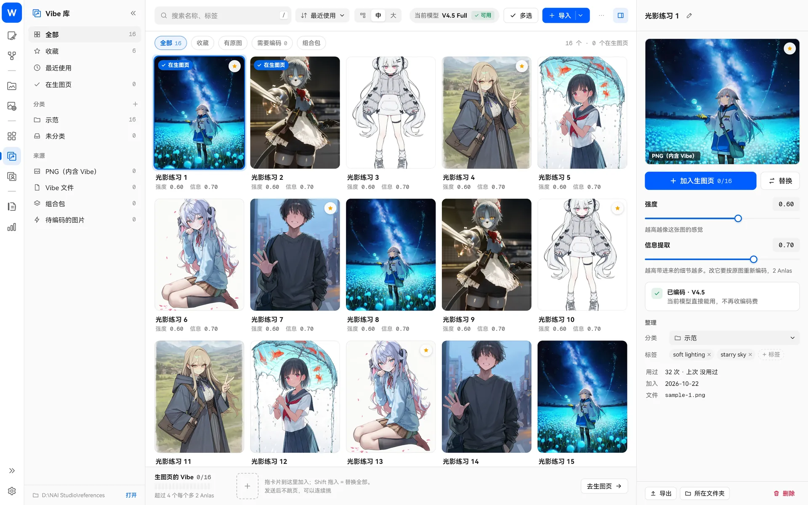
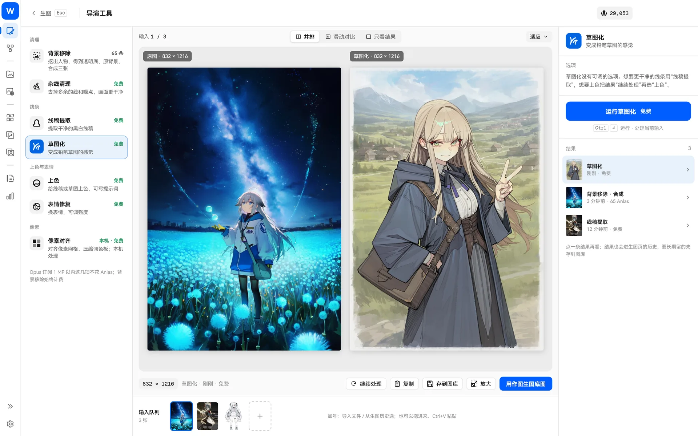
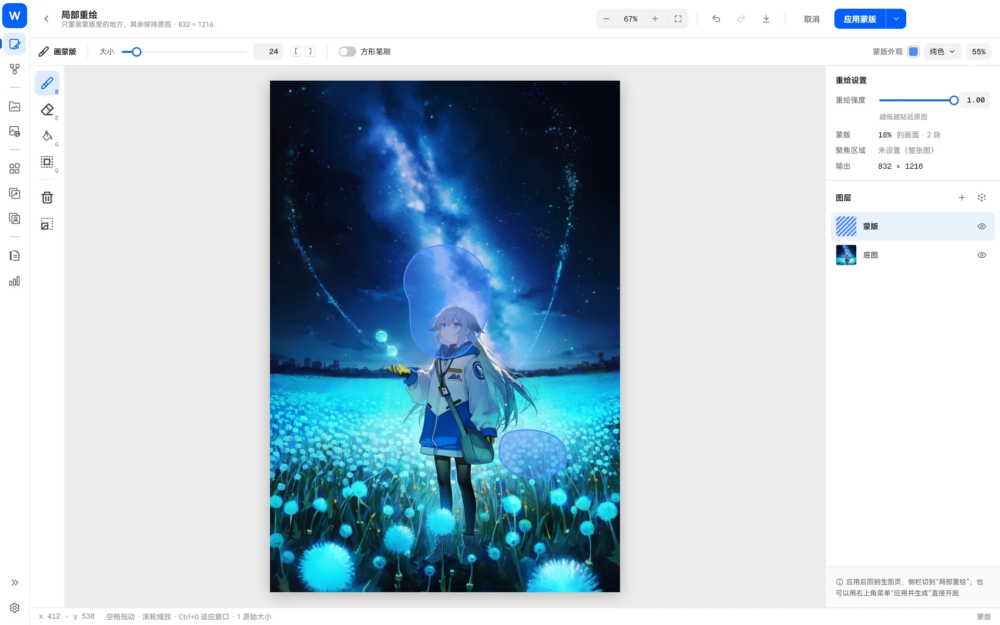
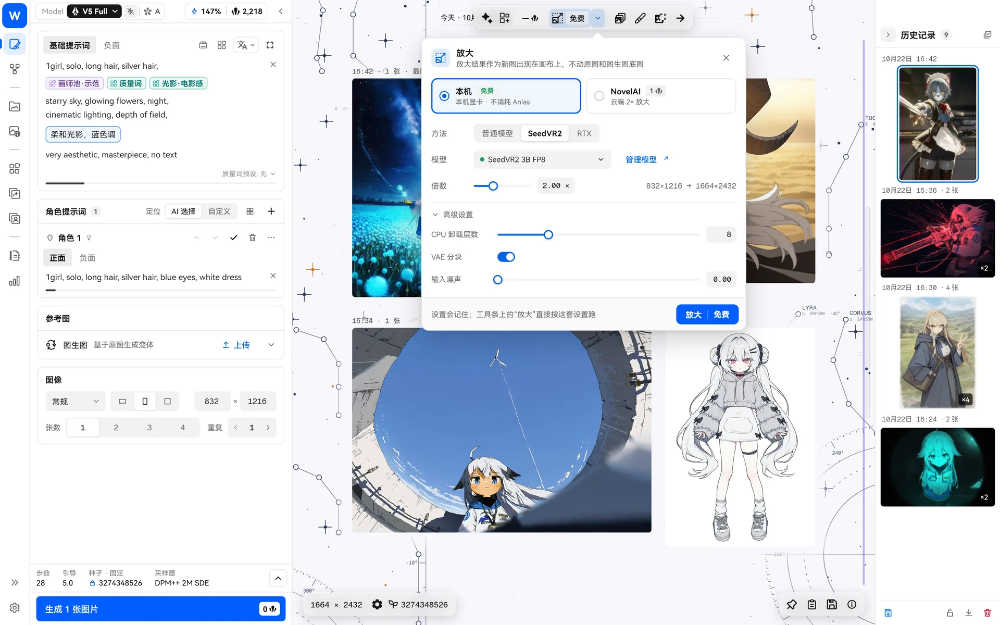

> [← 返回首頁](../../../README.md) · [教學目錄](README.md)

# 影像工具

## 風格遷移與精準參考

- **風格遷移（Vibe）**：參考一張或多張圖片的風格和氛圍。可調整強度和資訊擷取量；編碼一次後即可重複使用，不再額外花費 Anlas。
- **精準參考**：參考角色或畫風，可以調整保真度，每張計費。
- 同時設定時，精準參考優先，風格遷移不會傳送（介面會提示）。

左側導覽的「Vibe 庫」和「精準參考庫」分別管理兩種參考圖，可以搜尋、分組、匯入匯出 Vibe 整包。

## 導演工具

NovelAI 的七種導演工具：背景移除、雜線清理、線稿擷取、草圖化、上色、表情修復，以及在本機執行的像素對齊。Opus 訂閱在 1MP 以內大多免費（背景移除一律計費）。處理結果可以複製、儲存、加入輸入佇列，或直接用於圖生圖。

## 局部重繪與編輯

全螢幕編輯器，工具齊全：畫筆、橡皮擦、填滿、魔術棒（可選智慧物件模式，首次使用會下載約 133 MB 模型）、選取範圍、套索、仿製印章、模糊、圖層、畫布尺寸、色相飽和度。

畫完遮罩後可以選擇「應用」，或直接「應用並生成」。在畫布上按住生成結果，即可與原圖比較。

## 放大

| 方式 | 說明 | 需求 |
| --- | --- | --- |
| NovelAI 放大 | 雲端 2 倍放大，依圖片大小計費 | 登入 |
| 本機 · Real-ESRGAN | 內建引擎和模型（動漫畫質、動漫快速、通用攝影），1–4 倍，保留透明度，不花 Anlas | 支援 Vulkan 的顯示卡 |
| 本機 · RTX | NVIDIA RTX Video 快速放大，須下載約 64 MB 元件 | NVIDIA RTX 顯示卡 |
| 本機 · SeedVR2 | 高品質放大，提供 3B / 7B / 7B Sharp 多種型號（權重 3.4–8.2 GB），有色彩校正、顯示記憶體策略等進階設定 | NVIDIA 顯示卡（INT8 版須 Turing 或更新架構） |

本機放大的元件和模型都可以在「設定 → 本地放大」依需要下載。也能在生圖頁「增強」選擇本機方案，讓每張圖片生成後自動在本機放大。
