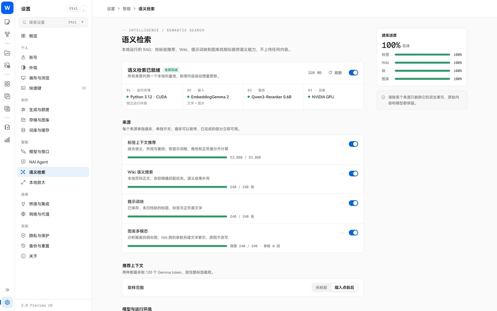

> [← 返回首頁](../../../README.md) · [教學目錄](README.md)

# 本機語義檢索（RAG）

一般搜尋要求字面符合；語義檢索依**意思**尋找。啟用後，輸入「下雨的街道」也能找到與 `rain`、`wet street`、`umbrella` 相關的標籤、積木、百科條目，以及你以前畫過的相似圖片。

**全部在你的電腦上執行，不會上傳任何內容。** 這是選用元件，不啟用也不影響其他功能。

截圖來自較早版本；目前只有一個嵌入模型和一個 RAG 總開關，請以下列說明及實際介面為準。

## 可以用在哪裡

| 來源 | 效果 |
| --- | --- |
| 標籤語義搜尋與推薦 | 輸入描述時依意思尋找標籤；空白時以本機共現提供搭配 |
| Wiki 語義搜尋 | 標籤百科依意思搜尋，名稱完全符合者優先 |
| 提示詞塊 | 塊庫依意思搜尋積木（只收錄已儲存積木的標題、標籤和文字） |
| 圖庫多模態 | 本地畫廊依畫面內容找圖，或選一張圖尋找相似圖片；NAI 圖片的參數另建文字索引 |

各來源分別建立索引，已建立的內容直接用於搜尋；只有一個 RAG 總開關。輸入時的一般補全仍依名稱、別名和關鍵字比對，不需要模型。NAI Agent 透過 `studio_search` 進行語義搜尋；`tag_query` 查詢名稱和別名，`tag_related` 查詢本機共現，兩者不依賴 RAG。

## 安裝

開啟「設定 → 語義檢索」，依序完成：

1. **執行環境**：Windows 的 NVIDIA 顯示卡可選 **CUDA**，也能使用 **CPU**；Apple 晶片 Mac 使用自動安裝環境和「自動／CPU」裝置選項。Intel Mac 不提供代管環境安裝，可檢測現有的相容 Python。這一步只安裝 Python 和推論相依套件，不下載模型。
2. **嵌入模型**：只需 **EmbeddingGemma 2**，用於文字和圖片。可點選「下載」，或選擇現有模型目錄；下載的檔案會逐一驗證。模型與執行環境分開管理。
3. **啟用語義檢索總開關**，在需要的來源列點「建立索引」。先預覽範圍，再手動點「開始」。來源沒有額外開關，未建立索引的來源不會自動開始。

建立索引可以隨時暫停，已完成的部分立即可用。之後會增量更新，圖庫會同步圖片或 NAI 參數的變動。清除某個來源的索引只會刪除衍生資料，原始內容和模型都會保留。

試著在本地畫廊的 RAG 選單中選「僅畫面」，搜尋「雨夜街道上的霓虹倒影」。手邊有範例圖片時，可以選「選擇圖片找相似」。

## 設定項目

- **執行裝置**：Windows 為自動、CUDA 或 CPU；Mac 為自動或 CPU。
- **Python 直譯器**：預設使用自動安裝的獨立環境，也可以指定現有的 `python.exe`。

## 升級與重試

舊標籤索引會顯示升級入口。確認後建立新版，完成並驗證後只清理同模型的退役標籤資料；Wiki、提示詞塊、圖庫和翻譯資料保留。已使用新版建立的部分索引可以繼續，不必先刪除。

建立索引中斷或失敗後，保留現有索引，使用「繼續／重試」。只有明確選擇「重建」才會清除該來源的現有索引。清理舊標籤失敗時，新版索引仍可搜尋，可單獨重試清理。

## 常見問題

- **首次建立索引很慢**：標籤庫有數十萬筆資料，圖庫可能有上萬張圖片，第一次需要較長時間，可以暫停後再繼續。
- **準備階段的進度不動**：載入模型和現有索引需要時間，請耐心等候。
- **沒有 NVIDIA 顯示卡也能用嗎**：可以使用 CPU，速度會慢一些。
- **會把我的圖片傳出去嗎**：不會。只有下載模型和執行環境時需要連網。
