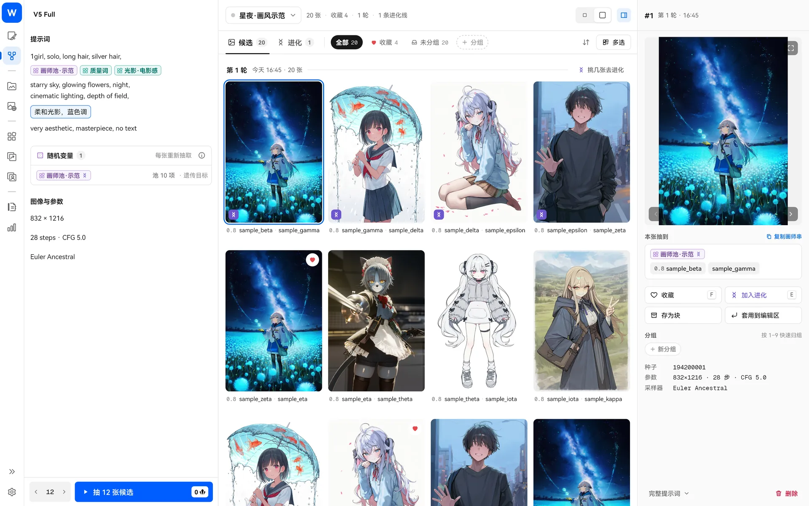
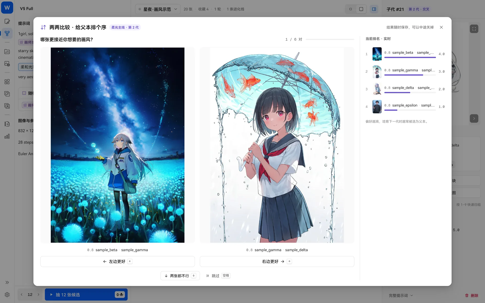

> [← 返回首頁](../../../README.md) · [教學目錄](README.md)

# 畫風遺傳（畫風探索）

畫風探索幫你回答一個問題：**哪幾位畫師混在一起最好看？** 先用隨機畫師池批次抽取候選，你挑出喜歡的，程式再透過「交叉、變異」產生下一代。你只負責挑選，畫風就會逐代朝你想要的方向靠攏。



入口：左側導覽的「畫風探索」。探索頁和生圖頁共用同一份提示詞和參數。

## 準備：放一個隨機積木

在提示詞裡插入隨機模式的積木，例如包含幾十位畫師的畫師池（做法請見 [積木](blocks.md)）。例如：

```
1girl, solo, silver hair, starry sky, night, {画师池·示范}, very aesthetic, masterpiece
```

將畫師池設為隨機，每次抽 2–3 個，附帶隨機權重。

## 第一步：抽取候選

點選左下角的「抽 N 張候選」。每張圖片都會重新抽取畫師，因此畫風各不相同。數量旁會顯示預估消耗的 Anlas，餘額不足時按鈕會變紅。

候選圖片出來後：

- 點一下查看，右側檢查器會列出這張圖**抽到了哪些畫師**、種子和完整提示詞；
- 點選愛心收藏；按 `1`–`9` 快速歸入不同分組；
- 網格太擠可以切換卡片大小；按兩下查看大圖。

## 第二步：開始進化

挑幾張喜歡的（多選），點選「開始進化」：

1. 每張候選抽到的畫師串就是一個**父本**；
2. 子代由父本**交叉**（各取兩個父本的一部分）、**變異**（調整權重、偶爾移除一位）和**注入新畫師**產生；
3. 勾選喜歡的子代，**培育下一代**。


幾個規則：

- 每個父本至少會分配到一張子代，因此父本越多，一輪需要的張數越多；
- 只能從最新一代建立下一代，舊世代可以檢視，但不能從中間分支；
- 如果提示「產不出足夠不同的子代」，表示基因池太小，請在畫師池多加幾位畫師；
- 提示詞裡可以有多個積木設為「遺傳目標」（順序或隨機積木皆可），抽到的結果會合併為一個父本串。

> 想再手動加入一個父本？在開始進化的對話框裡點選「再加一段自訂畫師串」，例如 `0.8::artist:sample_alpha::, artist:sample_beta`。

## 第三步：兩兩比較（選用）

拿不定主意時，點選「兩兩比較排序」：每次並排顯示兩張父本圖片，選出較接近你想要的那張。偏好越高的父本，培育下一代時越常被選中。結果隨時儲存，可以中途關閉。



## 第四步：收穫

找到滿意的畫風後，點選「存為塊」：

- **只要抽到的畫師**：存成畫師積木；多選幾張時會合併並移除重複項目；
- **完整正向提示詞**：只有一張候選時可用。

存好的積木回到生圖頁就能直接使用。

## 常見問題

- **按鈕呈灰色，無法進化**：提示詞裡沒有啟用中的順序或隨機積木，或尚未開啟遺傳。
- **刪除探索會刪掉我的圖片嗎**：不會。只會刪除探索任務中的候選副本，本地畫廊的原圖不受影響。
- **第一代都不好看**：很正常。多挑幾代再下結論，變異經常帶來意外驚喜。
- **探索會修改生圖頁的草稿嗎**：進化輪次使用獨立資料，不會修改目前積木的鎖定狀態和抽取結果。

演算法構想參考 [monineko/PromptCard-Studio](https://github.com/monineko/PromptCard-Studio)（GPL-3.0），本專案採獨立的 Dart 實作。
