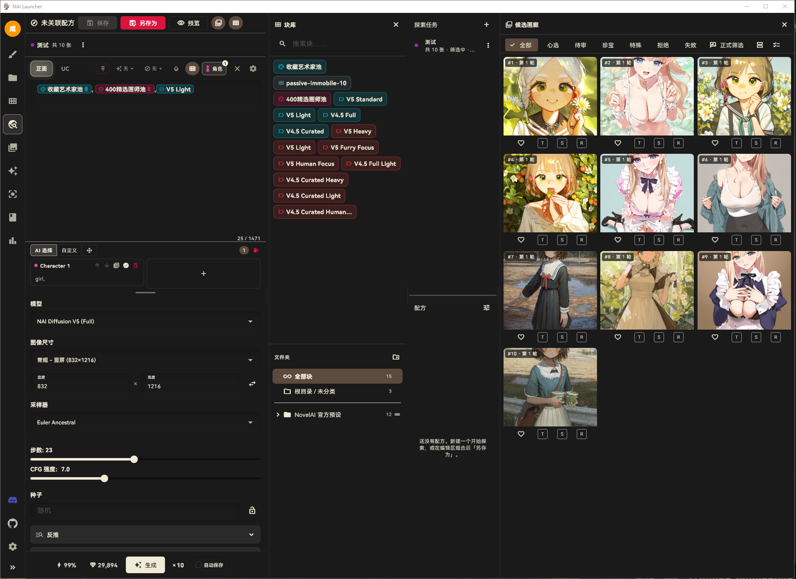
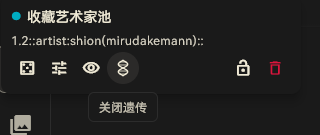
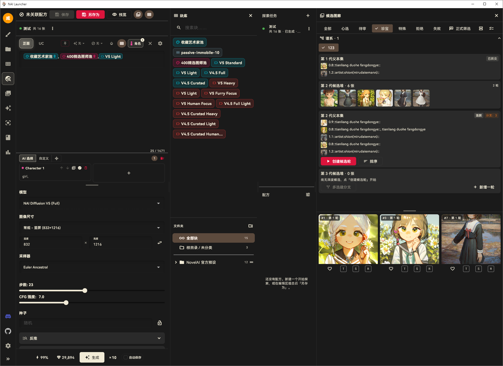
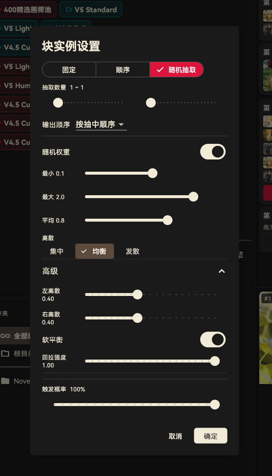

# Style Exploration · Multi-Pool Genetics Tutorial

> [简体中文](style-exploration.md) | English

Style Exploration is a selective-breeding tool for art styles: generate a batch of candidates toward a direction, label them, promote the winners to parents, and let the genetic engine mutate / crossover / inject the next generation — converging round by round onto the style you want. At the end, adopt the winning string as a pill block and use it directly back on the generation page.

Entry: the "Style Exploration" icon in the left navigation rail.

## The flow in 30 seconds

1. **Prepare**: turn artist pools / style strings into blocks, set them to random draw and enable genetics (DNA badge).
2. **Basic round**: create an exploration task, batch-generate dozens of candidates.
3. **Favorites & folders**: page through candidates in the detail dialog, ♡ to favorite, click a folder to file it.
4. **Deep rounds**: multi-select favorites → "Create Family" → "Generate candidates"; offspring mutate automatically.
5. **Iterate**: multi-select the best offspring → "Create branch"; parents backcross into the next generation.
6. **Harvest**: "Adopt as Block" or "Import metadata" — the string flows back into the pill system.

## Interface overview

The page is a multi-pane layout — every pane can be resized and toggled:

- **Main editor**: the same editor panels as the generation page (prompt, character boxes, model, size, sampler…) — **data-source-shared**, so both pages read and write the same live prompt and parameters. The bottom generate button works as usual; images produced here are registered as "manual candidates" of the active run.
- **Block library slot**: the shared block panel; tap a block to insert it into the current prompt.
- **Run sidebar**: the run list, toggleable from the top bar.
- **Candidate gallery**: every candidate of the selected run, plus the lineage panel.

An **exploration task (Run)** freezes the prompt and parameter snapshot at creation time, batch-generates candidates, and records each image's roll result. Run lifecycle: draft → generating → generated; it can be paused and resumed, or cancelled (**cancel is irreversible** — remaining pending candidates are marked cancelled).

> While a run is generating, the editor is exclusively owned by the run — the inline generate button, "Load snapshot into editor", and "Import metadata" are temporarily disabled so they can't overwrite the workspace the run is reading.

## Step 0: Make blocks heritable

Genetics works on **block instances**. For a block (e.g. an artist pool) to contribute genes to the mutation pool, two conditions must hold:

1. The instance is **enabled**;
2. Its mode is **random draw** or **sequential** (a "fixed" block never changes — nothing to inherit).

Then a **DNA icon** appears on the pill, toggling "genetics on / off":

> Note: the genetics toggle is **only available on the Style Exploration page** — on the generation page no DNA elements are rendered at all, so daily prompting can't accidentally change your genetics setup.

The most common setup: set pool blocks like "Favorite Artist Pool" or "400 Curated Artists" to random draw and enable genetics — they become the engine's gene pool.

## Step 1: Basic round — batch candidates

In the run sidebar, tap **+** to create a task — just **name it** (the first batch is a fixed 10 images). The current prompt and parameters are snapshotted and batch generation begins. To add more images afterwards, use the **generate button** in the main editor: its output is registered per batch as "manual candidates" of the active run (a draft run is auto-created when none is active).

The candidate gallery offers:

- **Deck grouping**, always on: grouped by your **own folders** ("New folder" in the toolbar — folder names must be unique; rename / delete from the group header — deleted folders return their members to "Uncategorized", which is always last); the newest candidates come first;
- **Multi-select** (for creating families and batch actions);
- Label filters: All / Favorites / Failed;
- A **♡ favorite** button at each candidate's top-right (also toggleable inside the detail dialog);
- A **roll snapshot** per candidate: exactly which strings every random block drew for that image — archived per card, with copy-positive / copy-negative;
- **Hover preview** on the lineage pile's 64px thumbnails: hovering ~0.8s pops up a large preview; while a preview is open, moving to a neighboring thumbnail switches instantly; a ~0.2s grace period after leaving all thumbnails before it closes; clicking any thumbnail closes it immediately.

## Step 2: Favorites & folders

The **candidate detail dialog** (click any candidate or pile thumbnail) is where you classify:

- `<` `>` arrows beside the image and **← / → (numpad too)** page through candidates; the order is the gallery's filter snapshot at open time (matching gallery display order, newest first), and paging **stops at both ends** (no wrap-around);
- The "**Move to**" section at the bottom of the info column lists your folders: click one to file the candidate (the current one is highlighted). After filing, the dialog **jumps to the next uncategorized** candidate so you can keep going; clicking the current folder again returns it to Uncategorized;
- A "+" button creates a folder right there;
- **Delete image**: available for any candidate that still has a copy (with confirmation) — only the candidate copy inside the Run directory is removed, the candidate record stays as "no copy", and **source images in your gallery are untouched**.

## Step 3: Deep iteration — lineage & genetics

After review, the genetic loop happens in the "**Lineage**" panel:

### Create a family

**Multi-select** favorite candidates in the gallery and tap "**Create Family**": name the family, preview the parent strings from the selection, and optionally **append a custom string** (type any prompt string as an extra parent). Confirming creates the family + the **1st-generation parent set** (status: active).

### Generate candidates (deep rounds)

On the active parent set, enter a count and tap "**Generate candidates**". The mutation engine applies **mutation / crossover / random injection** to the parent strings and produces the next generation:

- The image count is at least the parent count (**every parent is guaranteed at least one child**), at most 50;
- Prerequisite: the main prompt must contain at least one **enabled, genetics-on** random/sequential block — without a mutation carrier, the engine refuses deep rounds;
- The same active parent set accepts repeated "Generate candidates" rounds to append more candidates;
- Deep rounds run on a separate data layer and **never touch your current editor draft**.

### Pairwise parent ranking

Tap "**A/B comparison**" to compare parents pairwise (greyed out when fewer than two parents): two strings at a time, answer "left better / right better / neither / skip". A win is preference +1.0, "neither" costs both sides −0.25 (floor 0.25), skip records the pair without scoring. Preference values show on parent entries in the lineage, quantifying which string is closer to the target.

### Multi-select branch creation (next generation)

Multi-select outstanding offspring from the **latest-generation candidate pile** and tap "**Create branch**": the selected offspring become new parents, and **all 1st-generation parents backcross in** (keeping their preference values), forming the next-generation parent set; the old active set is marked "backcrossed".

Three guardrails (violations are rejected with a reason):

- Offspring can only be picked from the **latest-generation** pile;
- All candidate rounds of the current generation must be **finished** (no pending candidates);
- Deduplicated offspring strings must not **exactly duplicate** the backcross parents.

The lineage panel keeps every generation's parent sets, candidate piles, and branch relations — any offspring's full ancestry is traceable.

## Appendix: random-draw settings in detail

Exploration diversity is governed by each block's random-draw settings. Tap the pill's gear to open "Block Instance Settings":

- **Draw count**: how many entries to draw per generation (a range like 1 ~ 1 means exactly one);
- **Output order**: how multiple draws are ordered;
- **Trigger probability**: chance this instance participates at all (100% = always);
- **Random weights**: drawn entries get `weight::tag::` weights, sampled around the "average" within "min ~ max" (Split-Beta distribution);
- **Dispersion presets**: concentrated / balanced / divergent — pull weights toward the mean or spread them to both ends; "Advanced" exposes left / right dispersion to shape each side of the mean independently;
- **Soft balance + pull-back strength**: shifts the whole string's drawn weights toward the "average weight", damping collective over/under-shooting without changing the relative gaps between members — more stable style intensity across multi-image batches.

Combined with **per-instance lock** (locked instances are excluded from re-rolls) and the **re-roll** button, you control exactly which variables move each round.

## Harvesting results

From a candidate's detail view or the multi-select menu:

- **Adopt as Block**: turn the candidate's roll string into a pill block (name it, or merge-adopt), then insert it anywhere from the generation page / block library;
- **Import metadata**: pour the string into the main prompt editor (data-source-shared with the generation page — it lands directly on your current draft);
- **Roll snapshot**: view and copy the actual positive / negative strings drawn for that image in the detail dialog; the run-level "Load snapshot into editor" restores the task's whole snapshot.

## FAQ

- **"Deep round not possible"**: no enabled random/sequential genetics block in the main prompt. Set at least one block to random draw and light up its DNA icon in the left pane.
- **Branch creation refused**: make sure you selected offspring from the latest-generation pile, all rounds of the current generation are finished, and the offspring strings don't exactly duplicate the backcross parents.
- **Cancelling a run** is permanent; use "Pause" if you just need a break.
- **Deleting candidate images** is available for any candidate with a copy; only Run-directory copies are removed — gallery sources and candidate records stay intact.
- **No DNA icon on the generation page**: the genetics toggle is exclusive to the Style Exploration page — hidden there by design to prevent accidental changes.
- **Why are "Import metadata" / "Load snapshot" disabled while a run is generating?** Both overwrite the workspace, which conflicts with the prompt projection the run reads image by image — so they are temporarily blocked with a "run busy" toast.

---

Algorithm design inspired by [monineko/PromptCard-Studio](https://github.com/monineko/PromptCard-Studio) (GPL-3.0); this module is a Dart rewrite that copies no source code. Credits: [THIRD_PARTY_NOTICES.md](../THIRD_PARTY_NOTICES.md).
